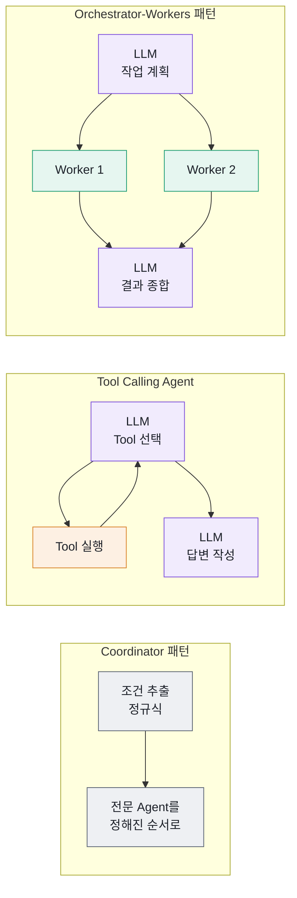
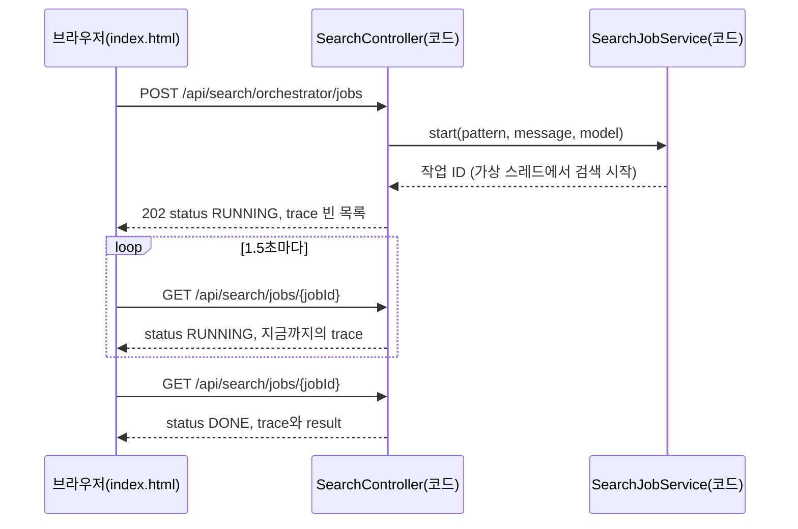

# 들어가며

"이번 주 금요일이나 토요일에 김포나 광주에서 제주 가는 제일 싼 항공편 찾아줘."

여행을 앞둔 사람이라면 아무렇지 않게 던지는 문장입니다. 그런데 이 문장을 처리하는 프로그램을 만든다고 생각해 보면 이야기가 달라집니다. 공공데이터 포털의 항공편 조회 API는 출발 공항 하나, 도착 공항 하나, 날짜 하루만 받습니다. 금요일과 토요일, 김포와 광주를 짝지으면 검색은 네 번 필요합니다. 네 번의 결과를 모아 가장 싼 항공편을 골라야 하고, "이번 주 금요일"이 며칠인지도 계산해야 합니다.

이 일을 누가 해야 할까요? 개발자가 정규식과 `for` 문으로 미리 짜 둘 수도 있고, LLM에게 문장을 맡겨 "검색을 몇 번, 어떤 조건으로 할지" 정하게 할 수도 있습니다. 이 책은 처음부터 끝까지 한 가지 질문을 붙듭니다.

> **다음 단계를 누가 결정하는가 — 코드인가, LLM인가?**

이 질문에 대한 답에 따라 프로그램의 구조가 달라집니다. 코드가 결정하면 빠르고 결과가 늘 같지만, 미리 생각하지 못한 문장에는 약합니다. LLM이 결정하면 유연하지만 느리고, 같은 문장에도 다른 길을 고를 수 있습니다. 이 책은 같은 항공편 검색 문제를 세 가지 구조로 풀어 보고, 그 차이를 화면에서 눈으로 확인하게 합니다.

## 이 책에서 만드는 것

완성된 애플리케이션은 데모 사이트 [https://fly.java21.net](https://fly.java21.net)에서 바로 써 볼 수 있습니다. 소스는 [https://github.com/nhn-academy-marco/ai-fly-schedule](https://github.com/nhn-academy-marco/ai-fly-schedule)에 있고, 이 책의 모든 코드는 이 저장소에서 발췌했습니다. 기술 구성은 Java 21, Spring Boot 3.5.11, Spring AI 1.1.4이고, 항공편 정보는 공공데이터 포털의 국내항공운항정보 API에서 가져옵니다.

### 화면 둘러보기

데모 사이트를 열면 맨 위 막대 오른쪽에 **GitHub 저장소**와 **교재 보기** 버튼이 있습니다. 그 아래 큰 제목이 **Agent 패턴 비교 실습**이고, 제목 밑에 이 책의 질문 "다음 단계를 누가 결정하는가 — 코드인가, LLM인가?"가 그대로 적혀 있습니다.

제목 아래에는 패턴 카드 세 장이 나란히 놓입니다. 카드마다 색칠한 작은 흐름도, 한 줄 설명, 엔드포인트, 이 책의 해당 장으로 가는 링크(**7장 읽기**, **8장 읽기**, **9장 읽기**)가 있습니다.

| 카드 | 흐름도 | 설명 | 이 책의 장 |
|------|------|------|-----------|
| Coordinator | 코드가 순서 결정 → 전문 Agent 7단계 | 처리 순서가 코드에 고정되어 있다. LLM은 정규식으로 검색 조건을 뽑지 못할 때만 쓴다 | [7장](07-coordinator.md) |
| Tool Calling Agent | LLM이 Tool 선택 ⇄ Tool 실행 | LLM이 어떤 Tool을 어떤 인자로 몇 번 부를지 결정한다 | [8장](08-tool-calling-agent.md) |
| Orchestrator-Workers | LLM이 작업 분해 → Worker 병렬 실행 → LLM이 종합 | LLM이 요청을 여러 작업으로 나누고, Worker가 동시에 검색한 뒤, LLM이 결과를 비교해 추천한다 | [9장](09-orchestrator-workers.md) |

카드 아래에는 검색 상자와 **실행하기** 버튼이 있습니다. 검색 상자 밑의 예시 칩(기본, 시간, 가격, 복합)을 누르면 문장이 채워집니다. 그 아래에서 LLM을 **Ollama**와 **Gemini** 가운데 하나로 고르고(두 칸짜리 전환 버튼), 실행할 패턴을 체크 상자로 고릅니다. 검색 상자 아래에는 실행 기록의 색 범례가 있습니다.

실행하면 패턴마다 결과 패널이 하나씩 생깁니다. 패널 맨 위에는 패턴 이름과 상태 배지(실행 중·완료·실패)가 있고, 그 아래 숫자 칸 네 개에 **전체 시간**, **LLM 호출**, **Tool 호출**, **Worker** 수가 나옵니다. 다음으로 답변 문장이 있고, 이어서 이 책에서 가장 자주 보게 될 **실행 기록(trace) 타임라인**이 시간 눈금과 함께 나옵니다. 실행 중에는 타임라인이 한 단계씩 늘어납니다. 맨 아래에는 항공사별 항공편 목록이 있고, 가장 싼 항공편에 "최저가" 표시가 붙습니다.

페이지 아래쪽의 **사용한 외부 API와 도구**에는 이 앱이 쓰는 네 가지(국토교통부 국내항공운항정보 API, Spring AI, Ollama + Qwen 2.5, Google Gemini API)가 카드로 정리되어 있습니다.

> **팁**
> 주소에 검색 조건을 붙이면 문장이 채워진 채로 바로 실행됩니다. 형식은 `/?q=문장&model=ollama&patterns=coordinator,orchestrator&run=1`입니다. `q`는 검색 문장, `model`은 `ollama` 또는 `gemini`, `patterns`는 쉼표로 구분한 패턴 이름(`coordinator`, `tool-calling`, `orchestrator`)이고, `run=1`이면 페이지를 열자마자 실행합니다. `run`을 빼면 채우기만 합니다. 브라우저 주소창에 한글을 그대로 넣어도 됩니다.

### 실행 기록 타임라인

타임라인의 한 줄은 프로그램이 한 일 하나입니다. 줄마다 실행 순서, 실행한 클래스나 Tool 이름, 한 일, 걸린 시간, 입력과 출력 요약, 실행한 스레드 이름이 적힙니다. 오른쪽에는 요청 시작부터의 시각을 가로 막대로 그려, 어느 단계가 오래 걸렸는지와 어느 단계들이 동시에 실행되었는지가 한눈에 보입니다.

줄의 색은 **누가 그 단계를 결정하고 실행했는지**를 뜻합니다. 이 색 규칙은 화면과 이 책의 모든 그림에서 같습니다.

| 색 | 종류 | 뜻 |
|----|------|-----|
| 회색 | CODE | 개발자가 작성한 코드가 순서를 정해 실행 |
| 보라색 | LLM | LLM 호출 (판단·계획·요약) |
| 주황색 | TOOL | LLM이 호출을 요청해 실행된 Tool |
| 초록색 | WORKER | Orchestrator가 맡긴 하위 작업 |

예시 칩의 "복합" 문장으로 세 패턴을 모두 실행해 보면 타임라인의 모양이 확연히 다릅니다. Coordinator 패널은 회색 줄이 차례로 늘어섭니다. 이 문장은 공항 이름이 세 개라 정규식이 포기하므로 첫 줄(검색 조건 추출)만 보라색이 되고, 검색은 한 번만 일어납니다. "기본" 문장으로 실행하면 첫 줄까지 모두 회색입니다. Tool Calling Agent 패널에는 짧은 주황색 막대들이 먼저 나오고, 마지막 줄의 긴 보라색 막대 하나가 그 구간을 모두 감쌉니다. Tool은 실행되는 즉시 기록되고, LLM 단계는 답변이 끝난 뒤 기록되기 때문입니다. Orchestrator-Workers 패널은 보라색 막대로 시작해, 초록색 Worker 막대 여러 개가 같은 시각에 겹쳐 실행되고, 다시 보라색 막대로 끝납니다. 같은 문장인데도 일을 나누고 결정하는 주체가 다르기 때문입니다.



그림 읽기: 위에서부터 회색만 있는 줄은 코드가 모든 것을 정하는 구조, 보라색과 주황색이 오가는 줄은 LLM이 Tool을 고르는 구조, 보라색 사이에 초록색이 갈라졌다 모이는 줄은 LLM이 계획하고 코드가 실행하는 구조입니다.

세 구조는 비용도 다릅니다. Coordinator 패턴은 정규식으로 처리되는 문장이면 LLM을 한 번도 부르지 않고, 처리 시간 약 0.6초의 대부분이 공공데이터 포털 API를 기다리는 시간입니다. Tool Calling Agent는 LLM을 최소 한 번 부르지만, 그 안에서 Tool 결과를 받아 다시 생성하므로 모델과는 두 번 이상 왕복합니다. Orchestrator-Workers 패턴은 계획에 한 번, 종합에 한 번 LLM을 부릅니다. 원격 서버의 작은 Ollama 모델은 호출 한 번에 수십 초가 걸리기도 합니다. 이 차이는 [10장](10-choosing-testing-operating.md)에서 표로 정리합니다.

### 화면 뒤의 API

화면은 서버의 REST API를 부를 뿐입니다. 같은 일을 터미널에서 직접 해 볼 수 있습니다. 패턴마다 검색이 끝날 때까지 기다렸다가 응답하는 동기 API가 있습니다.

| 메서드와 경로 | 하는 일 |
|---------------|---------|
| `POST /api/search/coordinator` | Coordinator 패턴으로 검색 |
| `POST /api/search/tool-calling` | Tool Calling Agent로 검색 |
| `POST /api/search/orchestrator` | Orchestrator-Workers 패턴으로 검색 |
| `POST /api/search/{pattern}/jobs` | 검색을 백그라운드에서 시작하고 작업 ID를 바로 돌려줌 (202 Accepted) |
| `GET /api/search/jobs/{jobId}` | 작업의 진행 상황(지금까지의 실행 기록)과 결과 조회 |

요청 본문은 모두 같습니다. `model`은 `"ollama"` 또는 `"gemini"`이고, 생략하면 Ollama를 씁니다.

```json
{ "message": "이번 주 금요일이나 토요일에 김포나 광주에서 제주 가는 제일 싼 항공편 찾아줘", "model": "gemini" }
```

화면은 동기 API가 아니라 아래쪽 두 개, **작업(job) API**를 씁니다. LLM을 여러 번 부르는 패턴은 응답에 1분이 넘게 걸릴 수 있는데, 서버 앞의 프록시(nginx 기본 60초)가 그 전에 연결을 끊으면 504 오류가 나기 때문입니다. 그래서 화면은 작업을 시작해 ID만 받고, 1.5초마다 짧은 요청으로 상태를 물어봅니다.



그림 읽기: 검색 자체는 서버의 가상 스레드에서 계속 진행되고, 브라우저는 짧은 조회 요청만 반복합니다. 조회할 때마다 실행 기록이 조금씩 늘어나므로, 화면에는 "실행 중 12.0초" 같은 상태 배지와 함께 지금까지 쌓인 단계가 보입니다.

작업을 시작하면 바로 다음 응답이 옵니다.

```json
{
  "jobId": "3f6c1d2e-8a4b-4f0e-9c7d-5b2a1e9f0c11",
  "pattern": "orchestrator",
  "status": "RUNNING",
  "trace": [],
  "result": null
}
```

몇 초 뒤 같은 작업을 조회하면 LLM의 계획 단계가 끝나고 Worker들이 일하는 중입니다(일부 생략).

```json
{
  "jobId": "3f6c1d2e-8a4b-4f0e-9c7d-5b2a1e9f0c11",
  "pattern": "orchestrator",
  "status": "RUNNING",
  "trace": [
    { "order": 1, "kind": "LLM", "actor": "gemini", "title": "작업 계획 (FlightSearchPlanner)",
      "detail": "4개 작업: 김포 → 제주 · 2026-10-16 / 광주 → 제주 · 2026-10-16 / 김포 → 제주 · 2026-10-17 / 광주 → 제주 · 2026-10-17",
      "startMs": 0, "durationMs": 2310, "thread": "virtual-48" },
    { "order": 2, "kind": "CODE", "actor": "DateParserAgent", "title": "날짜 변환",
      "detail": "2026-10-16 → 20261016", "startMs": 2312, "durationMs": 1, "thread": "virtual-53" },
    { "order": 3, "kind": "CODE", "actor": "DateParserAgent", "title": "날짜 변환",
      "detail": "2026-10-17 → 20261017", "startMs": 2312, "durationMs": 1, "thread": "virtual-55" }
  ],
  "result": null
}
```

끝나면 `status`가 `DONE`이 되고 `result`에 최종 응답이 들어 있습니다(일부 생략).

```json
{
  "jobId": "3f6c1d2e-8a4b-4f0e-9c7d-5b2a1e9f0c11",
  "pattern": "orchestrator",
  "status": "DONE",
  "trace": [ "... result.trace와 같음 ..." ],
  "result": {
    "pattern": "orchestrator",
    "success": true,
    "message": "네 가지 조건 중 가장 저렴한 항공편은 토요일 광주에서 출발하는 진에어 LJ0571편(07:10 출발, 45,900원)입니다. ...",
    "results": [
      { "label": "김포 → 제주 · 2026-10-16", "totalCount": 58,
        "cheapest": { "flightId": "TW0711", "airline": "티웨이항공", "departureTime": "06:20", "price": 52900 } },
      { "label": "광주 → 제주 · 2026-10-17", "totalCount": 12,
        "cheapest": { "flightId": "LJ0571", "airline": "진에어", "departureTime": "07:10", "price": 45900 } }
    ],
    "trace": [
      { "order": 1, "kind": "LLM", "actor": "gemini", "title": "작업 계획 (FlightSearchPlanner)", "durationMs": 2310 },
      { "order": 12, "kind": "WORKER", "actor": "FlightSearchWorker", "title": "광주 → 제주 · 2026-10-17",
        "detail": "광주 → 제주 · 2026-10-17: 12편, 최저가 진에어 LJ0571 07:10 출발 45,900원", "thread": "virtual-55" },
      { "order": 26, "kind": "LLM", "actor": "gemini", "title": "결과 종합 (ResultSynthesizer)", "detail": "142자 답변" }
    ],
    "elapsedMs": 4870
  }
}
```

항공편 번호, 편수, 가격은 검색한 날의 실제 운항 정보에 따라 달라집니다. 눈여겨볼 것은 `trace`의 `kind`와 `thread`입니다. 계획과 종합은 `LLM`이고, Worker는 서로 다른 가상 스레드(`virtual-53`, `virtual-55` 등)에서 같은 시각에 실행됩니다. 이 응답의 구조는 [7장](07-coordinator.md)에서, 작업 API는 [10장](10-choosing-testing-operating.md)에서 자세히 다룹니다.

## 장 지도

이 책은 작은 부품에서 시작해 세 패턴으로 올라갑니다. 앞의 여섯 장에서 만든 부품을 뒤의 세 장이 서로 다른 방식으로 조립합니다.

| 장 | 제목 | 이 장에서 얻는 것 |
|----|------|-------------------|
| [1장](01-llm-and-spring-ai.md) | LLM과 Spring AI 시작하기 | LLM의 최소 개념, Spring AI 설정과 실행 |
| [2장](02-chatclient.md) | ChatClient로 LLM 부르기 | LLM 호출, Structured Output, 프롬프트 설계 기초 |
| [3장](03-advisor.md) | Advisor로 LLM 호출 들여다보기 | 요청과 응답을 관찰하는 방법 |
| [4장](04-tool-calling.md) | Tool Calling의 원리 | LLM이 자바 메서드 호출을 요청하는 구조 |
| [5장](05-domain-tools.md) | 항공편 도메인 Tool 만들기 | 공공데이터 포털 API와 Tool 설계 원칙 |
| [6장](06-specialized-agents.md) | 전문 Agent로 나누기 | LLM 없이 한 가지 일만 하는 결정적 부품 |
| [7장](07-coordinator.md) | Coordinator 패턴 — 코드가 결정한다 | 코드가 순서를 정하는 워크플로와 실행 기록 |
| [8장](08-tool-calling-agent.md) | Tool Calling Agent — LLM이 결정한다 | LLM이 Tool을 고르는 구조와 그 실패 사례 |
| [9장](09-orchestrator-workers.md) | Orchestrator-Workers 패턴 — LLM이 나누고 코드가 실행한다 | 계획, 병렬 Worker, 종합 |
| [10장](10-choosing-testing-operating.md) | 패턴 고르기, 테스트, 운영 | 선택 기준, 가짜 LLM 테스트, 배포와 타임아웃 |
| [부록 A](appendix-a-glossary.md) | 용어집 | |
| [부록 B](appendix-b-troubleshooting.md) | 문제 해결 모음 | |

1장부터 순서대로 읽기를 권합니다. 세 패턴만 빨리 보고 싶다면 1장과 2장으로 환경을 갖춘 뒤 7장으로 건너뛰어도 됩니다. 7장 이후에서 모르는 부품이 나오면 해당 장으로 돌아가면 됩니다.

이 책은 업계에서 쓰는 구분을 따릅니다. Anthropic의 글 [Building effective agents](https://www.anthropic.com/engineering/building-effective-agents)는 코드가 경로를 정하는 구조를 **workflow**, LLM이 경로를 정하는 구조를 **agent**로 나눕니다. 이 책의 Coordinator 패턴은 workflow에, Tool Calling Agent는 agent에 해당하고, Orchestrator-Workers 패턴은 그 중간에 있습니다.

## 개발 환경 준비

### 필요한 것

| 항목 | 필수 여부 | 설명 |
|------|-----------|------|
| Java 21 | 필수 | `java -version`으로 21인지 확인합니다. Orchestrator-Workers 패턴이 가상 스레드를 씁니다 |
| 공공데이터 포털 서비스 키 | 필수 | 공공데이터 포털에서 "국내항공운항정보"를 찾아 활용 신청을 하면 발급됩니다. 승인 뒤 실제로 쓸 수 있을 때까지 시간이 걸리기도 합니다 |
| Gemini API 키 | 선택 | Google AI Studio에서 발급합니다. 없어도 애플리케이션은 시작됩니다 |
| Ollama | 선택 | 기본 설정은 실습용 원격 Ollama 서버를 씁니다. 내 컴퓨터에서 모델을 돌릴 때만 설치합니다 |
| IDE | 권장 | IntelliJ IDEA를 기준으로 설명합니다. Lombok 플러그인과 어노테이션 처리를 켜 둡니다 |

Maven은 따로 설치하지 않아도 됩니다. 저장소에 Maven Wrapper(`mvnw`, Windows는 `mvnw.cmd`)가 들어 있어, 처음 실행할 때 알맞은 Maven을 내려받습니다.

### 키를 환경 변수로 넘기기

키는 파일에 적지 않고 환경 변수로 넘깁니다. 이유와 다른 방법은 [1장](01-llm-and-spring-ai.md)에서 설명합니다.

```bash
git clone https://github.com/nhn-academy-marco/ai-fly-schedule.git
cd ai-fly-schedule
export DATA_GO_KR_SERVICE_KEY="발급받은_서비스_키"
export GOOGLE_GENAI_API_KEY="발급받은_Gemini_키"   # 선택
```

### 실행과 테스트

```bash
./mvnw spring-boot:run
```

브라우저에서 `http://localhost:8080`을 열면 데모 사이트와 같은 화면이 나옵니다.

테스트는 다음 명령으로 실행합니다. 테스트는 LLM과 공공데이터 포털을 가짜로 바꿔 끼우므로 키나 Ollama 없이도 통과합니다.

```bash
./mvnw test
```

> **직접 확인하기**
> 애플리케이션을 실행한 터미널과 다른 터미널에서 다음을 실행합니다.
> ```bash
> curl -s -X POST http://localhost:8080/api/search/coordinator \
>   -H "Content-Type: application/json" \
>   -d '{"message": "내일 광주에서 제주로 가는 항공편 알려줘"}'
> ```
> 기대 결과: `"success": true`와 함께 `trace` 첫 줄이 `"kind": "CODE"`, `"title": "정규식으로 검색 조건 추출"`입니다. 이 문장은 LLM 없이 처리되었습니다. `./mvnw test`는 마지막에 `BUILD SUCCESS`가 나오면 됩니다(애플리케이션 전체를 띄우는 테스트 하나는 `@Disabled`로 꺼 두어 `Skipped`로 표시됩니다).

> **주의**
> 서비스 키 없이 실행해도 애플리케이션은 시작됩니다. 다만 검색하면 "공공데이터 포털 서비스 키가 설정되지 않았습니다. 환경 변수 DATA_GO_KR_SERVICE_KEY를 설정하세요."라는 실패 응답이 옵니다. 환경 변수는 설정한 터미널에서 실행한 프로그램에만 전달된다는 점도 기억하세요. IDE에서 실행한다면 실행 구성의 Environment variables에 따로 적어야 합니다.

## 이 책을 읽는 방법

장마다 짧은 설명, 실제 코드 발췌, 직접 실행해 보는 단계, 생각해 볼 질문의 순서로 진행합니다. 코드 발췌에는 파일 경로를 붙였고, 발췌한 부분은 저장소의 소스와 글자 그대로 같습니다. 생략한 곳은 `// ...`로 표시했습니다. 장 끝의 연습 문제에는 볼 파일과 메서드(힌트), 성공을 판단하는 방법(완료 기준)을 적었습니다.

몇 가지 용어는 영어로 씁니다. Agent, Tool, Worker, Orchestrator처럼 코드의 클래스 이름과 업계 용어가 겹치는 단어는 번역하지 않아야 코드와 글을 오가며 읽기 쉽기 때문입니다. 모든 용어는 [부록 A](appendix-a-glossary.md)에 모아 두었습니다.

이제 첫 질문으로 들어갑니다. LLM은 무엇이고, Spring 애플리케이션은 LLM과 어떻게 이어질까요? [1장](01-llm-and-spring-ai.md)에서 시작합니다.
