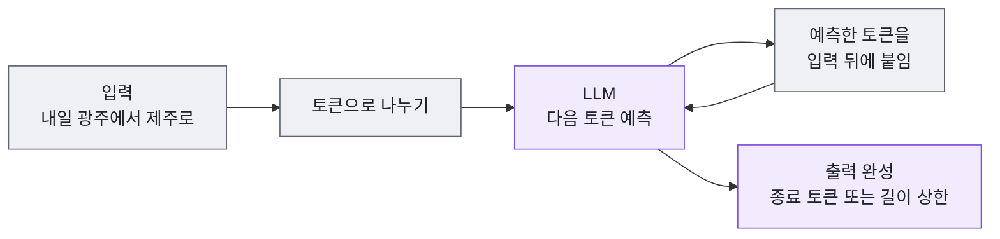
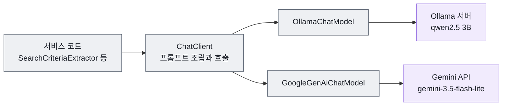
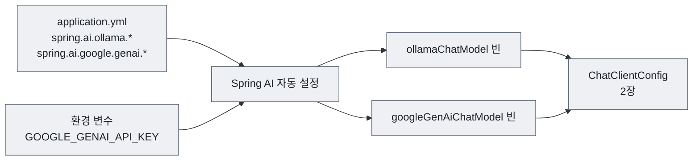

# 1장 LLM과 Spring AI 시작하기

LLM에게 "내일 광주에서 제주 가는 항공편 알려줘"라고 물으면 무엇이 돌아올까요? 대개 그럴듯한 답이 옵니다. 항공사 이름이 나오고, 아침 7시대 출발편이 있다고 하고, 가격도 적혀 있습니다. 문제는 그 답이 실제 내일의 운항 정보와 아무 관계가 없다는 점입니다. LLM은 내일이 며칠인지도, 오늘 어떤 비행기가 뜨는지도 모릅니다.

이 책의 질문은 "다음 단계를 누가 결정하는가 — 코드인가, LLM인가?"입니다. 이 질문에 답하려면 먼저 LLM이 무엇을 잘하고 무엇을 못하는지 알아야 합니다. 결정을 맡길 상대를 모르고서 맡길지 말지 정할 수는 없기 때문입니다. 이 장에서는 LLM의 최소 개념을 짚고, Spring AI로 Ollama와 Gemini 두 LLM에 연결하는 설정을 읽은 뒤, 애플리케이션을 실행해 봅니다.

## 1.1 LLM은 다음 토큰을 예측한다

**LLM**(Large Language Model, 대규모 언어 모델)은 방대한 텍스트로 학습해, 주어진 입력 다음에 올 내용을 한 조각씩 예측하며 글을 만드는 모델입니다. 일반 프로그램은 개발자가 작성한 규칙대로 움직입니다. LLM은 학습한 패턴에서 "다음에 올 가능성이 높은 것"을 고릅니다. 그래서 형식이 제각각인 자연어를 잘 다루지만, 사실이 아닌 내용을 사실처럼 만들어 내기도 합니다.

LLM이 한 번에 예측하는 조각을 **토큰**(token)이라고 합니다. 영어는 대략 단어나 단어의 일부, 한국어는 음절이나 형태소 몇 개가 한 토큰이 됩니다. 토큰은 비용과 길이 제한을 재는 단위입니다.



그림 읽기: LLM은 답을 한꺼번에 만들지 않습니다. 토큰 하나를 예측해 입력 뒤에 붙이고, 늘어난 입력으로 다시 다음 토큰을 예측하는 일을 반복합니다. 답이 길수록 오래 걸리는 이유입니다.

이 책에서 알아야 할 개념은 네 가지입니다.

| 개념 | 뜻 | 이 프로젝트에서 |
|------|-----|-----------------|
| 토큰 | LLM이 처리하는 최소 단위. 비용과 길이의 기준 | 출력 상한을 Ollama는 `max-tokens: 512`, Gemini는 `max-output-tokens: 1024`로 둔다 |
| 컨텍스트 윈도우 | 한 번에 다룰 수 있는 입력과 출력 토큰의 최대 길이 | Ollama `num-ctx: 4096`. Tool 설명과 Tool 결과가 함께 들어가야 한다 |
| temperature | 다음 토큰을 고를 때의 무작위성. 낮을수록 확률이 가장 높은 토큰을 고른다 | Ollama는 `0.0`, Gemini는 지정하지 않고 기본값(1.0)을 쓴다 |
| 비결정성 | 같은 입력에도 다른 출력이 나올 수 있는 성질 | temperature가 0이어도 완전히 없어지지는 않는다 |

**컨텍스트 윈도우**는 LLM의 작업 기억입니다. 시스템 지시, 사용자 문장, Tool 설명, Tool 결과, 그리고 LLM이 만드는 답까지 모두 이 안에 들어가야 합니다. 넘치면 앞부분이 잘리거나 오류가 납니다. [5장](05-domain-tools.md)에서 Tool 결과의 크기를 제한하는 이유가 여기에 있습니다.

**temperature**를 0으로 두면 LLM은 매번 가장 확률이 높은 토큰을 고르려 합니다. 그래도 같은 입력에 늘 같은 출력이 나온다는 보장은 없습니다. 서버의 계산 순서, 모델 버전, 하드웨어에 따라 확률이 미세하게 달라질 수 있습니다. 이 책에서는 "temperature 0은 비슷한 출력을 낼 가능성을 높일 뿐, 결과를 보장하지 않는다"고 기억하면 충분합니다.

토큰은 **입력 토큰**과 **출력 토큰**으로 나누어 봅니다. 입력 토큰은 LLM이 읽는 것(system 프롬프트, 사용자 문장, Tool 설명, Tool 결과)이고, 출력 토큰은 LLM이 새로 만드는 것(답변, Tool 호출 요청, JSON)입니다. 클라우드 LLM은 둘 다 빠르게 처리하지만, CPU에서 돌리는 작은 모델은 입력을 읽는 데도, 출력을 한 토큰씩 만드는 데도 시간이 듭니다. 응답이 느릴 때 어느 쪽을 줄일지는 [8장](08-tool-calling-agent.md)에서 실측 숫자로 따져 봅니다.

LLM이 **모르는 것**도 분명히 해 둡니다.

- **오늘 날짜**: LLM은 학습이 끝난 시점에 멈춰 있습니다. "내일", "이번 주 금요일"을 계산하려면 오늘 날짜를 프롬프트에 넣어 줘야 합니다([2장](02-chatclient.md)).
- **실시간 데이터**: 항공편 운항 정보는 학습 데이터에 없습니다. 이 정보는 공공데이터 포털 API를 부르는 자바 코드가 가져와야 합니다. LLM에게 그 코드를 쥐여 주는 방법이 Tool Calling입니다([4장](04-tool-calling.md)).
- **자신이 틀렸다는 사실**: LLM은 모르는 것도 그럴듯하게 답합니다. 그래서 LLM이 돌려준 값은 코드로 검증해야 합니다.

> **생각해 보기**
> LLM에게 "다음 단계"를 결정하게 한다는 것은 이 확률적인 예측에 프로그램의 흐름을 맡긴다는 뜻입니다. 항공편 검색에서 LLM에게 맡겨도 되는 결정과 맡기면 안 되는 결정을 하나씩 떠올려 보세요. 예를 들어 "김포나 광주"를 몇 번의 검색으로 나눌지는 맡길 만할까요? 공항 이름을 공항 코드로 바꾸는 일은 어떨까요?

## 1.2 Spring AI의 구조

**Spring AI**는 Spring 애플리케이션에서 여러 LLM을 같은 API로 쓰게 해 주는 프레임워크입니다. JDBC가 데이터베이스 제품의 차이를 감추듯, Spring AI는 LLM 제공자의 차이를 감춥니다. 이 프로젝트는 무료로 실행할 수 있는 **Ollama**와 Google의 클라우드 LLM인 **Gemini**를 함께 쓰는데, 서비스 코드는 두 모델을 구분하지 않고 같은 방식으로 부릅니다.



그림 읽기: 서비스 코드는 `ChatClient`만 봅니다. 제공자별 통신은 `ChatModel` 구현이 맡고, 실제 생성은 회색 상자 바깥의 LLM 서버에서 일어납니다.

| 구성 요소 | 역할 | 누가 만드는가 | 처음 다루는 장 |
|-----------|------|---------------|----------------|
| `ChatModel` | 특정 LLM 제공자와 HTTP로 통신 | 스타터의 자동 설정 | 1장 |
| `ChatClient` | 프롬프트를 조립하고 호출하고 결과를 변환하는 API | 개발자(`ChatClientConfig`) | [2장](02-chatclient.md) |
| Advisor | `ChatClient` 요청과 응답 앞뒤에 끼어드는 공통 처리 | 개발자 | [3장](03-advisor.md) |
| Tool | LLM이 호출을 요청할 수 있는 자바 메서드(`@Tool`) | 개발자 | [4장](04-tool-calling.md) |

익숙한 계층 구조에 놓아 보면 Repository 자리에 `ChatClient`가, 데이터베이스 자리에 LLM이 들어간 모양입니다. 컨트롤러와 서비스를 만드는 방법은 지금까지와 같습니다.

## 1.3 의존성: BOM과 스타터 두 개

Spring AI는 모듈이 많습니다. 모듈마다 버전을 따로 적으면 서로 맞지 않는 버전이 섞이기 쉬우므로, **BOM**(Bill of Materials, 여러 의존성의 버전을 한곳에서 정하는 목록)으로 버전을 맞춥니다.

파일: `pom.xml`

```xml
    <properties>
        <java.version>21</java.version>
        <spring-ai.version>1.1.4</spring-ai.version>
    </properties>

    <dependencyManagement>
        <dependencies>
            <dependency>
                <groupId>org.springframework.ai</groupId>
                <artifactId>spring-ai-bom</artifactId>
                <version>${spring-ai.version}</version>
                <type>pom</type>
                <scope>import</scope>
            </dependency>
        </dependencies>
    </dependencyManagement>
```

`<dependencies>`에는 제공자마다 스타터를 하나씩 넣습니다. 버전은 BOM이 정하므로 적지 않습니다.

```xml
        <dependency>
            <groupId>org.springframework.ai</groupId>
            <artifactId>spring-ai-starter-model-ollama</artifactId>
        </dependency>

        <!-- Spring AI Google GenAI (Gemini) -->
        <dependency>
            <groupId>org.springframework.ai</groupId>
            <artifactId>spring-ai-starter-model-google-genai</artifactId>
        </dependency>
```

**코드 읽기**

- `spring-ai-bom`을 `import` 범위로 넣으면 Spring AI 모듈 전체가 1.1.4로 맞춰집니다. BOM의 버전은 `<properties>`의 `<spring-ai.version>`을 `${spring-ai.version}`으로 참조하므로, 버전을 바꿀 때는 속성 한 곳만 고치면 됩니다. 부모인 `spring-boot-starter-parent`(3.5.11)가 Spring Boot 모듈의 버전을 맞추는 것과 같은 원리입니다.
- 스타터를 넣기만 하면 자동 설정이 `ChatModel` 빈을 만듭니다. Ollama 스타터는 `ollamaChatModel`, Google GenAI 스타터는 `googleGenAiChatModel`이라는 이름의 빈을 만듭니다. 이 이름은 2장에서 `@Qualifier`로 씁니다.

> **직접 확인하기**
> ```bash
> ./mvnw dependency:tree | grep spring-ai-starter
> ```
> 기대 결과: `spring-ai-starter-model-ollama:jar:1.1.4`와 `spring-ai-starter-model-google-genai:jar:1.1.4` 두 줄이 보입니다.

## 1.4 application.yml 읽기

스타터가 `ChatModel`을 만들려면 "어느 서버에, 어떤 모델로, 어떤 옵션으로" 접속할지 알아야 합니다. 그 정보는 `src/main/resources/application.yml`에 있습니다. 데이터베이스 접속 정보를 `spring.datasource.*`에 적는 것과 같습니다.



그림 읽기: 설정 파일과 환경 변수를 자동 설정이 읽어 `ChatModel` 빈 두 개를 만듭니다. 이 장은 여기까지 다루고, 빈을 `ChatClient`로 감싸는 일은 2장에서 합니다.

### Ollama

**Ollama**는 LLM을 내 컴퓨터나 사내 서버에서 실행하는 오픈소스 도구입니다. 사용료가 없어 실습에 알맞습니다.

파일: `src/main/resources/application.yml`

```yaml
# Spring AI Ollama 설정
spring.ai.ollama:
  base-url: http://ollama.java21.net
  chat:
    options:
      model: qwen2.5:3b-instruct-q4_K_M
      temperature: 0.0
      # CPU에서는 출력 토큰 하나하나가 느리다. 답변·계획(JSON)이 들어갈 만큼만 허용한다
      max-tokens: 512
      # Tool 설명과 Tool 결과가 들어가도록 컨텍스트를 늘린다
      num-ctx: 4096
      # num-thread는 지정하지 않는다. Ollama가 서버의 CPU 코어 수에 맞춰 정한다
      top-p: 0.9
      top-k: 40
      keep-alive: 10m
```

**코드 읽기**

| 설정 | 의미 |
|------|------|
| `base-url` | 실습용 원격 Ollama 서버입니다. 내 컴퓨터에서 Ollama를 실행한다면 `http://localhost:11434`로 바꿉니다 |
| `model` | Qwen 2.5, 30억(3B) 파라미터, 지시 따르기 학습(instruct), 4비트 양자화(q4_K_M)로 메모리를 줄인 모델입니다 |
| `temperature` | 0.0. 검색 조건 추출이나 Tool 선택은 창의성보다 일관성이 중요합니다 |
| `max-tokens` | 출력 토큰 상한 512입니다. CPU에서는 출력 토큰 하나하나에 시간이 들어, 상한이 곧 최악의 응답 시간을 정합니다. 2~3문장 답변과 검색 계획(JSON)이 들어갈 만큼만 둡니다. 넘으면 답이 중간에 잘립니다 |
| `num-ctx` | 컨텍스트 윈도우입니다. Ollama의 기본값으로는 Tool 설명과 결과가 다 들어가지 않아 늘렸습니다 |
| (`num-thread` 없음) | 계산에 쓸 CPU 스레드 수입니다. 고정값(예: 4)을 적으면 코어가 더 많은 서버에서도 그만큼만 씁니다. 적지 않으면 Ollama가 서버 코어 수에 맞춰 정합니다 |
| `top-p`, `top-k` | 다음 토큰 후보를 누적 확률 0.9 안, 상위 40개 안으로 제한합니다 |
| `keep-alive` | 마지막 요청 뒤 모델을 메모리에 올려 두는 시간입니다. 첫 요청이 느린 이유는 모델을 메모리에 올리는 시간 때문입니다 |

`spring.ai.ollama:`처럼 점으로 이은 키는 `spring:` 아래 `ai:` 아래 `ollama:`로 중첩해 쓴 것과 같습니다.

### Gemini

3B 모델은 무료지만 느리고, 여러 단계를 계획하거나 Tool을 고르는 판단이 약합니다. Gemini는 빠르고 판단이 안정적입니다. 두 모델을 모두 설정해 두면 요청마다 모델을 골라 결과를 비교할 수 있습니다.

```yaml
# Spring AI Google GenAI 설정 (Gemini)
spring.ai.google:
  genai:
    # 키가 없어도 앱이 시작되도록 기본값을 둔다. 이 값이면 Gemini를 고를 때 안내 메시지를 보여 준다. (ChatClientProvider)
    api-key: ${GOOGLE_GENAI_API_KEY:not-set}
    chat:
      options:
        # 무료 등급에서 쓸 수 있는 3.5 계열의 가장 빠른 모델. Function Calling과 Structured Output을 지원한다
        # (2.5 계열은 새 프로젝트에서 쓸 수 없을 수 있다 - Google은 새 프로젝트에 3.5 Flash-Lite를 권장)
        model: gemini-3.5-flash-lite
        # 응답 속도 우선: Tool 선택·짧은 요약에는 긴 추론이 필요 없다
        thinking-level: minimal
        # temperature는 지정하지 않는다. Google은 Gemini 3 계열에서 기본값 1.0을 강하게 권장한다
        # (1.0 미만이면 반복 출력 같은 예상치 못한 동작이 생길 수 있음). 결과 검증은 코드가 맡는다
        # 계획(JSON)과 추천 답변이 잘리지 않도록 넉넉하게 둔다
        max-output-tokens: 1024
```

**코드 읽기**

- `${GOOGLE_GENAI_API_KEY:not-set}`은 Spring의 프로퍼티 자리표시자(placeholder)입니다. 실행할 때 환경 변수 값으로 바뀌고, 환경 변수가 없으면 콜론 뒤의 `not-set`이 들어갑니다.
- 키가 비어 있으면 Gemini 자동 설정이 `ChatModel`을 만들지 못해 애플리케이션 전체가 시작되지 않을 수 있습니다. `not-set`이라는 자리표시 값을 넣어 두면 키 없이도 Ollama만으로 실습할 수 있습니다. 이 값을 보고 Gemini 선택을 막는 코드는 2장의 `ChatClientProvider`입니다.
- 출력 상한의 이름이 Ollama(`max-tokens`)와 Gemini(`max-output-tokens`)에서 다릅니다. 제공자별 옵션 이름은 제공자 문서를 따릅니다.

**왜 `gemini-3.5-flash-lite`인가.** 기준은 네 가지입니다. 무료 등급으로 쓸 수 있을 것, 미리보기가 아닌 안정(stable) 모델일 것, 이 책의 두 기능인 Function Calling(Tool Calling)과 Structured Output을 지원할 것, 그리고 빠를 것. Google은 새 프로젝트에 3.5 Flash-Lite나 3.8 Flash를 권장하고, 2.5 계열은 새 프로젝트에서 쓸 수 없을 수 있다고 안내합니다. 그래서 예전에 쓰던 `gemini-2.5-flash` 대신 3.5 계열에서 가장 가벼운 모델을 골랐습니다. 모델 이름과 지원 기능은 자주 바뀌므로, 실습 전에 Google AI Studio의 모델 목록에서 다시 확인합니다.

**`thinking-level: minimal`.** Gemini 3 계열은 답하기 전에 속으로 추론하는 단계(thinking)를 거칩니다. 추론이 길수록 복잡한 문제를 잘 풀지만 그만큼 늦어집니다. Tool 하나를 고르거나 2~3문장으로 요약하는 일에는 긴 추론이 필요 없으므로 가장 낮은 단계로 두어 지연을 줄입니다.

**temperature를 적지 않은 이유.** Ollama는 `0.0`으로 두었지만 Gemini에는 temperature를 아예 적지 않았습니다. Google은 Gemini 3 계열에 대해 temperature를 기본값 1.0으로 둘 것을 강하게 권장합니다("strongly recommend keeping the temperature parameter at its default value of 1.0"). 1.0보다 낮추면 같은 말을 되풀이하는 반복(looping)이나 성능 저하가 생길 수 있다고 합니다. 모델마다 권장값이 다르므로 "일관성을 원하면 temperature 0"을 모든 모델에 그대로 적용하면 안 됩니다. 이 프로젝트는 출력의 일관성을 temperature에 기대지 않고, LLM이 돌려준 값을 코드가 검증하는 쪽으로 지킵니다([9장](09-orchestrator-workers.md)의 `validate`).

> **주의**
> Gemini API의 무료 등급에서 보낸 프롬프트와 응답은 Google이 제품 개선에 쓸 수 있습니다. 개인정보나 회사 기밀 같은 민감한 데이터는 보내지 않습니다. 이 책의 실습 데이터(공개된 항공편 정보)는 문제가 없습니다.

| 항목 | Ollama (qwen2.5 3B) | Gemini (3.5 Flash-Lite) |
|------|---------------------|--------------------|
| 실행 위치 | 내 컴퓨터 또는 실습 서버 | Google 클라우드 |
| 비용 | 무료 | 무료 사용량을 넘으면 유료 |
| 응답 속도 | CPU 서버 기준 호출 한 번에 수 초에서 수십 초 | 대개 1~2초 |
| temperature | `0.0` | 지정하지 않음(기본값 1.0) |
| 판단 능력 | 약함. Tool을 건너뛰거나 인자를 틀리거나 JSON이 깨지기도 함 | 안정적 |
| 이 책에서의 쓰임 | 기본 실습 | 세 패턴 비교, 복잡한 요청 |

### 재시도와 타임아웃

LLM 호출은 일반 API 호출보다 훨씬 오래 걸리고, 실패할 때도 오래 걸립니다. 이 프로젝트는 이 두 가지를 설정으로 조정합니다.

```yaml
# Spring AI 재시도 설정
# 기본값(최대 10회, 대기 간격 5배씩 증가)은 LLM 서버가 꺼져 있을 때 응답이 수십 분 멈추므로 실습용으로 줄인다
spring.ai.retry:
  max-attempts: 2
  backoff:
    initial-interval: 1s
    max-interval: 5s
```

Spring AI는 LLM 호출이 실패하면 자동으로 다시 시도합니다. 일시적인 네트워크 오류에는 고마운 기능이지만, 서버가 아예 꺼져 있으면 기본값으로는 실패 응답을 받기까지 수십 분이 걸립니다. 그동안 화면은 아무 말 없이 멈춰 있습니다. 실습에서는 "빨리 실패하고 원인을 알려 주는 것"이 더 중요하므로 최대 2회로 줄였습니다.

```yaml
spring:
  # ...
  # LLM 응답이 느릴 수 있으므로 HTTP 클라이언트 읽기 타임아웃을 5분으로 늘린다 (Ollama·RestClient 공통)
  http:
    client:
      read-timeout: 300s

server:
  port: 8080
  # 서버 타임아웃 설정 (5분)
  tomcat:
    connection-timeout: 300000
    keep-alive-timeout: 300000
```

**코드 읽기**

- `spring.http.client.read-timeout`은 응답을 기다리는 최대 시간입니다. Spring Boot가 자동 설정한 `RestClient.Builder`로 만든 클라이언트에 적용됩니다. 이 프로젝트에서는 Ollama 호출과, 공공데이터 포털을 부르는 `ApiClientService`([5장](05-domain-tools.md))가 여기에 해당합니다.
- `server.tomcat.*`은 반대 방향, 즉 브라우저가 이 서버에 보낸 연결을 얼마나 유지할지입니다.
- 이 값들은 애플리케이션 안쪽의 이야기입니다. 서버 앞에 nginx 같은 프록시가 있으면 프록시의 제한(nginx 기본 60초)이 먼저 걸립니다. 그 문제를 푸는 작업(job) API는 [10장](10-choosing-testing-operating.md)에서 다룹니다.

> **주의**
> 타임아웃을 늘리는 것은 느린 응답을 "기다릴 수 있게" 할 뿐 빠르게 만들지는 않습니다. 원격 3B 모델은 호출 한 번에 수십 초가 걸릴 수 있습니다. LLM 호출 수를 줄이는 설계가 근본적인 해결책이고, 이것이 이 책이 패턴마다 LLM 호출 수를 세는 이유입니다.

## 1.5 키는 환경 변수로

`application.yml`에 키를 직접 적으면 GitHub에 코드를 올릴 때 키도 함께 공개됩니다. 공개된 키는 다른 사람이 내 계정으로 쓸 수 있고, Google은 공개 저장소에 올라간 키를 자동으로 막기도 합니다. 그래서 키는 환경 변수로 넘기고, 설정 파일에는 자리표시자만 둡니다.

| 환경 변수 | 필수 여부 | 읽는 곳 | 없을 때 |
|-----------|-----------|---------|---------|
| `DATA_GO_KR_SERVICE_KEY` | 필수 | `data-go-kr.api.service-key: ${DATA_GO_KR_SERVICE_KEY:}` | 앱은 시작된다. 검색하면 "공공데이터 포털 서비스 키가 설정되지 않았습니다..." |
| `GOOGLE_GENAI_API_KEY` | 선택 | `spring.ai.google.genai.api-key` | 앱은 시작된다. Gemini가 필요한 순간에 "Gemini API 키가 설정되지 않았습니다..." |

macOS와 Linux에서는 `export`, Windows PowerShell에서는 `$env:`를 씁니다.

```bash
export DATA_GO_KR_SERVICE_KEY="발급받은_서비스_키"
export GOOGLE_GENAI_API_KEY="발급받은_Gemini_키"   # 선택
./mvnw spring-boot:run
```

```powershell
$env:DATA_GO_KR_SERVICE_KEY="발급받은_서비스_키"
.\mvnw.cmd spring-boot:run
```

IntelliJ IDEA에서 실행한다면 Run > Edit Configurations의 Environment variables에 `DATA_GO_KR_SERVICE_KEY=...;GOOGLE_GENAI_API_KEY=...` 형식으로 적습니다.

> **팁**
> 키를 파일로 두고 싶다면 프로젝트 루트에 `.env`를 만들 수 있습니다. `.gitignore`에 이미 `.env`가 들어 있어 커밋되지 않습니다. 다만 Spring Boot는 `.env`를 저절로 읽지 않으므로 `application.yml`에 `spring.config.import: optional:file:.env[.properties]`를 추가해야 합니다. 배포 서버에서 키를 다루는 방법(GitHub Secrets와 `deploy/startup.sh`)은 [10장](10-choosing-testing-operating.md)에서 다룹니다.

## 1.6 실행해 보기

설정을 다 읽었으니 실행합니다.

```bash
./mvnw spring-boot:run
```

> **직접 확인하기**
> 1. 콘솔에 `Tomcat started on port 8080`과 `Started FlyscheduleApplication`이 차례로 나오면 `ChatModel` 빈 두 개가 모두 만들어진 것입니다.
> 2. Ollama 서버가 모델을 갖고 있는지 확인합니다.
>    ```bash
>    curl -s http://ollama.java21.net/api/tags
>    ```
>    기대 결과: 응답 JSON의 `models` 목록에 `qwen2.5:3b-instruct-q4_K_M`이 있습니다.
> 3. 브라우저에서 `http://localhost:8080`을 열면 "Agent 패턴 비교 실습" 화면이 나옵니다.

이제 Gemini 키 없이 Gemini를 골랐을 때 무슨 일이 일어나는지 봅니다. 영어 문장을 쓰는 이유는 한국어 공항 이름이 없어 정규식으로 처리되지 않고, 반드시 LLM이 필요하기 때문입니다(2장에서 자세히 봅니다).

> **직접 확인하기**
> `GOOGLE_GENAI_API_KEY`를 설정하지 않은 상태에서 실행합니다.
> ```bash
> curl -s -X POST http://localhost:8080/api/search/coordinator \
>   -H "Content-Type: application/json" \
>   -d '{"message": "flights from Gwangju to Jeju tomorrow", "model": "gemini"}'
> ```
> 기대 결과: `"success": false`, `"message": "Gemini API 키가 설정되지 않았습니다. 환경 변수 GOOGLE_GENAI_API_KEY를 설정하거나 Ollama를 선택하세요."`입니다. 애플리케이션은 멈추지 않고, `"model": "ollama"`로 바꾸면 같은 문장이 처리됩니다.

> **생각해 보기**
> 같은 영어 문장을 Ollama와 Gemini로 보냈더니 결과가 달랐다고 합시다. 그 차이는 코드 때문일까요, 모델 때문일까요? 코드는 똑같으므로 모델의 판단이 다른 것입니다. 결정을 LLM에게 맡길수록 결과는 모델에 더 많이 좌우됩니다. 이 관찰은 7장부터 9장까지 세 패턴을 비교할 때 다시 나옵니다.

## 핵심 정리

- LLM은 다음 토큰을 확률로 예측해 글을 만듭니다. temperature 0은 일관성을 높이지만 같은 결과를 보장하지 않습니다.
- 모델마다 권장 옵션이 다릅니다. Ollama는 temperature 0과 출력 상한 512, Gemini 3.5 Flash-Lite는 temperature 기본값과 `thinking-level: minimal`을 씁니다.
- LLM은 오늘 날짜도, 실시간 운항 정보도 모르고, 모르는 것을 그럴듯하게 지어내기도 합니다.
- Spring AI에서 서비스 코드는 `ChatClient`만 보고, 제공자별 통신은 스타터가 자동으로 만든 `ChatModel`이 맡습니다.
- `application.yml`에 모델과 옵션을 적고, 재시도를 줄이고 읽기 타임아웃을 늘려 느린 LLM에 대비했습니다.
- 키는 환경 변수로 넘기며, Gemini 키가 없어도 `not-set` 기본값 덕분에 애플리케이션은 시작됩니다.

## 연습 문제

**1. [기본] 로컬 Ollama로 바꾸기**

내 컴퓨터에 Ollama를 설치하고 `ollama pull qwen2.5:3b-instruct-q4_K_M`으로 모델을 받은 뒤, `spring.ai.ollama.base-url`을 `http://localhost:11434`로 바꿔 실행합니다.

- **힌트**: `src/main/resources/application.yml`의 `spring.ai.ollama.base-url`. 먼저 `curl http://localhost:11434/api/tags`로 모델이 보이는지 확인합니다.
- **완료 기준**: `{"message": "flights from Gwangju to Jeju tomorrow", "model": "ollama"}`를 `POST /api/search/coordinator`로 보냈을 때 응답의 `trace[0].kind`가 `LLM`이고 `success`가 `true`입니다.

**2. [기본] BOM이 버전을 정하는지 확인하기**

`pom.xml`의 스타터에는 버전이 없습니다. 실제로 어떤 버전이 들어오는지, 그 버전을 누가 정하는지 확인합니다.

- **힌트**: `pom.xml`의 `<spring-ai.version>` 속성과 `<dependencyManagement>`의 `${spring-ai.version}`. `./mvnw dependency:tree | grep spring-ai`로 들어온 모듈과 버전을 봅니다.
- **완료 기준**: 출력된 Spring AI 모듈이 모두 `1.1.4`인 것을 확인하고, `-Dspring-ai.version=...`처럼 속성만 바꿔 실행하면 모든 모듈의 버전이 함께 바뀌는 이유를 한 문장으로 설명합니다(실험한 뒤에는 원래대로 둡니다).

**3. [도전] 재시도 설정의 효과 재기**

`base-url`을 응답하지 않는 주소(예: `http://localhost:9999`)로 바꾸고 영어 문장으로 검색해, 실패 응답까지 걸린 시간을 잽니다. 다음으로 `spring.ai.retry` 블록을 주석 처리하고 다시 잽니다. 실험이 끝나면 설정을 원래대로 되돌립니다.

- **힌트**: `curl ... -w "\n응답 시간: %{time_total}초\n"`. 실패 메시지를 만드는 곳은 `ChatClientProvider.describeError()`입니다.
- **완료 기준**: 두 경우의 시간과 `message`를 표로 적고, 이 프로젝트가 재시도를 줄인 이유를 두 문장 이내로 설명합니다.

**4. [도전] temperature와 비결정성 관찰하기**

Ollama의 `temperature`를 `0.0`과 `0.9`로 바꿔 가며, 같은 영어 문장 `cheap flights from Gimpo to Jeju the day after tomorrow afternoon`을 각각 다섯 번씩 `POST /api/search/coordinator`로 보냅니다.

- **힌트**: 응답의 `trace[0].detail`에 LLM이 뽑은 검색 조건이 `김포 → 제주 · 2026-10-18 · 14:00 이후`처럼 요약됩니다. 설정은 `spring.ai.ollama.chat.options.temperature`입니다.
- **완료 기준**: 설정별로 다섯 번의 `detail`을 표로 정리하고, 결과가 달라진 필드가 있었는지, temperature 0에서도 차이가 있었는지 적습니다. 실험 뒤 `0.0`으로 되돌립니다.

설정된 LLM에 이제 실제로 말을 걸 차례입니다. [2장](02-chatclient.md)에서 `ChatClient`를 만들고, LLM이 문장에서 검색 조건을 뽑아내게 합니다.

## 참고 자료

- [Spring AI 공식 문서: Getting Started](https://docs.spring.io/spring-ai/reference/getting-started.html)
- [Spring AI 공식 문서: Ollama Chat](https://docs.spring.io/spring-ai/reference/api/chat/ollama-chat.html)
- [Spring AI 공식 문서: Google GenAI Chat](https://docs.spring.io/spring-ai/reference/api/chat/google-genai-chat.html)
