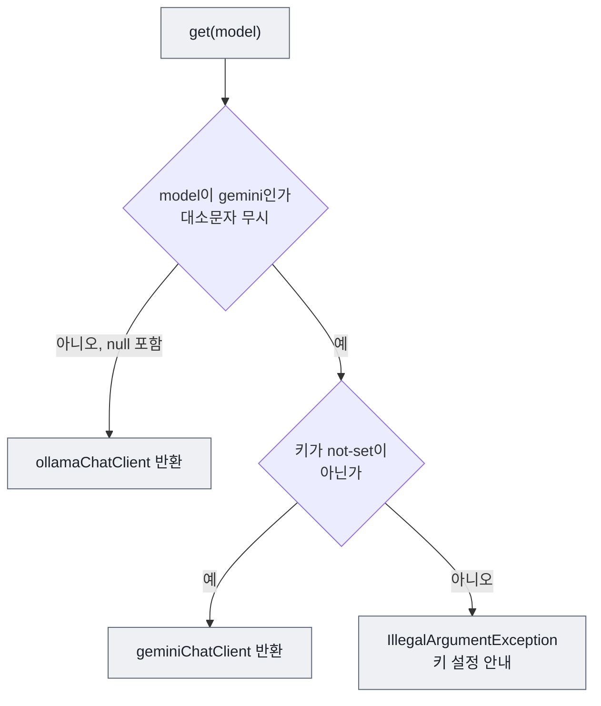
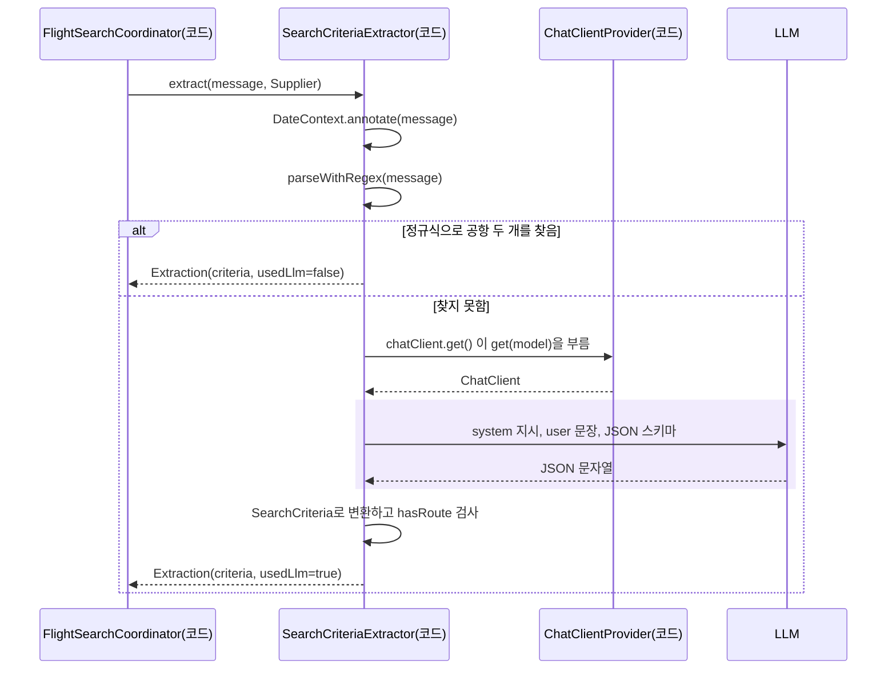

# 2장 ChatClient로 LLM 부르기

"내일 광주에서 제주로 가는 항공편 알려줘"와 "flights from Gwangju to Jeju tomorrow"는 같은 요청입니다. 그런데 정규식 하나로 두 문장을 모두 처리하기는 어렵습니다. 한글 공항 이름을 찾는 정규식은 영어 문장에서 아무것도 찾지 못하고, "다음 주 금요일" 같은 표현은 정규식으로 날짜를 계산하기가 까다롭습니다. 이럴 때 LLM이 쓸모가 있습니다. 형식이 제각각인 문장을 읽고 `출발: 광주, 도착: 제주, 날짜: 2026-10-17` 같은 데이터로 바꾸는 일은 LLM이 잘하는 일입니다.

이 장에서 LLM이 처음으로 애플리케이션에 들어옵니다. 다만 아직 LLM은 다음 단계를 결정하지 않습니다. 문장을 데이터로 **번역**할 뿐이고, LLM에게 물어볼지 말지는 코드가 정합니다. 책의 질문인 "다음 단계를 누가 결정하는가"에 비추면, 이 장의 답은 "코드가 결정하고, LLM은 코드가 시킨 일 하나만 한다"입니다.

이 장에서는 1장에서 만든 `ChatModel`을 `ChatClient`로 감싸고, 요청마다 모델을 고르고, LLM의 답을 문자열이 아닌 자바 객체로 받아 봅니다.

## 2.1 ChatClient와 ChatModel

**ChatClient**는 Spring AI에서 LLM에 프롬프트를 보내고 응답을 받는 API입니다. `RestClient`로 외부 HTTP API를 부르듯 `ChatClient`로 LLM을 부릅니다. 1장의 `ChatModel`과는 역할이 나뉩니다.

| 구분 | ChatModel | ChatClient |
|------|-----------|------------|
| 역할 | 특정 제공자와 실제로 통신 | 프롬프트 조립, 호출, 결과 변환 |
| 만드는 쪽 | 스타터의 자동 설정 | 개발자 (`ChatClient.builder(chatModel)`) |
| 이 프로젝트의 빈 | `ollamaChatModel`, `googleGenAiChatModel` | `ollamaChatClient`, `geminiChatClient` |
| 서비스 코드가 직접 쓰는가 | 쓰지 않는다 | 쓴다 |

`ChatClient`의 호출은 메서드를 이어 붙이는 유창한 API(fluent API) 형태입니다. 다음은 설명용 예시로, 프로젝트에 그대로 들어 있는 코드는 아닙니다.

```java
String answer = chatClient.prompt()
        .system("당신은 국내선 항공편 검색 도우미입니다.")
        .user("내일 광주에서 제주 가는 항공편")
        .call()
        .content();
```

| 메서드 | 반환 | 하는 일 |
|--------|------|---------|
| `prompt()` | `ChatClient.ChatClientRequestSpec` | 요청 조립을 시작한다. 호출할 때마다 새 요청이 만들어진다 |
| `system(String)` | 같은 스펙 | 시스템 프롬프트(LLM의 역할과 규칙)를 넣는다 |
| `user(String)` | 같은 스펙 | 사용자 메시지를 넣는다 |
| `call()` | `ChatClient.CallResponseSpec` | LLM을 동기로 호출한다. 응답이 올 때까지 이 스레드가 기다린다 |
| `content()` | `String` | 응답 텍스트를 꺼낸다 |
| `entity(Class)` | 지정한 타입 | 응답 JSON을 자바 객체로 바꾼다 (2.4절) |

**시스템 프롬프트**는 LLM의 역할, 규칙, 출력 형식을 정하는 지시입니다. **사용자 메시지**는 실제 질문입니다. 둘을 나누면 규칙은 코드에 고정하고 질문만 요청마다 바꿀 수 있습니다.

`prompt()`가 매번 새 요청 스펙을 만들기 때문에, 한 요청에 넣은 `system()`과 `user()`는 다른 요청에 섞이지 않습니다. 한 번 만든 `ChatClient`는 여러 스레드가 함께 써도 되므로 싱글톤 빈으로 둡니다.

## 2.2 ChatClientConfig: 모델마다 ChatClient 하나

Spring AI는 `ChatModel` 빈은 자동으로 만들지만, 이 프로젝트처럼 `ChatModel`이 두 개이면 `ChatClient`는 직접 만들어야 합니다. 외부 라이브러리의 객체는 클래스에 `@Component`를 붙일 수 없으므로 `@Configuration` 클래스의 `@Bean` 메서드로 등록합니다.

파일: `src/main/java/net/java21/flyschedule/config/ChatClientConfig.java`

```java
@Configuration
public class ChatClientConfig {

    @Bean
    public ChatClient ollamaChatClient(@Qualifier("ollamaChatModel") ChatModel ollamaChatModel) {
        return ChatClient.builder(ollamaChatModel)
                .defaultAdvisors(new SimpleLoggerAdvisor())
                .build();
    }

    @Bean
    public ChatClient geminiChatClient(@Qualifier("googleGenAiChatModel") ChatModel geminiChatModel) {
        return ChatClient.builder(geminiChatModel)
                .defaultAdvisors(new SimpleLoggerAdvisor())
                .build();
    }
}
```

**코드 읽기**

- `@Bean` 메서드 이름이 빈 이름이 됩니다. 같은 `ChatClient` 타입의 빈이 `ollamaChatClient`와 `geminiChatClient` 두 개 생깁니다.
- `ChatModel` 타입 빈도 두 개이므로 `@Qualifier`에 1장에서 본 빈 이름을 적어 골라 주입합니다.
- `ChatClient.builder(chatModel)`로 만든 빌더에 모든 요청에 붙일 기본값을 지정합니다. 여기서는 요청과 응답을 로그로 남기는 `SimpleLoggerAdvisor` 하나만 붙였습니다. Advisor는 [3장](03-advisor.md)에서 다룹니다.
- 눈여겨볼 것은 **하지 않은 일**입니다. 빌더에는 `defaultTools(...)`로 Tool을 기본 등록하는 기능도 있지만 쓰지 않았습니다. Tool을 기본으로 붙이면 검색 조건 추출, 작업 계획, 결과 요약처럼 Tool이 필요 없는 호출에도 Tool 목록이 따라가, LLM이 엉뚱하게 Tool을 부를 수 있습니다. Tool은 필요한 곳에서만 요청마다 넘깁니다([4장](04-tool-calling.md), [8장](08-tool-calling-agent.md)).

> **생각해 보기**
> `ChatClient.Builder`를 빈으로 두고 서비스마다 `build()`하는 방법도 있습니다. 이 프로젝트는 완성된 `ChatClient`를 빈으로 두었습니다. 서비스마다 기본값이 달라야 한다면 어느 쪽이 편할까요? 반대로 모든 서비스가 같은 Advisor를 써야 한다면 어느 쪽이 실수가 적을까요?

## 2.3 ChatClientProvider: 요청마다 모델 고르기

화면과 API에서 사용자는 요청마다 Ollama와 Gemini 중 하나를 고릅니다. 서비스마다 `"gemini".equals(model) ? ... : ...`를 반복하면 키 검사와 오류 문구가 서비스마다 달라지기 쉽습니다. 이 프로젝트는 고르는 규칙을 `ChatClientProvider` 한 클래스에 모아, 세 패턴이 모두 같은 방식으로 모델을 고르고 같은 문장으로 오류를 안내하게 했습니다.

파일: `src/main/java/net/java21/flyschedule/config/ChatClientProvider.java`

```java
    public ChatClientProvider(@Qualifier("ollamaChatClient") ChatClient ollamaChatClient,
                              @Qualifier("geminiChatClient") ChatClient geminiChatClient,
                              @Value("${spring.ai.google.genai.api-key:" + GEMINI_KEY_NOT_SET + "}") String geminiApiKey) {
        this.ollamaChatClient = ollamaChatClient;
        this.geminiChatClient = geminiChatClient;
        this.geminiConfigured = !geminiApiKey.isBlank() && !GEMINI_KEY_NOT_SET.equals(geminiApiKey);
    }

    /**
     * @throws IllegalArgumentException Gemini를 골랐는데 API 키가 설정되지 않은 경우
     */
    public ChatClient get(String model) {
        if (!GEMINI.equalsIgnoreCase(model)) {
            return ollamaChatClient;
        }
        if (!geminiConfigured) {
            throw new IllegalArgumentException(
                    "Gemini API 키가 설정되지 않았습니다. 환경 변수 GOOGLE_GENAI_API_KEY를 설정하거나 Ollama를 선택하세요.");
        }
        return geminiChatClient;
    }
```



그림 읽기: 모델 이름이 `gemini`가 아니면 무엇이든 Ollama입니다. Gemini를 골랐을 때만 키를 검사하고, 키가 없으면 예외를 던집니다.

**코드 읽기**

- 생성자는 1장의 `api-key` 값을 `@Value`로 받아, 키가 `not-set`인지 미리 판단해 둡니다. 요청이 올 때마다 설정을 다시 읽지 않습니다.
- 예외를 던지는 시점은 "Gemini를 고른 요청이 실제로 `ChatClient`를 꺼낼 때"입니다. 그래서 키가 없어도 애플리케이션은 시작되고, Ollama 요청은 아무 영향을 받지 않습니다.
- 던진 `IllegalArgumentException`은 각 패턴 서비스가 잡아 `success: false` 응답의 `message`로 바꿉니다.
- 같은 클래스의 `describeError(e)`는 LLM 호출 중 생긴 예외를 사용자가 읽을 문장으로 바꿉니다. 예외의 원인(cause)을 따라가며 연결 실패면 "LLM 서버에 연결할 수 없습니다...", 메시지에 `API key not valid`가 있으면 "Gemini API 키가 올바르지 않습니다..."로 바꾸고, 공공데이터 포털 오류(`ExternalApiException`, [5장](05-domain-tools.md))는 LLM 문제로 잘못 안내하지 않도록 메시지를 그대로 씁니다.

> **직접 확인하기**
> ```bash
> ./mvnw test -Dtest=ChatClientProviderTest
> ```
> 기대 결과: `Tests run: 4, Failures: 0`. 테스트 파일 `src/test/java/net/java21/flyschedule/config/ChatClientProviderTest.java`를 열어 보면 진짜 LLM 대신 Mockito의 `mock(ChatClient.class)`를 넘겨 고르는 규칙만 검증합니다. "어떤 객체를 돌려주는가"만 확인하므로 LLM이 없어도 됩니다.

## 2.4 문장을 데이터로: Structured Output

이제 실제로 LLM을 부르는 코드를 봅니다. `SearchCriteriaExtractor`는 사용자 문장에서 검색 조건을 뽑는 서비스입니다. 뽑은 결과는 세 패턴이 모두 쓰는 `SearchCriteria` record에 담깁니다.

LLM의 답을 `content()`로 받으면 문자열입니다. "출발은 광주, 도착은 제주입니다" 같은 문장을 코드가 다시 파싱해야 한다면 LLM을 쓴 의미가 줄어듭니다. 그래서 LLM에게 정해진 JSON 형식으로 답하게 하고, 그 JSON을 자바 객체로 바로 받습니다. 이것을 **Structured Output**이라고 합니다.

먼저 받을 객체입니다.

파일: `src/main/java/net/java21/flyschedule/dto/search/SearchCriteria.java`

```java
public record SearchCriteria(
        @JsonPropertyDescription("출발 공항 한글 이름 (예: 광주, 김포, 제주)")
        String departure,

        @JsonPropertyDescription("도착 공항 한글 이름 (예: 제주, 김포, 김해)")
        String arrival,

        @JsonPropertyDescription("출발 날짜, YYYY-MM-DD 형식")
        String date,

        @JsonPropertyDescription("이 시각 이후 출발, HH:mm 형식. 조건이 없으면 null")
        String afterTime,

        // ... beforeTime, minPrice, maxPrice도 같은 방식

        @JsonPropertyDescription("최대 가격(원). 조건이 없으면 null")
        Integer maxPrice
) {

    public boolean hasRoute() {
        return departure != null && !departure.isBlank() && arrival != null && !arrival.isBlank();
    }
    // ...
}
```

다음은 LLM을 부르는 메서드입니다.

파일: `src/main/java/net/java21/flyschedule/service/ai/SearchCriteriaExtractor.java`

```java
    public Extraction extract(String message, Supplier<ChatClient> chatClient) {
        // "이번 주 토요일" 같은 표현에 코드가 계산한 날짜를 먼저 붙인다 → 정규식도 LLM도 계산할 필요가 없다
        message = DateContext.annotate(message);
        Optional<SearchCriteria> parsed = parseWithRegex(message);
        if (parsed.isPresent()) {
            log.info("정규식으로 검색 조건 추출: {}", parsed.get());
            return new Extraction(parsed.get(), false);
        }

        log.info("정규식으로 공항을 찾지 못해 LLM으로 검색 조건 추출: {}", message);
        SearchCriteria criteria = chatClient.get().prompt()
                .system("""
                        항공편 검색 문장에서 검색 조건을 추출합니다.
                        "내일", "다음 주 금요일" 같은 표현은 계산하지 말고 아래 날짜표에서 찾아 YYYY-MM-DD로 적습니다.
                        공항은 공항 코드가 아니라 한글 이름(광주, 김포, 제주 등)으로 적습니다.
                        문장에 없는 조건은 null로 둡니다.

                        %s
                        """.formatted(DateContext.describe()))
                .user(message)
                .call()
                // 작은 모델이 JSON 앞뒤에 문장을 붙여도 JSON 부분만 읽는다
                .entity(new BeanOutputConverter<>(SearchCriteria.class, null, new LenientJsonCleaner()));

        if (criteria == null || !criteria.hasRoute()) {
            throw new IllegalArgumentException("출발 공항과 도착 공항을 찾지 못했습니다. 예: \"내일 광주에서 제주\"");
        }
        return new Extraction(criteria, true);
    }
```

**코드 읽기**

- `.entity(...)`가 Structured Output입니다. Spring AI는 `SearchCriteria`에서 JSON 스키마를 만들어 "이 스키마에 맞는 JSON으로 답하라"는 지시를 프롬프트에 덧붙이고, LLM이 돌려준 JSON을 `SearchCriteria` 객체로 바꿉니다. 가장 간단한 형태는 `.entity(SearchCriteria.class)`입니다. 이 프로젝트는 같은 일을 하는 변환기(`BeanOutputConverter`)를 직접 만들어 넘기는데, 그 이유는 바로 아래 "JSON이 문장에 섞여 올 때"에서 봅니다.
- 메서드의 첫 줄 `DateContext.annotate(message)`는 "이번 주 토요일" 같은 표현 옆에 코드가 계산한 날짜를 붙입니다(`이번 주 토요일(2026-10-17)`). 프롬프트 끝의 `%s`에는 `DateContext.describe()`가 만든 **날짜표**가 들어갑니다. 날짜를 왜 이렇게 두 겹으로 주는지는 2.5절에서 봅니다.
- `@JsonPropertyDescription`의 문장은 그 JSON 스키마의 `description`이 되어 LLM에게 전달됩니다. 필드 이름 `date`만으로는 형식을 알 수 없지만 "YYYY-MM-DD 형식"이라는 설명이 있으면 LLM이 형식을 맞춥니다. 필드 설명은 사람을 위한 주석이 아니라 **LLM을 위한 프롬프트**입니다.
- LLM의 결과를 그대로 쓰지 않고 `hasRoute()`로 다시 검사합니다. 작은 모델은 공항을 비워 두거나 영어로 적기도 합니다. 검사에 실패하면 사용자가 이해할 수 있는 예외를 던집니다.
- 메서드는 정규식을 먼저 시도하고, 실패했을 때만 LLM을 부릅니다. 결과에는 LLM을 썼는지(`usedLlm`)를 함께 담아, [7장](07-coordinator.md)의 Coordinator가 실행 기록에 `CODE` 또는 `LLM`으로 남깁니다.
- `ChatClient`가 아니라 `Supplier<ChatClient>`를 받습니다. 정규식으로 끝나는 요청에서는 `chatClient.get()`이 아예 불리지 않으므로, `ChatClientProvider.get(model)`의 키 검사도 일어나지 않습니다. 그래서 Gemini 키가 없어도 Gemini를 고른 한국어 요청은 정규식 경로로 성공합니다.



그림 읽기: 보라색 구간만 LLM이 일하는 시간입니다. 정규식이 성공하면 이 구간이 통째로 없어집니다. LLM에게 물어볼지 말지는 처음부터 끝까지 코드가 정합니다.

> **주의**
> `.entity()`는 LLM이 스키마에 맞는 JSON을 돌려줄 때만 성공합니다. 작은 모델은 JSON 앞뒤에 설명 문장을 붙이거나, 괄호를 닫지 않거나, 숫자 자리에 "6만원" 같은 문자열을 넣기도 합니다. 이때는 변환 단계에서 예외가 나고, Coordinator가 이를 `success: false` 응답으로 바꿉니다. LLM의 출력은 형식이 맞더라도 내용까지 맞다는 보장이 없으므로 **항상 코드로 검증**합니다. 이 원칙은 [9장](09-orchestrator-workers.md)의 `FlightSearchPlanner.validate()`에서 더 엄격한 형태로 다시 나옵니다.

### JSON이 문장에 섞여 올 때: LenientJsonCleaner

`.entity()`는 LLM의 응답 문자열을 JSON으로 읽기 전에 **정리기**(`ResponseTextCleaner`)를 한 번 거칩니다. Spring AI의 기본 정리기는 응답 **전체가** ` ``` `로 시작하고 ` ``` `로 끝날 때만 코드 블록 표시를 벗깁니다. Gemini처럼 JSON만 깔끔하게 돌려주는 모델에는 이것으로 충분합니다.

그런데 운영 중인 데모 사이트에서 Ollama `qwen2.5:3b`가 이런 응답을 돌려주었습니다(모양만 옮김).

````text
다음은 검색 계획입니다:
```json
{"reasoning": "2 × 2", "tasks": [ ... ]}
```
각 작업을 실행하세요.
````

JSON 자체는 멀쩡하지만 앞뒤에 문장이 붙어 있어 응답이 ` ``` `로 시작하지도 끝나지도 않습니다. 기본 정리기는 아무것도 벗기지 않고, 변환기는 "다음은..."부터 JSON으로 읽으려다 실패합니다. 실제로 이 때문에 Orchestrator의 계획 단계([9장](09-orchestrator-workers.md))가 실패했습니다. 그래서 JSON 부분만 꺼내는 정리기를 따로 만들었습니다.

파일: `src/main/java/net/java21/flyschedule/service/ai/LenientJsonCleaner.java`

```java
public class LenientJsonCleaner implements ResponseTextCleaner {

    @Override
    public String clean(String text) {
        if (text == null) {
            return null;
        }
        String trimmed = text.trim();

        int fence = trimmed.indexOf("```");
        if (fence >= 0) {
            int bodyStart = trimmed.indexOf('\n', fence);
            int closing = bodyStart < 0 ? -1 : trimmed.indexOf("```", bodyStart);
            if (closing > bodyStart) {
                return trimmed.substring(bodyStart + 1, closing).trim();
            }
        }

        int open = trimmed.indexOf('{');
        int close = trimmed.lastIndexOf('}');
        if (open >= 0 && close > open) {
            return trimmed.substring(open, close + 1);
        }
        return trimmed;
    }
}
```

**코드 읽기**

- 응답 안 어디든 코드 블록이 있으면 첫 번째 블록의 내용을 꺼냅니다. ` ```json ` 줄의 끝(첫 줄바꿈) 다음부터 닫는 ` ``` ` 앞까지입니다.
- 코드 블록이 없으면 처음 나온 `{`부터 마지막 `}`까지를 꺼냅니다. "결과: {...} 입니다" 같은 응답을 위한 것입니다.
- 둘 다 없으면 앞뒤 공백만 지우고 그대로 넘깁니다. 이때는 변환이 실패하고, 실패는 지금까지처럼 `success: false`로 이어집니다. 정리기는 형식을 고칠 뿐 **내용을 지어내지 않습니다**.

이 정리기는 `BeanOutputConverter`의 세 번째 생성자 인자로 연결합니다. 두 번째 인자(`null`)는 Jackson `ObjectMapper`로, `null`이면 기본값을 씁니다. `SearchCriteriaExtractor`와 [9장](09-orchestrator-workers.md)의 `FlightSearchPlanner`가 같은 방식으로 씁니다.

```java
.entity(new BeanOutputConverter<>(SearchPlan.class, null, new LenientJsonCleaner()));
```

> **직접 확인하기**
> ```bash
> ./mvnw test -Dtest=LenientJsonCleanerTest
> ```
> 기대 결과: `Failures: 0, Errors: 0`. `defaultCleanerFails`는 기본 변환기(`new BeanOutputConverter<>(SearchCriteria.class)`)가 같은 모양의 응답에서 예외를 던지는 것을, `worksWithBeanOutputConverter`는 정리기를 연결하면 `SearchPlan`으로 변환되는 것을 보여 줍니다.

## 2.5 프롬프트 설계 기초

`extract()`의 시스템 프롬프트는 네 줄뿐이지만, 줄마다 이유가 있습니다.

| 프롬프트의 줄 | 왜 필요한가 |
|---------------|-------------|
| 항공편 검색 문장에서 검색 조건을 추출합니다 | 할 일을 한 문장으로 못 박는다. 답변을 쓰거나 항공편을 추천하지 않게 한다 |
| "내일", "다음 주 금요일" 같은 표현은 계산하지 말고 아래 날짜표에서 찾아... | LLM은 오늘 날짜를 모른다(1장). 날짜를 주지 않으면 "내일"을 학습 시점 기준으로 엉뚱하게 계산한다. 날짜를 줘도 작은 모델은 요일 계산을 틀리므로 표를 준다 |
| 공항은 공항 코드가 아니라 한글 이름으로 적습니다 | 코드 변환은 결정적인 코드(`AirportCodeAgent`, [6장](06-specialized-agents.md))가 맡는다. LLM이 코드를 지어내면 틀려도 알아채기 어렵다 |
| 문장에 없는 조건은 null로 둡니다 | 빈칸을 그럴듯한 값으로 채우지 못하게 한다. 사용자가 말하지 않은 "10시 이후"를 만들어 내면 결과가 조용히 줄어든다 |
| `%s` 자리의 날짜표 | 오늘·내일·모레, 이번 주와 다음 주의 요일별 날짜를 표로 준다. 아래에서 자세히 본다 |

여기서 다섯 가지 원칙을 뽑을 수 있습니다. 마지막 원칙은 이 프롬프트를 운영하면서 얻었습니다.

첫째, **LLM이 모르는 사실은 프롬프트로 준다.** 오늘 날짜가 대표적입니다. 날짜표는 요청마다 `LocalDate.now()`로 새로 만들므로 날짜가 바뀌어도 코드를 고칠 필요가 없습니다.

둘째, **규칙은 짧은 목록으로 준다.** 긴 문단보다 한 줄에 규칙 하나를 적은 목록이 작은 모델에서도 잘 지켜집니다. 규칙이 서로 섞이지 않고, 나중에 어떤 규칙이 지켜지지 않았는지 짚기도 쉽습니다.

셋째, **근거가 없는 내용은 만들지 못하게 한다.** 이것을 근거 제한(grounding)이라고 합니다. "문장에 없는 조건은 null"이 이 장의 근거 제한입니다. [8장](08-tool-calling-agent.md)의 Tool Calling Agent는 시스템 프롬프트에 "Tool 결과에 없는 내용은 지어내지 마세요"라는 규칙을 넣어, 답변이 실제 검색 결과에만 기대게 합니다.

넷째, **계산은 시키지 말고 찾게 한다.** 처음에는 프롬프트에 "오늘 날짜는 2026-10-16(금)입니다" 한 줄만 넣었습니다. 그런데 오늘이 2026-10-16 금요일인 날, 데모 사이트에서 "이번 주 금요일이나 토요일"을 검색하자 Gemini는 10-16과 10-17로 바르게 계산했고 `qwen2.5:3b`는 10-17과 10-18로 하루씩 밀려 계산했습니다. 작은 모델에게 "오늘이 금요일이면 이번 주 금요일은 며칠인가"는 생각보다 어려운 문제입니다. 그래서 계산을 시키는 대신 **날짜표**를 줍니다. LLM은 표에서 "금"과 "토"를 찾아 옮겨 적기만 하면 됩니다.

파일: `src/main/java/net/java21/flyschedule/service/ai/DateContext.java`

```java
    public static String describe(LocalDate today) {
        LocalDate monday = today.with(TemporalAdjusters.previousOrSame(DayOfWeek.MONDAY));
        return """
                오늘: %s
                내일: %s, 모레: %s
                이번 주: %s
                다음 주: %s""".formatted(
                withDay(today), withDay(today.plusDays(1)), withDay(today.plusDays(2)),
                week(monday), week(monday.plusWeeks(1)));
    }
```

`2026-10-16`에 만든 날짜표는 다음과 같습니다(`DateContextTest.fridayIsToday`의 기대값).

```text
오늘: 2026-10-16(금)
내일: 2026-10-17(토), 모레: 2026-10-18(일)
이번 주: 월 2026-10-12, 화 2026-10-13, 수 2026-10-14, 목 2026-10-15, 금 2026-10-16, 토 2026-10-17, 일 2026-10-18
다음 주: 월 2026-10-19, 화 2026-10-20, 수 2026-10-21, 목 2026-10-22, 금 2026-10-23, 토 2026-10-24, 일 2026-10-25
```

**코드 읽기**: 한 주는 월요일부터 일요일까지로 정합니다(`previousOrSame(MONDAY)`). "이번 주"의 뜻을 코드가 정해 두는 셈입니다. 이 날짜표는 `SearchCriteriaExtractor`, [8장](08-tool-calling-agent.md)의 Tool Calling 프롬프트, [9장](09-orchestrator-workers.md)의 Planner 프롬프트가 함께 씁니다. 결정적으로 계산할 수 있는 일은 코드가 하고, LLM에게는 고르는 일만 남긴다는 이 책의 원칙이 프롬프트 한 줄에도 적용됩니다.

> **직접 확인하기**
다섯째, **코드가 확실히 할 수 있는 일은 LLM에게 맡기지 않는다.** 날짜표를 넣은 뒤에도 운영에서 `qwen2.5:3b`는 "이번 주 토요일 김포에서 제주"를 2026-10-18로 검색했습니다(정답은 10-17). 표를 주었어도 표에서 **고르는** 일마저 틀린 것입니다. "이번 주 토요일"이 며칠인지는 달력만 있으면 답이 하나로 정해지는 문제입니다. 이런 일까지 LLM에게 맡길 이유가 없습니다. 그래서 LLM에게 보내기 전에 코드가 문장 속 날짜 표현 옆에 날짜를 직접 붙입니다.

파일: `src/main/java/net/java21/flyschedule/service/ai/DateContext.java`

```java
    /** 오늘, 내일, 모레, 글피 (내일모레는 모레) */
    private static final Pattern RELATIVE_DAY = Pattern.compile("(내일모레|오늘|내일|모레|글피)(?!\\s*\\()");
    /** [이번 주|다음 주|다다음 주] X요일 */
    private static final Pattern WEEKDAY =
            Pattern.compile("(?:(이번\\s*주|다음\\s*주|다다음\\s*주)\\s*)?([월화수목금토일])요일(?!\\s*\\()");
```

| 문장 (오늘 2026-10-16 금) | `annotate()` 결과 |
|---|---|
| 이번 주 토요일 김포에서 제주 | 이번 주 토요일(2026-10-17) 김포에서 제주 |
| 이번 주 금요일이나 토요일에 김포나 광주에서 제주 | 이번 주 금요일(2026-10-16)이나 토요일(2026-10-17)에 김포나 광주에서 제주 |
| 수요일 출발 | 수요일(2026-10-21) 출발 |
| 모레랑 글피 | 모레(2026-10-18)랑 글피(2026-10-19) |

**코드 읽기**

- 두 정규식이 "오늘·내일·모레·글피"와 "[이번 주·다음 주·다다음 주] X요일"을 찾고, 찾은 표현 뒤에 `(YYYY-MM-DD)`를 붙입니다. 표의 기대값은 모두 `DateContextTest`에 있습니다.
- "금요일이나 토요일"처럼 앞에 나온 "이번 주"는 뒤의 요일에도 적용합니다. 주 표현 없이 요일만 있으면 오늘을 포함해 가장 가까운 그 요일로 봅니다.
- 끝의 `(?!\\s*\\()`는 "바로 뒤에 괄호가 없을 때만"이라는 뜻입니다. 이미 날짜가 붙은 문장에 다시 붙이지 않으므로, 여러 번 불러도 결과가 같습니다(`annotateIsIdempotent`).
- "주말", "3일 뒤", 연도 없는 "3월 25일"처럼 코드가 확실하게 정하기 어려운 표현은 건드리지 않습니다. 이런 표현만 LLM이 날짜표를 보고 해석합니다.

날짜표(`describe()`)는 그대로 프롬프트에 남아 있습니다. 코드가 붙인 날짜가 1차, 날짜표가 2차 안전망입니다. 덤으로 정규식 경로도 넓어졌습니다. `parseWithRegex()`는 `2026-10-17` 같은 절대 날짜를 읽을 수 있으므로, 날짜가 붙은 "다음 주 금요일 광주에서 제주"는 LLM 없이 정규식으로 끝납니다(2.6절).

> **직접 확인하기**
> ```bash
> ./mvnw test -Dtest=DateContextTest
> ```
> 기대 결과: `Failures: 0, Errors: 0`. 날짜표(오늘이 금요일인 경우, 일요일인 경우, 월이 바뀌는 주)와 `annotate()`(주 표현 이어 붙이기, 요일만 있는 경우, 이미 날짜가 붙은 경우)를 검사합니다.

> **팁**
> 프롬프트를 고쳤다면 같은 문장을 여러 번, 가능하면 두 모델로 보내 확인합니다. 한 번 잘 나왔다고 늘 잘 나오는 것은 아닙니다(1장의 비결정성). 프롬프트에 무엇이 실제로 나갔는지는 [3장](03-advisor.md)에서 로그로 들여다봅니다.

## 2.6 왜 정규식이 먼저인가

LLM이 문장을 잘 읽는다면 처음부터 LLM에게 맡기면 되지 않을까요? 이 프로젝트가 정규식을 먼저 쓰는 이유는 결정성과 비용입니다.

| | 정규식 경로 | LLM 경로 |
|---|---|---|
| 같은 입력에 같은 결과 | 항상 같다 | 대체로 같지만 보장하지 않는다 |
| 걸리는 시간 | 1ms 안팎 | Gemini는 수 초, 원격 3B 모델은 수십 초까지 |
| 비용 | 없음 | 호출마다 토큰 비용(Gemini) 또는 서버 자원(Ollama) |
| 실패할 때 | 빈 값을 돌려주고 LLM에 넘긴다 | JSON이 깨지거나 빈칸이 생긴다 |

`parseWithRegex()`는 확신할 수 있을 때만 결과를 돌려주고, 조금이라도 해석이 필요하면 포기합니다. 문장에서 찾은 공항 이름이 정확히 두 개가 아니거나("김포나 광주에서 제주"는 세 개), "주말", "3일 뒤"처럼 코드가 날짜를 붙이지 못한 표현이 있으면 빈 값을 돌려줘 LLM에 맡깁니다. 정규식의 규칙은 [7장](07-coordinator.md)에서 자세히 봅니다.

| 문장 | 경로 | 이유 |
|------|------|------|
| 내일 광주에서 제주로 가는 항공편 알려줘 | 정규식 | 공항 두 개, "내일"은 정규식이 처리 |
| 모레 김포에서 제주 오후 2시 이후 항공편 | 정규식 | 시간 조건도 정규식이 처리 |
| flights from Gwangju to Jeju tomorrow | LLM | 한글 공항 이름이 없다 |
| 다음 주 금요일 광주에서 제주 | 정규식 | `annotate()`가 날짜를 붙이므로 계산이 필요 없다 |
| 주말에 광주에서 제주 | LLM | "주말"은 코드가 날짜 하나로 정하지 않는다 |

> **직접 확인하기**
> 애플리케이션을 실행하고(`./mvnw spring-boot:run`) 다음 두 요청을 보냅니다.
> ```bash
> curl -s -X POST http://localhost:8080/api/search/coordinator \
>   -H "Content-Type: application/json" \
>   -d '{"message": "내일 광주에서 제주로 가는 항공편 알려줘"}' \
>   -w "\n응답 시간: %{time_total}초\n"
>
> curl -s -X POST http://localhost:8080/api/search/coordinator \
>   -H "Content-Type: application/json" \
>   -d '{"message": "flights from Gwangju to Jeju tomorrow", "model": "ollama"}' \
>   -w "\n응답 시간: %{time_total}초\n"
> ```
> 기대 결과: 첫 요청은 `trace[0]`이 `"kind": "CODE"`, `"title": "정규식으로 검색 조건 추출"`이고 1초 안팎에 끝납니다. 둘째 요청은 `"kind": "LLM"`, `"title": "LLM으로 검색 조건 추출"`이고, `detail`에 `광주 → 제주 · (내일 날짜)`가 적힙니다. 응답 시간은 LLM 호출 때문에 훨씬 깁니다. 두 응답의 `trace[1]` 이후는 모두 `CODE` 단계로 같습니다.

> **직접 확인하기**
> `GOOGLE_GENAI_API_KEY` 없이 실행한 상태에서 위 두 문장을 `"model": "gemini"`로 보냅니다.
> 기대 결과: 한국어 문장은 `"success": true`입니다. 정규식으로 끝나 `chatClient.get()`이 불리지 않았기 때문입니다. 영어 문장은 `"success": false`이고 `message`가 "Gemini API 키가 설정되지 않았습니다..."이며, `trace[0]`은 `"title": "검색 조건 추출"`, `"detail": "실패: Gemini API 키가..."`입니다.

## 2.7 가짜 LLM으로 테스트하기

LLM이 들어간 코드는 테스트하기 어려워 보입니다. 결과가 매번 다를 수 있고, 느리고, 키가 필요합니다. 하지만 우리가 검증하고 싶은 것은 LLM의 실력이 아니라 **우리 코드의 흐름**입니다. 정규식이 성공하면 LLM을 부르지 않는지, LLM이 이런 값을 돌려주면 코드가 그 값을 제대로 쓰는지를 보면 됩니다. 그래서 `ChatClient`를 가짜로 바꿔 끼웁니다.

파일: `src/test/java/net/java21/flyschedule/service/ai/SearchCriteriaExtractorTest.java`

```java
    @BeforeEach
    void setUp() {
        extractor = new SearchCriteriaExtractor();
        chatClient = mock(ChatClient.class, RETURNS_DEEP_STUBS);
    }
    // ...

    @Test
    @DisplayName("정규식으로 충분하면 LLM을 호출하지 않는다")
    void regexSkipsLlm() {
        SearchCriteriaExtractor.Extraction extraction = extractor.extract("내일 광주에서 제주", () -> chatClient);

        assertThat(extraction.usedLlm()).isFalse();
        verifyNoInteractions(chatClient);
    }

    @Test
    @DisplayName("정규식이 실패하면 LLM의 Structured Output을 사용한다")
    void usesLlmWhenRegexFails() {
        SearchCriteria fromLlm = new SearchCriteria("김포", "제주", "2026-03-27", null, null, null, null);
        when(chatClient.prompt().system(anyString()).user(anyString()).call().entity(org.mockito.ArgumentMatchers.<org.springframework.ai.converter.StructuredOutputConverter<SearchCriteria>>any()))
                .thenReturn(fromLlm);

        SearchCriteriaExtractor.Extraction extraction =
                extractor.extract("이번 주 금요일 서울에서 제주도 가는 비행기", () -> chatClient);

        assertThat(extraction.usedLlm()).isTrue();
        assertThat(extraction.criteria()).isEqualTo(fromLlm);
    }
```

**코드 읽기**

- `RETURNS_DEEP_STUBS`는 메서드 체인의 중간 객체까지 Mockito가 자동으로 가짜를 만들게 하는 옵션입니다. 그 덕분에 `prompt().system(...).user(...).call().entity(...)`라는 긴 체인의 끝에 "LLM이 돌려줄 객체"를 한 줄로 정할 수 있습니다.
- `entity(...)`의 인자가 클래스가 아니라 변환기 객체(`BeanOutputConverter`)이므로, 어떤 변환기가 와도 맞도록 `any()`로 받습니다. 타입을 밝힌 `ArgumentMatchers.<StructuredOutputConverter<SearchCriteria>>any()`는 `entity`의 여러 오버로드 가운데 변환기를 받는 쪽을 고르게 합니다.
- `regexSkipsLlm`은 `verifyNoInteractions(chatClient)`로 가짜 `ChatClient`에 아무 호출도 없었음을 확인합니다. "정규식이 성공하면 LLM을 부르지 않는다"는 설계 의도를 테스트로 고정한 것입니다.
- `usesLlmWhenRegexFails`는 공항이 하나("서울"은 공항 이름이 아님)뿐인 문장으로 LLM 경로를 타게 하고, LLM이 돌려준 객체가 그대로 결과가 되는지 봅니다.

> **직접 확인하기**
> ```bash
> ./mvnw test -Dtest=SearchCriteriaExtractorTest
> ```
> 기대 결과: `Failures: 0, Errors: 0`. Ollama가 꺼져 있어도, 키가 없어도 통과합니다. 정규식 규칙을 검증하는 테스트도 같은 파일에 함께 있습니다.

가짜 LLM으로 테스트하는 다른 기법들, 예를 들어 Tool을 직접 실행하는 가짜나 병렬 실행을 검증하는 테스트는 [10장](10-choosing-testing-operating.md)에 모아 두었습니다.

## 핵심 정리

- `ChatModel`은 제공자와 통신하고, `ChatClient`는 프롬프트를 조립하고 호출하고 결과를 바꾸는 공통 API입니다.
- `ChatClientConfig`는 모델마다 `ChatClient` 빈을 하나씩 만들고, Tool은 기본 등록하지 않습니다.
- `ChatClientProvider`는 요청의 `model` 값으로 `ChatClient`를 고르고, Gemini 키가 없으면 그 순간에만 안내 예외를 던집니다.
- `.entity(...)`로 LLM의 답을 자바 객체로 받고, `@JsonPropertyDescription`은 LLM에게 전달되는 필드 설명이 됩니다. 받은 값은 `hasRoute()`처럼 코드로 다시 검증합니다.
- 작은 모델은 JSON을 문장으로 감싸기도 합니다. `LenientJsonCleaner`를 `BeanOutputConverter`에 연결해 JSON 부분만 읽습니다.
- 프롬프트에는 LLM이 모르는 사실(오늘 날짜)을 날짜표로 주고, 규칙은 짧은 목록으로, 근거 없는 값은 만들지 못하게 씁니다. 계산은 시키지 않고 찾게 합니다.
- 코드가 확실히 할 수 있는 일은 LLM에게 맡기지 않습니다. `DateContext.annotate()`가 "이번 주 토요일" 옆에 날짜를 붙여 보내고, 그 덕분에 요일 표현도 정규식 경로로 처리됩니다.
- 정규식으로 확신할 수 있으면 LLM을 부르지 않습니다. 어느 경로로 갈지는 코드가 정합니다.

## 연습 문제

**1. [기본] 세 문장의 경로 비교하기**

다음 네 문장을 `"model": "ollama"`로 `POST /api/search/coordinator`에 보냅니다: `내일 광주에서 제주로 가는 항공편 알려줘`, `flights from Gwangju to Jeju tomorrow`, `다음 주 금요일 광주에서 제주`, `주말에 광주에서 제주`.

- **힌트**: `DateContext.annotate()`, `SearchCriteriaExtractor.parseWithRegex()`의 공항 개수 검사와 `COMPLEX_DATE_PATTERN`.
- **완료 기준**: 네 응답의 `trace[0].kind`, `trace[0].detail`, `elapsedMs`를 표로 정리하고, 각 문장이 그 경로로 간 이유를 한 문장씩 적습니다. 셋째 문장이 LLM 없이(CODE) 처리되고 `detail`의 날짜가 실제로 다음 주 금요일인지 달력으로 확인합니다.

**2. [기본] 모델 이름 처리를 테스트로 고정하기**

`ChatClientProviderTest`에 알 수 없는 모델 이름(`"gpt"`)과 빈 문자열(`""`)을 넘기는 테스트를 추가합니다.

- **힌트**: 같은 파일의 `selectsByModelName()`과 `normalize()` 테스트를 본뜹니다.
- **완료 기준**: `get("gpt")`와 `get("")`이 Ollama 클라이언트를, `normalize("gpt")`가 `"ollama"`를 돌려준다는 단언을 넣은 테스트가 `./mvnw test -Dtest=ChatClientProviderTest`로 통과합니다.

**3. [도전] 날짜표 대신 오늘 날짜 한 줄만 주면 어떻게 되는가**

`SearchCriteriaExtractor.extract()`의 `.formatted(DateContext.describe())`를 `.formatted("오늘: " + LocalDate.now())`로 바꾸고, `flights from Gwangju to Jeju this Saturday`와 `flights from Gimpo to Jeju next Friday`를 Ollama로 세 번씩 보냅니다. 실험 뒤 원래대로 되돌립니다.

- **힌트**: 결과 날짜는 응답의 `trace[0].detail`과 `trace[1].detail`(날짜 변환)에 나옵니다. 비교 기준은 `DateContext.describe()`가 만드는 표입니다.
- **완료 기준**: 바꾸기 전과 후의 날짜를 표로 비교하고, 날짜표를 주는 이유를 두 문장으로 설명합니다. 되돌린 뒤 `./mvnw test -Dtest=SearchCriteriaExtractorTest,DateContextTest`가 통과합니다.

**4. [도전] 필드 설명의 힘 관찰하기**

`SearchCriteria.date`의 `@JsonPropertyDescription`을 `"출발 날짜"`로 바꾸고(형식 안내 제거), 영어 문장 `flights from Gimpo to Jeju on the 3rd of next month`를 Ollama로 여러 번 보냅니다. 실험 뒤 원래대로 되돌립니다.

- **힌트**: 형식이 어긋난 날짜는 `DateParserAgent`의 날짜 변환 단계에서 드러납니다. 응답의 `trace`에서 `실패:`로 시작하는 `detail`을 찾아보세요.
- **완료 기준**: 설명을 바꾸기 전과 후의 `date` 값 형식과 `success`를 비교해 적고, Structured Output에서 필드 설명이 하는 역할을 세 문장 이내로 정리합니다.

지금까지 LLM은 우리가 보낸 프롬프트에 답만 했습니다. 그런데 실제로 어떤 프롬프트가 나갔고 어떤 답이 왔는지는 아직 눈으로 본 적이 없습니다. [3장](03-advisor.md)에서는 Advisor로 LLM 호출의 안쪽을 들여다봅니다.

## 참고 자료

- [Spring AI 공식 문서: Chat Client API](https://docs.spring.io/spring-ai/reference/api/chatclient.html)
- [Spring AI 공식 문서: Structured Output Converter](https://docs.spring.io/spring-ai/reference/api/structured-output-converter.html)
