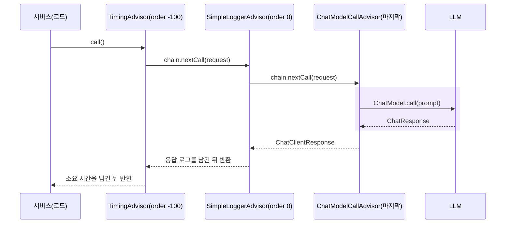
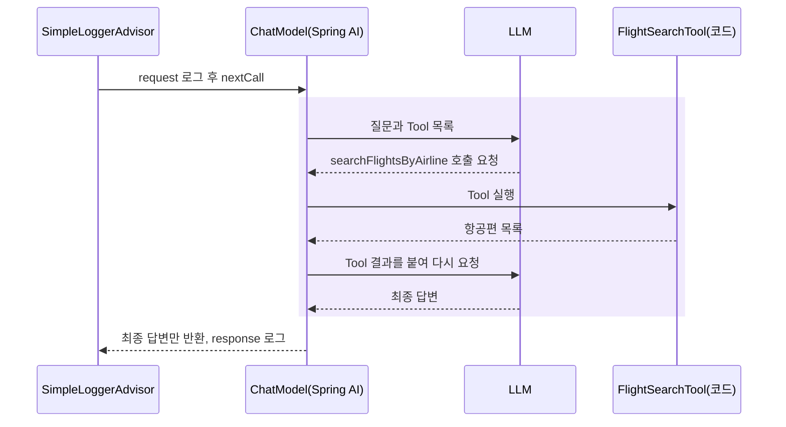

# 3장 Advisor로 LLM 호출 들여다보기

검색 화면에 "다음 주 금요일 광주에서 제주"를 넣었는데 엉뚱한 날짜로 검색되었다고 해 봅시다. 원인은 어디에 있을까요? 프롬프트에 오늘 날짜가 빠졌을 수도 있고, LLM이 JSON을 잘못 만들었을 수도 있고, 우리 코드가 응답을 잘못 읽었을 수도 있습니다. 실제로 LLM에 **무엇을 보냈고 무엇을 받았는지** 보지 않고는 어느 쪽인지 알 수 없습니다.

이 책은 "다음 단계를 누가 결정하는가 — 코드인가, LLM인가?"를 묻습니다. 그 질문에 답하려면 먼저 결정 과정을 **볼 수 있어야** 합니다. 이 장에서는 ChatClient 호출 앞뒤에 끼어드는 **Advisor**로 LLM 호출을 들여다보고, Advisor로도 보이지 않는 부분이 어디인지 확인합니다. 그 빈틈이 이 책의 실행 기록(trace)이 생겨난 이유입니다.

## Advisor는 LLM 호출의 Filter다

서블릿 `Filter`는 컨트롤러 앞뒤에서 인증, 로깅, 인코딩 같은 공통 처리를 합니다. **Advisor**는 같은 일을 LLM 호출 앞뒤에서 합니다. `chatClient.prompt()...call()`을 부르면 요청은 등록된 Advisor들을 차례로 지나 마지막에 `ChatModel`에 닿고, 응답은 같은 길을 거꾸로 돌아옵니다.



그림 읽기: 요청은 order가 작은 Advisor부터 안쪽으로 들어가고, 응답은 안쪽부터 바깥으로 나옵니다. 체인의 맨 끝은 Spring AI가 자동으로 붙이는 `ChatModelCallAdvisor`이며, 이 Advisor가 실제로 `ChatModel`을 부릅니다.

Advisor로 하는 일은 대개 다음 넷 중 하나입니다.

| 쓰임 | 예 | Spring AI 1.1.4 기본 제공 |
|---|---|---|
| 관찰 | 프롬프트와 응답 로그, 소요 시간, 토큰 수 | `SimpleLoggerAdvisor` |
| 프롬프트 보강 | 이전 대화를 프롬프트에 덧붙이기 | `MessageChatMemoryAdvisor`, `PromptChatMemoryAdvisor` |
| 차단·검증 | 금지어가 든 요청 막기, Structured Output 검증 | `SafeGuardAdvisor`, `StructuredOutputValidationAdvisor` |
| 실행 제어 | Tool 호출 루프를 Advisor 체인에서 돌리기 | `ToolCallAdvisor` |

이 프로젝트가 쓰는 것은 첫째 줄, 관찰입니다.

## SimpleLoggerAdvisor 켜기

[2장](02-chatclient.md)에서 본 `ChatClientConfig`는 두 ChatClient에 모두 `SimpleLoggerAdvisor`를 기본으로 붙여 둡니다.

파일: `src/main/java/net/java21/flyschedule/config/ChatClientConfig.java` (일부)

```java
@Bean
public ChatClient ollamaChatClient(@Qualifier("ollamaChatModel") ChatModel ollamaChatModel) {
    return ChatClient.builder(ollamaChatModel)
            .defaultAdvisors(new SimpleLoggerAdvisor())
            .build();
}
```

코드 읽기: `defaultAdvisors(...)`로 등록한 Advisor는 이 ChatClient로 보내는 모든 요청에 붙습니다. 특정 요청에만 붙이려면 `chatClient.prompt().advisors(...)`를 씁니다. 같은 클래스의 주석은 Tool은 기본값으로 등록하지 않는다고 밝히고 있습니다. 로깅은 LLM의 판단을 바꾸지 않으니 어디에나 붙여도 되지만, Tool은 LLM의 판단을 바꾸기 때문입니다. 이 차이는 [4장](04-tool-calling.md)에서 다시 다룹니다.

`SimpleLoggerAdvisor`는 `request: ...`, `response: ...` 두 줄을 **DEBUG** 레벨로 남깁니다. 그런데 이 프로젝트의 `src/main/resources/logback-spring.xml`은 기본 프로필에서 `org.springframework` 로거를 INFO로 둡니다. 그래서 그대로 실행하면 아무것도 보이지 않습니다. 파일을 고치지 않고 실행할 때만 Advisor 패키지의 레벨을 올려 봅시다.

> **직접 확인하기**
>
> ```bash
> ./mvnw spring-boot:run \
>   -Dspring-boot.run.arguments=--logging.level.org.springframework.ai.chat.client.advisor=DEBUG
> ```
>
> 다른 터미널에서 Coordinator 패턴을 부릅니다. "다음 주 금요일"처럼 계산이 필요한 날짜는 정규식이 처리하지 않고 LLM에 넘기므로(7장) LLM 호출이 한 번 일어납니다.
>
> ```bash
> curl -X POST http://localhost:8080/api/search/coordinator \
>   -H "Content-Type: application/json" \
>   -d '{"message": "다음 주 금요일 광주에서 제주", "model": "ollama"}'
> ```
>
> 기대 결과(콘솔, 줄여서 표시): `SimpleLoggerAdvisor - request: ChatClientRequest[prompt=Prompt{messages=[SystemMessage{...오늘 날짜...}, UserMessage{content='다음 주 금요일 광주에서 제주' ...` 다음에 `SimpleLoggerAdvisor - response: {...}` 한 줄이 이어집니다. 요청 안에 오늘 날짜가 들어 있는지 찾아보세요. 날짜 계산이 틀렸다면 가장 먼저 볼 곳이 여기입니다.

> **팁**: "내일 광주에서 제주"처럼 정규식으로 끝나는 문장은 LLM을 부르지 않으므로 Advisor 로그도 없습니다. 로그가 안 나온다고 설정부터 의심하지 말고, 그 요청이 정말 LLM을 불렀는지 먼저 확인하세요.

## Advisor에 보이지 않는 것

이번에는 Tool Calling Agent 엔드포인트를 같은 설정으로 부릅니다. 이 엔드포인트는 LLM에게 항공편 검색 Tool을 쥐여 주고, LLM이 Tool을 골라 부르게 합니다(Tool의 원리는 4장, 서비스 전체는 8장).

> **직접 확인하기**
>
> ```bash
> curl -X POST http://localhost:8080/api/search/tool-calling \
>   -H "Content-Type: application/json" \
>   -d '{"message": "내일 광주에서 제주로 가는 항공편 알려줘", "model": "ollama"}'
> ```
>
> 기대 결과(콘솔, 줄여서 표시):
>
> ```text
> DEBUG o.s.a.c.c.a.SimpleLoggerAdvisor - request: ChatClientRequest[prompt=Prompt{messages=[SystemMessage{...}, UserMessage{...}], ...
> INFO  n.j.flyschedule.mcp.FlightSearchTool - MCP Tool 호출: searchFlightsByAirline(departure=광주, arrival=제주, date=...)
> INFO  n.j.flyschedule.mcp.FlightSearchTool - MCP Tool 응답: 2개 항공사, 6편 (항공사별 최대 3편)
> DEBUG o.s.a.c.c.a.SimpleLoggerAdvisor - response: { ... "text" : "내일 광주에서 제주로 가는 항공편은 ..." ... }
> ```
>
> 항공편 수는 날짜마다 다릅니다. 중요한 것은 request 한 줄과 response 한 줄 **사이**에 Tool 로그가 끼어 있다는 점입니다.

이상한 점이 있습니다. LLM이 Tool을 쓰려면 "이 Tool을 이 인자로 불러 달라"는 응답을 한 번 보내고, Tool 결과를 받은 뒤 다시 답을 만들어야 합니다. LLM과는 적어도 두 번 왕복했는데, Advisor 로그는 한 쌍뿐입니다.

이유는 Tool 실행 루프가 Advisor 체인 바깥이 아니라 **`ChatModel` 안**에서 돌기 때문입니다. Spring AI 1.1.4의 `OllamaChatModel`은 LLM 응답에 Tool 호출 요청이 있으면 `ToolCallingManager.executeToolCalls(...)`로 Tool을 실행하고, 그 결과를 붙여 자기 자신을 다시 호출합니다. Advisor 입장에서는 `chain.nextCall()` 한 번이 그 모든 왕복을 품고 있습니다.



그림 읽기: 칠한 구간 전체가 Advisor에게는 한 번의 호출로 보입니다. Advisor는 첫 요청과 마지막 답변만 봅니다. "LLM이 어떤 Tool을 어떤 인자로 몇 번 불렀는가"는 Advisor 로그에 남지 않습니다.

> **생각해 보기**: Tool Calling Agent에서는 LLM이 Tool을 고릅니다. 그런데 그 선택이 Advisor에 보이지 않는다면, 세 패턴을 비교할 때 "LLM이 무엇을 결정했는가"를 무엇으로 보여 줄 수 있을까요?

이 프로젝트의 답은 Tool 쪽에서 기록하는 것입니다. 모든 Tool 메서드는 `ToolResultCapture.capture(...)`로 이름, 인자, 결과, 시작·종료 시각을 남기고, 서비스가 `call()` 전에 실행 기록을 연결해 두면(`bind`) Tool이 실행되는 즉시 그 기록이 실행 기록의 TOOL 단계로 남습니다. `ToolResultCapture`는 [5장](05-domain-tools.md)에서, TOOL 단계 기록은 [8장](08-tool-calling-agent.md)에서 읽습니다.

> **팁**: `ToolCallAdvisor`를 등록하면 Tool 루프가 `ChatModel` 대신 Advisor 체인에서 돌아, 왕복마다 안쪽 Advisor가 다시 실행됩니다. 이 프로젝트는 기본 방식을 그대로 두었습니다. Tool의 실제 실행 구간과 실패 여부를 가장 정확히 아는 곳은 Tool 메서드이고, LLM 없이 Tool을 직접 부르는 경로(`/api/mcp/**`, 단위 테스트)에서도 같은 기록이 동작하기 때문입니다. 연습 문제 4에서 직접 비교해 봅니다.

## Advisor 직접 만들기

`SimpleLoggerAdvisor`는 요청과 응답을 그대로 찍을 뿐입니다. "LLM 호출 하나에 몇 초가 걸렸고 토큰을 얼마나 썼는가"를 알고 싶다면 Advisor를 직접 만듭니다. 동기 호출(`call()`)용 Advisor는 `CallAdvisor`를 구현합니다. Spring AI 1.1.4의 핵심 타입은 다음과 같습니다.

| 타입 (패키지 `org.springframework.ai.chat.client`) | 핵심 메서드 |
|---|---|
| `advisor.api.Advisor` (`Ordered` 상속) | `String getName()`, `int getOrder()` |
| `advisor.api.CallAdvisor` | `ChatClientResponse adviseCall(ChatClientRequest, CallAdvisorChain)` |
| `advisor.api.CallAdvisorChain` | `ChatClientResponse nextCall(ChatClientRequest)` |
| `ChatClientRequest` (record) | `prompt()`, `context()` |
| `ChatClientResponse` (record) | `chatResponse()`, `context()` |

스트리밍(`stream()`)용은 `StreamAdvisor`이며, `SimpleLoggerAdvisor`는 둘 다 구현합니다.

다음 파일은 실습용이며 프로젝트에 들어 있지 않습니다. 직접 만들고, 실습이 끝나면 지웁니다.

파일(직접 만들기): `src/main/java/net/java21/flyschedule/practice/TimingAdvisor.java`

```java
package net.java21.flyschedule.practice;

import lombok.extern.slf4j.Slf4j;
import org.springframework.ai.chat.client.ChatClientRequest;
import org.springframework.ai.chat.client.ChatClientResponse;
import org.springframework.ai.chat.client.advisor.api.CallAdvisor;
import org.springframework.ai.chat.client.advisor.api.CallAdvisorChain;
import org.springframework.ai.chat.metadata.Usage;

@Slf4j
public class TimingAdvisor implements CallAdvisor {

    @Override
    public String getName() {
        return "TimingAdvisor";
    }

    @Override
    public int getOrder() {
        return -100; // SimpleLoggerAdvisor(0)보다 바깥쪽
    }

    @Override
    public ChatClientResponse adviseCall(ChatClientRequest request, CallAdvisorChain chain) {
        long start = System.currentTimeMillis();
        ChatClientResponse response = chain.nextCall(request); // 다음 Advisor, 마지막에는 ChatModel
        long elapsed = System.currentTimeMillis() - start;

        Usage usage = response.chatResponse() == null ? null : response.chatResponse().getMetadata().getUsage();
        log.info("LLM 호출 {}ms, 토큰 {}", elapsed, usage == null ? "-" : usage.getTotalTokens());
        return response;
    }
}
```

코드 읽기

- `chain.nextCall(request)`가 경계입니다. 이 줄 앞은 요청 전 처리, 뒤는 응답 후 처리입니다. AOP의 Around Advice, `Filter.doFilter()`와 같은 구조입니다.
- 시작 시각을 지역 변수에 둡니다. Advisor 객체 하나를 여러 요청이 함께 쓰므로, 요청별 값을 필드에 두면 동시 요청끼리 섞입니다.
- 앞 절에서 본 대로 Tool 루프는 `nextCall()` 안에서 돕니다. 그래서 Tool Calling 요청에서 이 시간은 LLM 왕복 여러 번과 Tool 실행 시간을 모두 더한 값입니다.
- 토큰 수는 모델이 돌려준 메타데이터에서 읽습니다. 모델에 따라 비어 있을 수 있어 `null`을 확인합니다.

`ChatClientConfig`의 `ollamaChatClient`에 잠시 등록합니다.

```java
.defaultAdvisors(new SimpleLoggerAdvisor(), new TimingAdvisor())
```

> **직접 확인하기**: 앞 절의 두 curl 명령을 다시 보냅니다. 기대 결과: 요청마다 `TimingAdvisor - LLM 호출 ...ms, 토큰 ...` 한 줄이 찍힙니다. Coordinator 요청은 대개 수 초, Tool Calling 요청은 그보다 깁니다. 원격 Ollama의 3B 모델은 호출 한 번에 수십 초가 걸리기도 합니다. 이 숫자는 10장의 결정성과 비용 비교에서 다시 씁니다.

## 순서는 getOrder가 정한다

Advisor가 여럿이면 순서가 결과를 바꿉니다. 캐시 Advisor가 로깅 Advisor보다 안쪽에 있으면 캐시에서 바로 답할 때 로그가 남지 않습니다. 순서는 등록 순서가 아니라 `getOrder()` 값이 정합니다.

| order | 위치 | 예 |
|---|---|---|
| 작을수록 (`Ordered.HIGHEST_PRECEDENCE` 쪽) | 바깥. 요청을 먼저, 응답을 나중에 받음 | 캐시, 측정 |
| `0` | `SimpleLoggerAdvisor` 기본값 | 로깅 |
| `Integer.MAX_VALUE` | 맨 안쪽 | `ChatModelCallAdvisor` (Spring AI가 자동으로 붙임) |

> **주의**: 재시도 Advisor는 만들지 않는 편이 좋습니다. 모델 호출 단계에 이미 재시도가 있고, 이 프로젝트는 `application.yml`의 `spring.ai.retry.max-attempts: 2`로 줄여 두었습니다([1장](01-llm-and-spring-ai.md)). Advisor로 재시도를 더하면 횟수가 곱으로 늘어, LLM 서버가 꺼져 있을 때 응답이 한참 멈춥니다.

## 관찰에서 실행 기록으로

이 장에서 본 것을 정리하면 이렇습니다. Advisor 로그는 개발자가 콘솔에서 한 번의 LLM 호출을 자세히 보기에 좋습니다. 그러나 화면에서 세 패턴을 나란히 비교하려면 두 가지가 부족합니다. 로그는 데이터가 아니고, Tool 호출처럼 `ChatModel` 안에서 일어난 일은 보이지 않습니다.

그래서 이 책의 애플리케이션은 응답마다 **실행 기록(trace)** 을 돌려줍니다. 누가(코드, LLM, Tool, Worker) 언제부터 얼마 동안 무엇을 했는지를 단계별로 남기고, 화면은 그것을 색이 다른 타임라인 막대로 그립니다. 실행 기록의 구조는 [7장](07-coordinator.md)에서, LLM 막대 안에 Tool 막대가 들어가는 모습은 [8장](08-tool-calling-agent.md)에서 봅니다.

## 핵심 정리

- Advisor는 ChatClient 호출 앞뒤에 끼어드는 구성 요소이며, `CallAdvisor.adviseCall()` 안의 `chain.nextCall()` 앞뒤가 그 자리입니다.
- `SimpleLoggerAdvisor`는 요청·응답을 DEBUG로 남깁니다. 로거 `org.springframework.ai.chat.client.advisor`를 DEBUG로 올려야 보입니다.
- 기본 설정에서 Tool 루프는 `ChatModel` 안에서 돌기 때문에 Advisor는 첫 요청과 최종 답변만 봅니다.
- 순서는 `getOrder()`가 정하고, 작을수록 바깥쪽입니다.
- Advisor로 보이지 않는 결정 과정을 보이게 하려고, 이 책의 애플리케이션은 실행 기록(trace)을 만듭니다.

## 연습 문제

**1. [기본] Advisor 로그 사이에서 Tool 실행 찾기**
Advisor 로거와 함께 Spring AI의 Tool 실행 로거도 DEBUG로 올려 실행합니다(`--logging.level.org.springframework.ai.model.tool=DEBUG`를 인자에 추가). 그다음 Coordinator("다음 주 금요일 광주에서 제주")와 Tool Calling("내일 광주에서 제주")을 한 번씩 부릅니다.
- 힌트: `DefaultToolCallingManager`가 남기는 `Executing tool call: ...` 로그를 찾습니다. request 로그의 `modelOptions`는 객체 이름만 찍혀서, Tool 목록이 실렸는지는 request 로그만으로 알기 어렵습니다.
- 완료 기준: Tool Calling 요청에서는 request와 response 로그 사이에 `Executing tool call: searchFlightsByAirline`이 있고, Coordinator 요청에는 없다는 것을 로그 일부를 인용해 보인다.

**2. [기본] 패턴별 LLM 호출 횟수 세기**
`TimingAdvisor`를 등록하고 화면(`http://localhost:8080`)에서 같은 문장 "금요일이나 토요일에 김포나 광주에서 제주"를 세 패턴으로 검색합니다.
- 힌트: `TimingAdvisor` 로그 줄 수, 응답 실행 기록에서 `kind`가 `LLM`인 단계 수.
- 완료 기준: 패턴별 LLM 호출 횟수와 총 소요 시간을 표로 정리하고, 로그 줄 수와 실행 기록의 LLM 단계 수가 맞는지 확인한다. Tool Calling에서는 로그가 한 줄인데 모델 왕복은 그보다 많은 이유를 한 문장으로 쓴다.

**3. [기본] 순서 바꿔 보기**
`TimingAdvisor.getOrder()`를 `100`으로 바꿔 다시 실행합니다.
- 힌트: 이제 `TimingAdvisor`가 `SimpleLoggerAdvisor`보다 안쪽입니다. 응답은 안쪽부터 나옵니다.
- 완료 기준: `TimingAdvisor` 로그가 `SimpleLoggerAdvisor`의 response 로그보다 먼저 찍히는 것을 확인하고, 그 이유를 설명한다.

**4. [도전] ToolCallAdvisor로 Tool 루프 옮기기**
`ollamaChatClient`에 `ToolCallAdvisor.builder().build()`를 `SimpleLoggerAdvisor`와 함께 등록하고 Tool Calling 엔드포인트를 부릅니다.
- 힌트: `ToolCallAdvisor`의 order가 `SimpleLoggerAdvisor`보다 작으면(바깥쪽) 루프의 왕복마다 안쪽 로거가 다시 실행됩니다. 빌더의 `advisorOrder(int)`로 정할 수 있습니다.
- 완료 기준: request/response 로그가 모델 왕복마다 찍히는 것을 확인하고, 기본 방식과의 차이를 두세 문장으로 정리한다. 실험 뒤 원래대로 되돌리고 `./mvnw test`가 통과하는지 확인한다.

LLM이 Tool을 "요청"하고 Spring AI가 "실행"한다는 말을 이 장에서 여러 번 했습니다. 다음 장에서는 그 요청과 실행이 실제로 어떻게 오가는지, 계산기 Tool을 만들며 확인합니다. [4장 Tool Calling의 원리](04-tool-calling.md)
