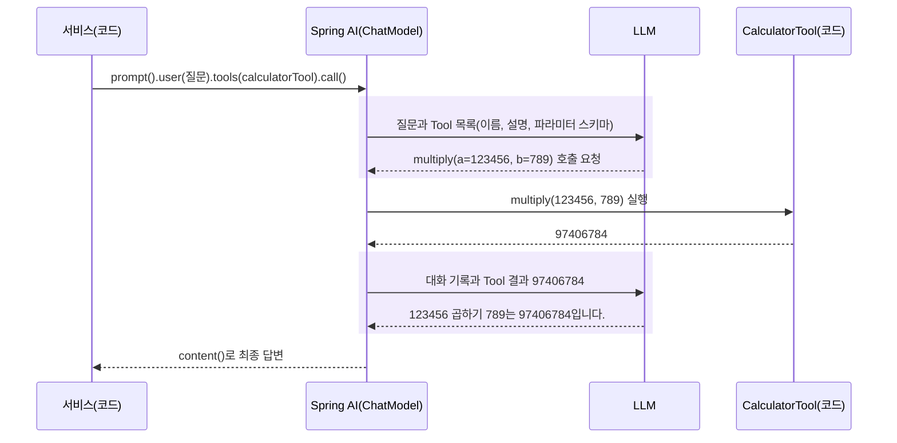
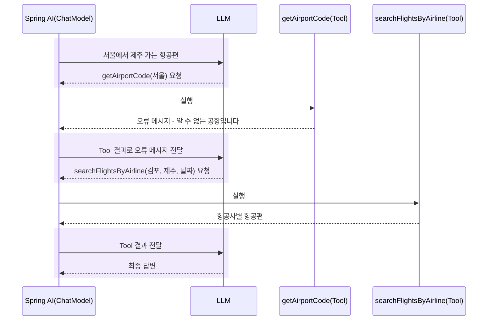

# 4장 Tool Calling의 원리

"123456 곱하기 789는?" 이 질문을 작은 LLM에 몇 번 보내 보면 답이 그때그때 다릅니다. LLM은 계산기가 아니라, 앞 글자에 이어질 그럴듯한 글자를 고르는 모델이기 때문입니다([1장](01-llm-and-spring-ai.md)). "내일 광주에서 제주 가는 항공편"은 더 어렵습니다. 내일의 운항 정보는 LLM이 학습한 데이터 어디에도 없습니다.

해법은 정확해야 하는 일을 코드에 맡기는 것입니다. 다만 이번에는 **어떤 코드를 언제 부를지를 LLM이 정합니다**. 이 책의 질문 "다음 단계를 누가 결정하는가"에서, 결정권이 처음으로 LLM 쪽으로 넘어가는 장치가 **Tool Calling**입니다. 이 장에서는 그 장치가 어떻게 움직이는지 계산기 Tool로 확인합니다.

## LLM은 요청하고, Spring AI가 실행한다

**Tool Calling**(Function Calling이라고도 합니다)은 LLM이 질문을 보고 "이 메서드를 이 인자로 불러 달라"고 **요청**하면, 애플리케이션이 그 메서드를 **실행**해 결과를 LLM에게 돌려주는 방식입니다. LLM이 부를 수 있게 공개한 메서드를 **Tool**이라고 부릅니다.

가장 중요한 사실은 LLM이 코드를 실행하지 않는다는 것입니다. LLM이 돌려주는 것은 Tool 이름과 인자가 담긴 JSON뿐입니다. 실행은 언제나 우리 JVM 안에서, 우리가 공개한 메서드로만 일어납니다.

| 주체 | 하는 일 | 하지 않는 일 |
|---|---|---|
| LLM | 의도 파악, Tool과 인자 선택, Tool 결과를 보고 답변 작성 | 코드 실행 |
| Spring AI | Tool 목록을 JSON 스키마로 만들어 보내기, 요청받은 Tool 실행, 결과를 다시 보내기 | 어떤 Tool을 쓸지 결정 |
| 우리 코드(Tool) | 계산, API 조회처럼 정확해야 하는 일 | 자연어 해석 |

한 번의 `call()` 안에서 일어나는 일을 순서대로 그리면 다음과 같습니다.



그림 읽기: 칠한 두 구간이 LLM과의 왕복입니다. 코드가 `call()`을 **한 번** 불렀지만 모델과는 **두 번** 오갔습니다. 첫 왕복에서 LLM은 답 대신 Tool 호출 요청을 보냈고, 실제 곱셈은 그 사이에 우리 코드가 했습니다.

> **생각해 보기**: LLM이 Tool을 두 번, 세 번 연달아 요청하면 왕복도 그만큼 늘어납니다. 그 횟수는 누가 정할까요? 응답 시간을 미리 알 수 있을까요?

## 계산기 Tool 만들기

LLM에게 "이런 메서드가 있고, 이럴 때 쓰고, 이런 인자를 받는다"고 알려 주는 것이 `@Tool`과 `@ToolParam`입니다. 결과가 분명한 계산기로 시작합니다. 다음 파일은 실습용이며 프로젝트에 들어 있지 않습니다. 프로젝트 코드와 섞이지 않도록 `practice` 패키지에 만들고, 실습이 끝나면 지웁니다.

파일(직접 만들기): `src/main/java/net/java21/flyschedule/practice/CalculatorTool.java`

```java
package net.java21.flyschedule.practice;

import lombok.extern.slf4j.Slf4j;
import org.springframework.ai.tool.annotation.Tool;
import org.springframework.ai.tool.annotation.ToolParam;
import org.springframework.stereotype.Component;

@Slf4j
@Component
public class CalculatorTool {

    @Tool(description = "두 정수의 합을 계산합니다. 덧셈이 필요할 때 사용합니다.")
    public long add(@ToolParam(description = "첫 번째 정수") long a,
                    @ToolParam(description = "두 번째 정수") long b) {
        log.info("Tool 실행: {} + {} = {}", a, b, a + b);
        return a + b;
    }

    @Tool(description = "두 정수의 곱을 계산합니다. 곱셈이 필요할 때 사용합니다.")
    public long multiply(@ToolParam(description = "첫 번째 정수") long a,
                         @ToolParam(description = "두 번째 정수") long b) {
        log.info("Tool 실행: {} * {} = {}", a, b, a * b);
        return a * b;
    }
}
```

코드 읽기

- `@Component`는 서비스에서 주입받기 위한 것입니다. Spring AI가 빈 안의 `@Tool` 메서드를 알아서 찾아 쓰지는 않습니다. ChatClient에 직접 넘겨야 합니다(다음 절).
- `@Tool`의 `description`은 LLM이 "언제 이 Tool을 쓸지" 정할 때 읽는 유일한 설명입니다. 하는 일과 쓰는 때를 함께 적습니다.
- `@ToolParam`의 `description`은 LLM이 문장에서 값을 뽑아 인자에 넣을 때 참고합니다.
- 메서드 본문은 평범한 자바 코드입니다. 반환값은 JSON 문자열로 바뀌어 LLM에게 전달됩니다.

Spring AI 1.1.4에서 두 어노테이션의 속성은 다음이 전부입니다.

| 어노테이션 | 속성 | 기본값 | 뜻 |
|---|---|---|---|
| `@Tool` | `name` | `""` (메서드 이름을 씀) | LLM에게 보이는 Tool 이름 |
| `@Tool` | `description` | `""` (메서드 이름으로 만든 문장을 씀) | 하는 일과 쓰는 때 |
| `@Tool` | `returnDirect` | `false` | `true`면 Tool 결과를 LLM에게 돌려보내지 않고 그대로 최종 응답으로 반환 |
| `@Tool` | `resultConverter` | `DefaultToolCallResultConverter` | 반환값을 LLM에게 보낼 문자열로 바꾸는 방법 |
| `@ToolParam` | `description` | `""` | 파라미터의 의미, 형식, 예시 |
| `@ToolParam` | `required` | `true` | `false`면 LLM이 값을 비워도 되는 선택 파라미터 |

Spring AI는 이 정보로 Tool 정의를 만들어 LLM API에 보냅니다. `multiply`는 대략 다음과 같이 전달됩니다.

```json
{
  "name": "multiply",
  "description": "두 정수의 곱을 계산합니다. 곱셈이 필요할 때 사용합니다.",
  "parameters": {
    "type": "object",
    "properties": {
      "a": { "type": "integer", "format": "int64", "description": "첫 번째 정수" },
      "b": { "type": "integer", "format": "int64", "description": "두 번째 정수" }
    },
    "required": ["a", "b"]
  }
}
```

[2장](02-chatclient.md)의 Structured Output이 `@JsonPropertyDescription`으로 **응답**의 JSON 스키마를 설명했다면, Tool Calling은 `@ToolParam`으로 **입력**의 JSON 스키마를 설명합니다. 두 기능은 "LLM에게 스키마를 보여 주고, 그 형식에 맞는 JSON을 받는다"는 같은 원리 위에 있습니다.

## Tool을 넘기는 두 방법

`@Tool` 메서드를 만들어도 ChatClient가 모르면 LLM에게 알릴 수 없습니다. Tool을 넘기는 자리는 두 곳입니다.

| 방법 | 코드 | Tool 목록이 붙는 범위 |
|---|---|---|
| 기본값으로 등록 | `ChatClient.builder(model).defaultTools(...)` | 이 ChatClient로 보내는 모든 요청 |
| 요청마다 전달 | `chatClient.prompt()...tools(...)` | `.tools(...)`를 붙인 그 요청만 |

이 프로젝트는 요청마다 넘깁니다. Tool을 쓰는 곳은 Tool Calling Agent 한 곳뿐입니다.

파일: `src/main/java/net/java21/flyschedule/service/toolcalling/ToolCallingSearchService.java` (일부)

```java
String answer = chatClientProvider.get(model).prompt()
        .system(systemPrompt())
        .user(message)
        .tools(flightSearchTool, airportInfoTool, airlineInfoTool)
        .call()
        .content();
```

코드 읽기: `.tools(...)`에는 `@Tool` 메서드를 가진 **객체**를 넘깁니다. 세 객체에 든 Tool 7개가 이 요청에만 붙습니다. `.call()` 안에서 앞 그림의 왕복이 필요한 만큼 반복되고, `.content()`는 마지막 답변만 돌려줍니다. Tool 7개의 설계는 [5장](05-domain-tools.md), 이 서비스 전체는 [8장](08-tool-calling-agent.md)에서 읽습니다.

같은 ChatClient를 Tool이 필요 없는 곳에서도 쓰기 때문에 이렇게 합니다.

| LLM 호출 위치 | 하는 일 | Tool 필요 |
|---|---|---|
| `SearchCriteriaExtractor` | 문장에서 검색 조건 추출(`.entity`) | 아니요 |
| `FlightSearchPlanner` | 요청을 검색 작업으로 나누기(`.entity`) | 아니요 |
| `ResultSynthesizer` | 작업별 결과 요약(`.content`) | 아니요 |
| `ToolCallingSearchService` | LLM이 Tool을 골라 항공편 검색 | 예 |

`defaultTools`로 등록했다면 위의 세 호출에도 Tool 목록이 붙습니다. 검색 조건만 뽑아야 할 LLM이 직접 `searchFlightsByAirline`을 부르는 의도하지 않은 호출이 생길 수 있고, Tool 설명만큼 프롬프트가 길어져 작은 모델의 컨텍스트(`num-ctx: 4096`)를 잡아먹습니다. 요청마다 넘기면 **어느 호출이 Tool을 쓸 수 있는지가 코드에 드러납니다**.

> **팁**: 같은 Tool 묶음을 여러 곳에서 쓴다면 `MethodToolCallbackProvider.builder().toolObjects(...).build()`로 `ToolCallbackProvider`를 만들어 두고 `.toolCallbacks(provider)`로 넘길 수 있습니다. 이 프로젝트는 쓰는 곳이 한 곳이라 객체를 바로 넘깁니다.

> **직접 확인하기**
>
> ```bash
> ./mvnw test -Dtest=ToolCallingSearchServiceTest#passesToolsPerRequest
> ```
>
> 기대 결과: `Tests run: 1, Failures: 0`. 이 테스트는 가짜 ChatClient로 `search()`를 실행한 뒤, 요청에 `tools(...)`가 Tool 객체 세 개로 호출되었는지(`verify(requestSpec).tools(any(), any(), any())`)와 system 프롬프트에 오늘 날짜가 들어갔는지 검증합니다. 진짜 LLM 없이 Tool Calling 코드를 테스트하는 방법은 10장에서 정리합니다.

## 실습: LLM이 계산기를 부르게 하기

계산기 Tool을 요청마다 넘기는 서비스와, curl로 부를 컨트롤러를 만듭니다. 두 파일 모두 실습용입니다.

파일(직접 만들기): `src/main/java/net/java21/flyschedule/practice/FunctionCallTestService.java`

```java
package net.java21.flyschedule.practice;

import org.springframework.ai.chat.client.ChatClient;
import org.springframework.beans.factory.annotation.Qualifier;
import org.springframework.stereotype.Service;

@Service
public class FunctionCallTestService {

    private final ChatClient chatClient;
    private final CalculatorTool calculatorTool;

    public FunctionCallTestService(@Qualifier("ollamaChatClient") ChatClient chatClient,
                                   CalculatorTool calculatorTool) {
        this.chatClient = chatClient;
        this.calculatorTool = calculatorTool;
    }

    public String ask(String message) {
        return chatClient.prompt()
                .user(message)
                .tools(calculatorTool) // 이 요청에만 Tool 전달
                .call()
                .content();
    }
}
```

파일(직접 만들기): `src/main/java/net/java21/flyschedule/practice/FunctionCallTestController.java`

```java
package net.java21.flyschedule.practice;

import lombok.RequiredArgsConstructor;
import org.springframework.web.bind.annotation.GetMapping;
import org.springframework.web.bind.annotation.RequestParam;
import org.springframework.web.bind.annotation.RestController;

@RestController
@RequiredArgsConstructor
public class FunctionCallTestController {

    private final FunctionCallTestService testService;

    @GetMapping("/api/test/function-calling")
    public String ask(@RequestParam String message) {
        return testService.ask(message);
    }
}
```

코드 읽기: 2장의 LLM 호출과 달라진 것은 `.tools(calculatorTool)` 한 줄뿐입니다. 그 한 줄로 요청에 Tool 목록이 붙고, 나머지 왕복은 Spring AI가 처리합니다.

Spring AI가 Tool을 실행하는 순간은 `org.springframework.ai.model.tool` 패키지의 DEBUG 로그로 볼 수 있습니다.

> **직접 확인하기**
>
> ```bash
> ./mvnw spring-boot:run \
>   -Dspring-boot.run.arguments=--logging.level.org.springframework.ai.model.tool=DEBUG
> ```
>
> ```bash
> curl -G "http://localhost:8080/api/test/function-calling" \
>   --data-urlencode "message=123456 곱하기 789는?"
> ```
>
> 기대 결과: 응답 문장에 `97406784`가 들어 있고, 콘솔에 다음 두 줄이 차례로 찍힙니다(날짜 생략).
>
> ```text
> [http-nio-8080-exec-1] DEBUG o.s.a.m.t.DefaultToolCallingManager - Executing tool call: multiply
> [http-nio-8080-exec-1] INFO  n.j.f.practice.CalculatorTool - Tool 실행: 123456 * 789 = 97406784
> ```
>
> 로그 없이 다른 숫자가 나왔다면 LLM이 Tool을 건너뛰고 스스로 계산한 것입니다. 같은 질문을 몇 번 더 보내 보세요.

> **주의**: 작은 모델(이 프로젝트의 기본 Ollama 모델 `qwen2.5:3b-instruct-q4_K_M`)은 Tool을 부르지 않고 답을 지어내거나 인자를 잘못 뽑기도 합니다. temperature가 `0.0`이어도 Tool을 부를지 말지는 질문 문장에 따라 달라질 수 있습니다. Tool Calling의 품질은 모델 능력에 크게 좌우됩니다.

## Spring AI 안에서 일어나는 일

3장에서 Tool 루프가 `ChatModel` 안에서 돈다고 했습니다. 조금 더 들어가 봅시다. Spring AI 1.1.4의 `OllamaChatModel`은 LLM 응답을 받으면 다음을 반복합니다.

1. 응답에 Tool 호출 요청(`AssistantMessage.getToolCalls()`)이 있는지 봅니다.
2. 있으면 `ToolCallingManager.executeToolCalls(prompt, chatResponse)`로 요청받은 Tool을 실행합니다. 기본 구현은 `DefaultToolCallingManager`이며, 앞에서 본 `Executing tool call` 로그가 여기서 나옵니다.
3. 실행 결과가 담긴 대화 기록(`ToolExecutionResult.conversationHistory()`)으로 새 프롬프트를 만들어 LLM을 **다시** 부릅니다.
4. 응답에 Tool 호출 요청이 없으면 그것이 최종 답변입니다. Tool이 `returnDirect = true`였다면 3번을 건너뛰고 Tool 결과를 그대로 돌려줍니다.

LLM이 앞 Tool의 결과를 보고 다음 Tool을 고르면 이 반복이 여러 번 일어납니다. 항공편 검색에서 실제로 볼 수 있는 모양입니다.



그림 읽기: 모델 왕복이 세 번입니다. 둘째 왕복에서 LLM은 Tool의 오류 메시지를 읽고 스스로 방향을 바꿨습니다. 이 그림은 `ToolCallingSearchServiceTest`의 `failedToolIsRecorded`가 가정하는 시나리오와 같습니다. 실제 LLM이 언제나 이렇게 영리하게 움직인다는 보장은 없습니다.

Tool이 예외를 던지면 어떻게 될까요? Spring AI 1.1.4의 기본값 `spring.ai.tools.throw-exception-on-error: false`에서는 예외가 호출한 쪽으로 터지지 않고, 예외 메시지가 Tool 결과로 LLM에게 전달됩니다. 위 그림의 둘째 왕복이 그 경우입니다. `true`로 바꾸면 예외가 `call()` 밖으로 던져져 코드가 직접 처리하게 됩니다.

> **생각해 보기**: 그림에서 "서울이면 김포로 검색한다"는 결정을 내린 것은 코드가 아니라 LLM입니다. 같은 일을 Coordinator 패턴(7장)에서는 누가, 어디서 결정할까요?

## 동기 실행과 스레드

Tool이 **어느 스레드에서, 어떤 순서로** 실행되는지는 뒤에서 중요해집니다. Spring AI 1.1.4의 `call()`에서는 다음이 성립합니다.

- Tool은 `call()`을 부른 스레드에서 실행됩니다. 컨트롤러에서 불렀다면 그 요청을 처리하는 Tomcat 스레드(`http-nio-8080-exec-N`)입니다. 앞의 직접 확인하기 로그에서 두 줄의 스레드 이름이 같았던 이유입니다.
- LLM이 한 응답에서 Tool 여러 개를 함께 요청해도 `DefaultToolCallingManager`는 그것을 **차례로** 실행한 뒤 결과를 한꺼번에 돌려보냅니다. Tool 실행을 병렬로 바꿔 주지 않습니다.
- `call()`은 모든 왕복이 끝날 때까지 돌아오지 않습니다. 모델 왕복 한 번에 수십 초가 걸리는 원격 3B 모델에서는 `call()` 하나가 1분을 넘길 수 있습니다.

이 세 가지에서 이 책의 설계 몇 가지가 나옵니다.

| 성질 | 이 프로젝트에서 이어지는 곳 |
|---|---|
| 같은 스레드에서 실행 | Tool 호출을 `ThreadLocal`에 기록하는 `ToolResultCapture`가 동작함([5장](05-domain-tools.md)). `stream()`은 다른 스레드에서 Tool을 실행하므로 이 방식을 쓸 수 없음 |
| 차례로 실행 | 여러 검색을 동시에 돌리려면 LLM에 맡기지 않고 코드가 가상 스레드로 나눔([9장](09-orchestrator-workers.md)) |
| 끝날 때까지 블로킹 | 프록시 60초 제한을 피하려고 작업(job) API로 실행하고 진행 상황을 조회함([10장](10-choosing-testing-operating.md)) |

> **직접 확인하기**: 계산기 실습에서 "10과 20을 더한 값과, 3과 4를 곱한 값을 알려 줘"를 보냅니다. 기대 결과: 모델이 두 Tool을 함께 요청하면 `Executing tool call: add`와 `Executing tool call: multiply`가 같은 스레드 이름으로 차례로 찍힙니다. 모델에 따라 한 번에 하나씩 요청해 왕복이 늘어나기도 합니다. 어느 쪽이었는지 로그 순서로 판단해 보세요.

## 비용과 결정성

Tool Calling을 쓰면 코드에서 LLM 호출은 `call()` 한 번이지만, 모델 왕복은 **Tool을 한 번만 불러도 최소 두 번**입니다. Tool을 몇 번 부를지, 어떤 순서로 부를지는 LLM이 정하므로 응답 시간과 토큰 비용을 미리 정확히 알 수 없습니다. 같은 질문에 Tool을 부를 때도 있고 안 부를 때도 있습니다.

반대로 처리 순서가 항상 같은 일이라면 Tool Calling은 과합니다. 입력 형식이 정해져 있고 단계가 고정되어 있다면 코드가 순서를 정하는 편이 빠르고 결과도 늘 같습니다. 이 저울질이 7장부터 비교할 세 패턴의 핵심입니다.

| | 코드가 순서를 정함 | LLM이 Tool을 고름 |
|---|---|---|
| 알맞은 경우 | 단계가 고정됨, 응답 속도·비용이 중요함 | 질문마다 필요한 작업이 다름, 문장 형태가 다양함 |
| 모델 왕복 | 0회 또는 정해진 횟수 | 최소 2회, 실행할 때마다 달라질 수 있음 |
| 같은 입력에 같은 결과 | 예 | 보장되지 않음 |

## 핵심 정리

- Tool Calling에서 LLM은 Tool 이름과 인자를 **요청**할 뿐이고, 실행은 Spring AI가 우리 JVM에서 합니다.
- `@Tool`(name, description, returnDirect, resultConverter)과 `@ToolParam`(description, required)이 Tool 정의의 JSON 스키마가 됩니다. 설명의 품질이 Tool 선택과 인자의 정확도를 좌우합니다.
- 이 프로젝트는 `defaultTools` 대신 요청마다 `.tools(...)`를 넘겨, Tool이 필요한 호출을 코드에 드러냅니다.
- `call()` 한 번 안에서 `ToolCallingManager`가 Tool을 실행하고 LLM을 다시 부르는 일이 반복됩니다. Tool은 호출한 스레드에서 차례로 실행됩니다.
- Tool 예외는 기본 설정에서 메시지로 바뀌어 LLM에게 전달됩니다.

## 연습 문제

**1. [기본] Tool이 있을 때와 없을 때**
`FunctionCallTestService`에 `.tools(...)`를 뺀 `askWithoutTools()`를 추가하고 엔드포인트를 하나 더 만듭니다. "123456 곱하기 789는?"을 두 엔드포인트에 다섯 번씩 보냅니다.
- 힌트: 정답은 97406784입니다. Tool 실행 여부는 `Executing tool call: multiply` 로그로 판단합니다.
- 완료 기준: 두 방식의 정답 횟수를 표로 정리하고, Tool을 쓴 요청마다 실행 로그가 찍혔는지 함께 적는다.

**2. [기본] description이 선택을 바꾼다**
`multiply`의 description을 `"계산합니다."`로, `add`도 `"계산합니다."`로 바꾸고 같은 곱셈 질문을 다시 보냅니다.
- 힌트: LLM은 Tool을 고를 때 이름과 description만 봅니다. `FlightSearchTool`의 세 검색 Tool이 description으로 서로를 어떻게 구분하는지도 읽어 보세요(`src/main/java/net/java21/flyschedule/mcp/FlightSearchTool.java`).
- 완료 기준: 엉뚱한 Tool을 고르거나 Tool을 건너뛴 사례가 있었는지 로그로 확인하고, 좋은 description의 조건을 두 가지 적는다. 실험 뒤 되돌린다.

**3. [도전] returnDirect 실험**
`CalculatorTool`에 `@Tool(description = "앞의 정수에서 뒤의 정수를 뺍니다.", returnDirect = true)`인 `subtract`를 추가하고 "50에서 8을 빼 줘"를 보냅니다.
- 힌트: `returnDirect = true`면 Tool 결과를 LLM에게 돌려보내는 왕복이 없습니다. `TimingAdvisor`(3장)를 함께 켜면 시간 차이도 보입니다.
- 완료 기준: 응답이 문장이 아니라 Tool 반환값 `42` 그대로 오는 것을 확인하고, 이 옵션이 어울리는 상황을 한 가지 적는다.

**4. [도전] 선택 파라미터와 required**
`FlightSearchTool.searchFlightsByPriceRange`의 `minPrice`, `maxPrice`는 description에 "선택사항"이라고 적혀 있지만 `@ToolParam`에 `required`를 지정하지 않았습니다.
- 힌트: `@ToolParam.required`의 기본값은 `true`입니다. 계산기에 `@ToolParam(description = "...", required = false) Long c` 같은 파라미터를 추가해 Tool 정의가 어떻게 달라지는지 비교해 봅니다.
- 완료 기준: 지금 코드에서 두 파라미터가 LLM에게 필수로 전달된다는 것을 설명하고, "선택"을 스키마에 정확히 반영하려면 무엇을 바꿔야 하는지 한 문장으로 쓴다(src는 고치지 않는다).

계산기는 원리를 보기 위한 장난감이었습니다. 다음 장에서는 공공데이터 포털의 실제 운항 정보로 항공편 검색 Tool 7개를 만들고, Tool을 어떻게 설계해야 작은 LLM도 잘 쓰는지 살펴봅니다. [5장 항공편 도메인 Tool 만들기](05-domain-tools.md)
