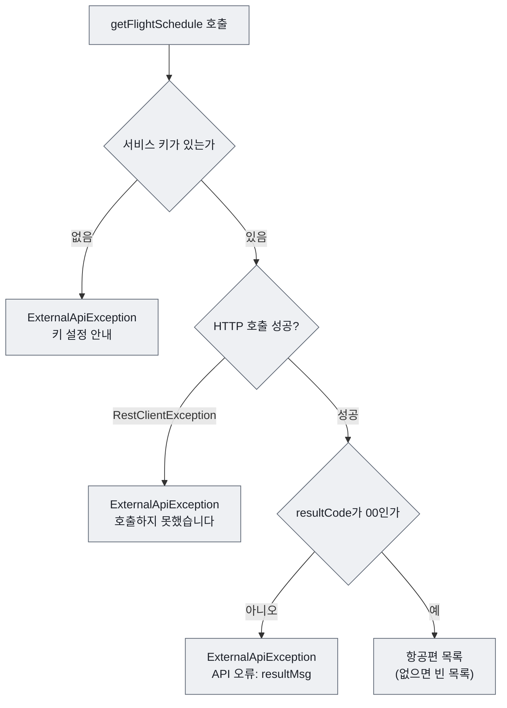
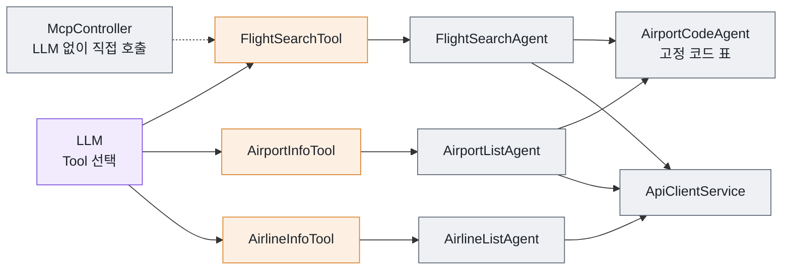
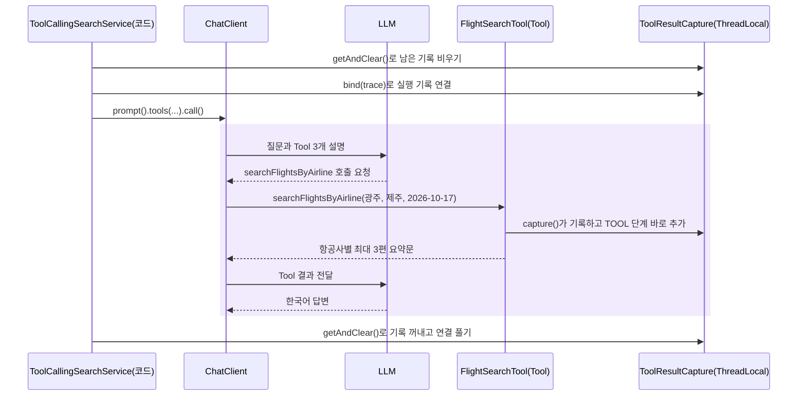

# 5장 항공편 도메인 Tool 만들기

4장의 계산기 Tool은 실패할 일이 거의 없었습니다. 숫자 두 개를 받아 더하면 끝이었습니다. 이번에는 사정이 다릅니다. 사용자가 "내일 김포에서 제주 가는 항공편"이라고 말하면 LLM은 `"김포"`, `"제주"`, `"2026-10-17"` 정도를 Tool에 넘겨 줍니다. 그런데 공공데이터 포털 API가 받는 값은 `NAARKSS`, `NAARKPC`, `20261017`입니다. 그 사이를 메우고, 네트워크가 끊기거나 서비스 키가 틀렸을 때도 거짓말하지 않는 Tool을 만들어야 합니다.

이 책의 질문 "다음 단계를 누가 결정하는가"로 보면, 이 장은 **LLM이 고를 선택지를 코드로 만드는 장**입니다. 8장의 Tool Calling Agent에서는 LLM이 어떤 Tool을 부를지 정합니다. 하지만 Tool 안에서 일어나는 일, 곧 공항 코드 변환, API 호출, 결과 줄이기, 실패 알리기는 모두 코드가 결정합니다. Tool을 잘 만들수록 LLM이 결정할 부분은 작고 분명해집니다.

이 장에서 다루는 순서는 다음과 같습니다.

1. 공공데이터 포털 국내항공운항정보 API를 직접 호출해 응답 모양을 봅니다.
2. `ApiClientService`로 API를 부르고, 실패를 `ExternalApiException`으로 알립니다.
3. Tool 7개의 구조와 설계 원칙을 살펴보고, LLM에게 넘기는 결과를 짧게 바꾸는 `CompactFlightResultConverter`를 만듭니다.
4. `ToolResultCapture`로 Tool 호출을 기록합니다.
5. `McpController`로 LLM 없이 Tool을 직접 호출해 확인합니다.

> **주의**
> 이 프로젝트의 `mcp` 패키지에 있는 "MCP Tool"은 MCP 서버가 아닙니다. MCP(Model Context Protocol)는 Agent와 Tool·데이터를 잇는 표준 프로토콜이고, 이 프로젝트의 Tool은 Spring AI `@Tool`로 만든 평범한 Spring Bean입니다. 같은 애플리케이션 안에서 `ChatClient`가 직접 호출하며, 나중에 MCP 서버로 노출하기 쉬운 형태로 나누어 두었다는 뜻일 뿐입니다. MCP 서버로 확장하는 방법은 [10장](10-choosing-testing-operating.md)에서 개념만 소개합니다.

---

## 5.1 공공데이터 포털 국내항공운항정보 API

### 오퍼레이션 세 개

이 프로젝트는 공공데이터 포털의 [국내항공운항정보 API](https://www.data.go.kr/data/15098526/openapi.do)를 씁니다. 기본 URL은 `application.yml`의 `data-go-kr.api.url`에 있습니다.

```yaml
# 공공데이터 포털 API 설정
data-go-kr:
  api:
    url: https://apis.data.go.kr/1613000/DmstcFlightNvgInfo
    service-key: ${DATA_GO_KR_SERVICE_KEY:}
```

`src/main/resources/application.yml` (일부)

서비스 키는 환경 변수 `DATA_GO_KR_SERVICE_KEY`로 넣습니다. 값이 없으면 빈 문자열이 들어가고, 애플리케이션은 그대로 시작됩니다. 키가 없다는 사실은 API를 부르는 순간 알립니다(5.2절). 이 값은 `config/DataGoKrApiProperties`(`@ConfigurationProperties(prefix = "data-go-kr.api")`)의 `url`, `serviceKey` 필드로 들어갑니다.

| 오퍼레이션 | 하는 일 | 주요 요청 파라미터 | 이 프로젝트의 메서드 |
|---|---|---|---|
| `/GetFlightOpratInfoList` | 항공편 운항 정보 | `depAirportId`, `arrAirportId`, `depPlandTime`(YYYYMMDD), `numOfRows`, `pageNo`, `_type=json` | `ApiClientService.getFlightSchedule()` |
| `/GetArprtList` | 공항 목록 | 없음(JSON이 기본) | `ApiClientService.getAirportList()` |
| `/GetAirmanList` | 항공사 목록 | `_type=json` | `ApiClientService.getAirlineList()` |

API는 공항 이름이 아니라 공항 코드를, 날짜는 `YYYYMMDD` 형식만 받습니다. 사용자 말을 이 형식으로 바꾸는 일은 6장의 전문 Agent(`AirportCodeAgent`, `DateParserAgent`)가 맡습니다.

### 공항 코드 표

공항 코드는 공항 목록 오퍼레이션(`GetArprtList`)이 돌려주는 공식 코드입니다. 3자리 IATA 코드(`GMP`, `CJU`)가 아니라 `NAARK` + 2글자 형식입니다. 프로젝트는 이 중 국내선 15개 공항을 `AirportCodeAgent`에 등록해 두었습니다.

| 권역 | 공항(등록된 이름) | 코드 |
|---|---|---|
| 수도권 | 김포 | `NAARKSS` |
| 수도권 | 인천 | `NAARKSI` |
| 부산/경남권 | 김해, 부산 | `NAARKPK` |
| 부산/경남권 | 사천 | `NAARKPS` |
| 부산/경남권 | 울산 | `NAARKPU` |
| 호남권 | 광주 | `NAARKJJ` |
| 호남권 | 여수 | `NAARKJY` |
| 호남권 | 무안 | `NAARKJB` |
| 호남권 | 군산 | `NAARKJK` |
| 영남권 | 대구 | `NAARKTN` |
| 영남권 | 포항, 포항경주 | `NAARKTH` |
| 충청/강원권 | 청주 | `NAARKTU` |
| 충청/강원권 | 양양 | `NAARKNY` |
| 충청/강원권 | 원주 | `NAARKNW` |
| 제주권 | 제주 | `NAARKPC` |

`AirportCodeAgent`는 이름마다 "광주", "광주공항", "광주국제공항" 세 가지를 같은 코드로 등록합니다. 이 표를 코드로 어떻게 관리하는지는 [6장](06-specialized-agents.md)에서 봅니다.

> **주의**
> 잘못된 공항 코드를 보내도 API는 오류 없이 빈 목록을 돌려줍니다. 그래서 공항 코드는 추측하지 않고 표에 있는 것만 씁니다. 표에 없는 이름은 `AirportCodeAgent`가 `IllegalArgumentException`("알 수 없는 공항입니다: ...")으로 거절합니다.

### 응답 구조와 DTO

항공편 오퍼레이션의 응답은 여러 겹으로 감싸여 있습니다.

```json
{
  "response": {
    "header": { "resultCode": "00", "resultMsg": "NORMAL SERVICE." },
    "body": {
      "items": { "item": [
        { "vihicleId": "7C125", "airlineNm": "제주항공", "depPlandTime": 202610161425,
          "arrPlandTime": 202610161535, "economyCharge": 51400, "depAirportNm": "김포", "arrAirportNm": "제주" }
      ] },
      "numOfRows": 500, "pageNo": 1, "totalCount": 1
    }
  }
}
```

(테스트 `ApiClientServiceTest`가 쓰는 응답 예시입니다. 실제 값은 날짜마다 다릅니다.)

`dto/response/ApiResponseWrapper`는 이 구조를 내부 클래스(`Response`, `Header`, `Body`, `Items`)로 그대로 옮기고, `getResultCode()`, `getResultMessage()`, `getTotalCount()`, `getItems()` 편의 메서드로 깊은 경로를 한 번에 꺼냅니다. 중간 값이 `null`이어도 `NullPointerException`이 나지 않습니다. 항공편 한 건은 `FlightInfoResponse`에 담깁니다.

```java
public class FlightInfoResponse {

    /**
     * 항공편명 (예: OZ8141)
     */
    @JsonProperty("vihicleId")
    private String flightId;

    /**
     * 항공사명 (예: 아시아나항공)
     */
    @JsonProperty("airlineNm")
    private String airlineName;

    /**
     * 출발시간 (예: 202503090955)
     */
    @JsonProperty("depPlandTime")
    private String departureTime;
    // ...
}
```

`src/main/java/net/java21/flyschedule/dto/response/FlightInfoResponse.java` (일부)

**코드 읽기**

- `@JsonProperty("vihicleId")`: API 필드 이름의 철자는 `vehicle`이 아니라 `vihicle`입니다. Java 쪽에는 `flightId`라는 읽기 쉬운 이름을 붙입니다.
- `departureTime`은 `YYYYMMDDHHmm` 문자열입니다. API는 숫자로 보내지만 Jackson이 `String` 필드에 맞춰 바꿉니다.
- `@JsonProperty`는 읽을 때와 쓸 때 모두 적용됩니다. 그래서 이 객체를 그대로 JSON으로 내보내면 필드 이름은 `flightId`가 아니라 `vihicleId`입니다(5.6절에서 확인).
- 나머지 필드는 `arrivalTime`(`arrPlandTime`), `economyCharge`, `prestigeCharge`, `departureAirport`(`depAirportNm`), `arrivalAirport`(`arrAirportNm`), `airlineId`입니다. 공항·항공사 목록은 `AirportInfoResponse`(`airportId`, `airportNm`, `region`)와 `AirlineInfoResponse`(`airlineId`, `airlineNm`)에 담깁니다.

### docs/api-test로 API 직접 불러 보기

코드를 보기 전에 API를 직접 불러 응답을 눈으로 확인합니다. `docs/api-test`에는 IntelliJ IDEA HTTP Client용 파일이 있습니다.

| 파일 | 내용 |
|---|---|
| `http-client.env.json` | 공개해도 되는 값(`baseUrl`, `appUrl`) |
| `http-client.private.env.json` | 서비스 키. 직접 만들며 `.gitignore`에 등록되어 있어 커밋되지 않습니다 |
| `01-항공편-조회.http` | 전국 공항 → 제주 노선 항공편 조회 |
| `02-공항-목록.http` | 공항 목록 조회 |
| `03-항공사-목록.http` | 항공사 목록 조회 |
| `04-패턴-비교.http` | 로컬 애플리케이션의 세 패턴 검색 API 호출(7~9장에서 사용) |

먼저 `docs/api-test/http-client.private.env.json`을 만들어 서비스 키를 적습니다.

```json
{
  "dev": {
    "serviceKey": "발급받은_서비스_키"
  }
}
```

그다음 `.http` 파일을 열고 에디터 오른쪽 위에서 환경을 `dev`로 고른 뒤, 요청 왼쪽의 실행 버튼을 누릅니다. `01-항공편-조회.http`는 파일 위쪽의 `@depPlandTime` 값을 오늘 이후 날짜로 바꾸고 실행합니다.

IntelliJ를 쓰지 않는다면 curl로도 됩니다.

```bash
curl "https://apis.data.go.kr/1613000/DmstcFlightNvgInfo/GetFlightOpratInfoList?serviceKey=$DATA_GO_KR_SERVICE_KEY&pageNo=1&numOfRows=10&_type=json&depAirportId=NAARKSS&arrAirportId=NAARKPC&depPlandTime=20261017"
```

> **직접 확인하기**
> `01-항공편-조회.http`의 "김포 → 제주" 요청을 실행합니다.
> 기대 결과: `response.header.resultCode`가 `"00"`입니다. `body.items.item`에는 10건만 있지만 `body.totalCount`는 100이 넘습니다. 서비스 키가 틀리면 `resultCode`가 `"00"`이 아닌 값과 오류 메시지가 옵니다.

### numOfRows 함정: 하루 118편

방금 본 결과가 이 절의 핵심입니다. 이 API는 페이지 단위로 응답합니다. `numOfRows`를 10으로 주면 `totalCount`가 아무리 커도 10건만 옵니다. 오류도 경고도 없습니다.

김포→제주는 국내에서 가장 붐비는 노선입니다. 2026년 10월에 실제로 조회했을 때 하루 **118편**이었습니다. 흔히 쓰는 값인 `numOfRows=100`으로 첫 페이지만 받으면 18편이 소리 없이 잘립니다. 잘린 항공편을 찾는 질문, 예를 들어 늦은 시간 출발편을 물으면 "항공편이 없다"는 틀린 답이 나옵니다. 오류가 없으니 로그만 봐서는 알아차리기도 어렵습니다.

| `numOfRows` | 김포→제주(118편)에서 받는 건수 | 결과 |
|---|---|---|
| 10 | 10 | 응답 앞쪽 10건만 보임 |
| 100 | 100 | 18편이 사라짐 |
| 500 (`MAX_ROWS`) | 118 | 모두 받음 |

해결책은 두 가지입니다. 모든 페이지를 차례로 받거나, 한 노선의 하루 운항 편수보다 넉넉한 값을 한 번에 요청하는 것입니다. 국내선 한 노선이 하루 500편을 넘을 일은 없으므로, 이 프로젝트는 단순한 쪽을 택해 `MAX_ROWS = 500`으로 한 번에 받습니다.

> **생각해 보기**
> 응답의 `totalCount`가 받은 건수보다 크면 데이터가 잘렸다는 뜻입니다. 이 사실을 로그로 경고하거나, 다음 페이지를 이어서 받으려면 `getFlightSchedule()`의 어디를 고치면 될까요?

---

## 5.2 ApiClientService — API를 부르고 실패를 알린다

### RestClient.Builder를 주입받는 이유

`ApiClientService`는 Spring Framework 6.1의 동기식 HTTP 클라이언트 `RestClient`로 API를 부릅니다. `RestClient`를 얻는 방법은 두 가지인데, 결과가 다릅니다.

| 방법 | 설정 적용 | 테스트 |
|---|---|---|
| `RestClient.create()` | Spring Boot 설정을 쓰지 않음. 타임아웃 등은 기본값 | 가짜 서버를 끼워 넣기 어려움 |
| Spring Boot가 만든 `RestClient.Builder`를 주입받아 `build()` | `spring.http.client.*` 설정이 적용됨 | `MockRestServiceServer.bindTo(builder)`로 가짜 서버 연결 가능 |

`application.yml`에는 `spring.http.client.read-timeout: 300s`가 있습니다. Builder를 주입받아야 이 값이 공공데이터 포털 호출에도 적용됩니다. `RestClient.create()`로 직접 만들면 이 설정은 조용히 무시됩니다.

```java
    /**
     * 한 번에 받을 최대 건수. 김포→제주처럼 하루 100편이 넘는 노선이 있으므로(2026-10 기준 118편)
     * 100으로 두면 뒤쪽 항공편이 잘립니다. 국내선 한 노선의 하루 운항 편수보다 넉넉하게 잡습니다.
     */
    static final int MAX_ROWS = 500;

    private final DataGoKrApiProperties properties;
    private final RestClient restClient;

    /**
     * Spring Boot가 만든 RestClient.Builder를 사용해야 application.yml의
     * spring.http.client.* (연결·읽기 타임아웃) 설정이 적용됩니다. RestClient.create()는 이 설정을 쓰지 않습니다.
     */
    public ApiClientService(DataGoKrApiProperties properties, RestClient.Builder restClientBuilder) {
        this.properties = properties;
        this.restClient = restClientBuilder.build();
    }

    /**
     * GET 요청을 보내고 응답을 변환합니다. 서비스 키가 없거나 호출이 실패하면 ExternalApiException을 던집니다.
     */
    private <T> T get(String url, Class<T> type) {
        if (properties.getServiceKey() == null || properties.getServiceKey().isBlank()) {
            throw new ExternalApiException("공공데이터 포털 서비스 키가 설정되지 않았습니다. 환경 변수 DATA_GO_KR_SERVICE_KEY를 설정하세요.");
        }
        try {
            return restClient.get().uri(url).retrieve().body(type);
        } catch (RestClientException e) {
            log.warn("공공데이터 포털 API 호출 실패: {}", e.getMessage());
            throw new ExternalApiException("공공데이터 포털 API를 호출하지 못했습니다. 잠시 후 다시 시도하세요.", e);
        }
    }
```

`src/main/java/net/java21/flyschedule/service/api/ApiClientService.java` (일부)

**코드 읽기**

- 생성자는 `RestClient.Builder`를 받아 `build()`합니다. 클래스에는 `@RequiredArgsConstructor` 대신 이 생성자를 직접 썼습니다.
- `get()`은 세 오퍼레이션이 함께 쓰는 공통 호출 메서드입니다. 서비스 키부터 검사해, 키가 없으면 API를 부르지 않고 설정 방법을 알려 주는 예외를 던집니다.
- HTTP 4xx/5xx 응답과 연결 실패는 모두 `RestClientException`입니다. 이를 `ExternalApiException`으로 바꿔 던지고, 원래 예외는 원인(cause)으로 남깁니다.

이제 항공편 조회 메서드입니다.

```java
    public List<FlightInfoResponse> getFlightSchedule(
            String depAirportId,
            String arrAirportId,
            String depPlandTime) {

        // Service Key는 인코딩하지 않고 그대로 사용 (공공데이터 포털 요구사항)
        String url = properties.getUrl() + "/GetFlightOpratInfoList" +
                "?serviceKey=" + properties.getServiceKey() +
                "&pageNo=1" +
                "&numOfRows=" + MAX_ROWS +
                "&_type=json" +
                "&depAirportId=" + encodeParam(depAirportId) +
                "&arrAirportId=" + encodeParam(arrAirportId) +
                "&depPlandTime=" + encodeParam(depPlandTime);

        log.info("항공편 API 호출: dep={}, arr={}, date={}", depAirportId, arrAirportId, depPlandTime);

        ApiResponseWrapper response = get(url, ApiResponseWrapper.class);
        if (response == null || !"00".equals(response.getResultCode())) {
            String reason = response != null ? response.getResultMessage() : "응답 없음";
            log.warn("항공편 API 오류: {}", reason);
            throw new ExternalApiException("공공데이터 포털 API 오류: " + reason);
        }

        log.info("항공편 {}건 조회 완료", response.getTotalCount());
        return response.getItems() != null ? response.getItems() : Collections.emptyList();
    }
```

`src/main/java/net/java21/flyschedule/service/api/ApiClientService.java` (일부)

**코드 읽기**

- `numOfRows=MAX_ROWS`: 5.1절의 함정을 막는 줄입니다.
- 서비스 키는 인코딩하지 않고 그대로 붙이고, 나머지 파라미터만 `encodeParam()`(URL 인코딩)을 거칩니다.
- 로그에는 URL 전체가 아니라 공항 코드와 날짜만 남깁니다. URL에 서비스 키가 들어 있기 때문입니다.
- HTTP는 성공했어도 API가 `resultCode`로 오류를 알릴 수 있습니다(예: 등록되지 않은 서비스 키). `"00"`이 아니면 `resultMsg`를 담아 예외를 던집니다.
- 빈 목록을 돌려주는 경우는 단 하나, `resultCode`가 `"00"`인데 `items`가 없을 때입니다. 이때만 "항공편이 없다"가 사실입니다.

공항 목록(`getAirportList()`)과 항공사 목록(`getAirlineList()`)도 같은 `get()`을 쓰고, `resultCode`가 `"00"`이 아니면 똑같이 `ExternalApiException`을 던집니다. 두 목록의 응답 래퍼(`AirportListResponse`, `AirlineListResponse`)는 이 클래스 밖에서 쓰이지 않으므로 `private static` 내부 클래스로 두었습니다.

### ExternalApiException — "항공편 없음"과 "호출 실패"는 다르다

`getFlightSchedule()`이 돌려줄 수 있는 결과를 그림으로 정리하면 다음과 같습니다.



그림 읽기: 실패 경로 세 개는 모두 예외로 끝나고, 빈 목록은 API가 정상 응답했을 때만 나옵니다. 모든 판단은 코드가 합니다.

왜 이렇게 구분할까요? 실패를 빈 목록으로 숨기면, 그 빈 목록을 받은 쪽은 "그날 항공편이 없다"고 결론 내립니다. 화면은 "검색 결과가 없습니다"를 보여 주고, LLM은 "죄송하지만 해당 날짜에는 항공편이 없습니다"라고 그럴듯하게 답합니다. 실제 원인은 서비스 키 누락인데 사용자도 개발자도 알아차리지 못합니다. LLM이 끼어 있으면 이런 거짓 답이 더 자연스러운 문장이 되어 버립니다.

```java
/**
 * 공공데이터 포털 API 호출 실패
 *
 * <p>"항공편이 없다"와 "API를 호출하지 못했다"는 다른 상황입니다.
 * 호출 실패를 빈 목록으로 숨기면 사용자는 항공편이 없다고 오해하므로, 별도 예외로 알립니다.
 */
public class ExternalApiException extends RuntimeException {

    public ExternalApiException(String message) {
        super(message);
    }

    public ExternalApiException(String message, Throwable cause) {
        super(message, cause);
    }
}
```

`src/main/java/net/java21/flyschedule/service/api/ExternalApiException.java`

**코드 읽기**

- 메시지와 원인만 받는 단순한 `RuntimeException`입니다. 중요한 것은 기능이 아니라 **이름**입니다. 예외 종류만 보고도 "공공데이터 포털 문제"라는 것을 알 수 있습니다.
- 이 예외는 사용자에게 그대로 보여 줄 수 있는 한국어 메시지를 담습니다. `ChatClientProvider.describeError()`는 이 예외를 LLM 오류와 구분해 메시지를 그대로 화면에 보여 줍니다(7장, 9장).
- Tool 안에서 이 예외가 나면 Spring AI가 오류 메시지를 LLM에게 Tool 결과로 전달합니다(5.4절). LLM은 "API를 호출하지 못했다"는 사실을 보고 답할 수 있습니다.

> **직접 확인하기**
> `./mvnw test -Dtest=ApiClientServiceTest`
> 기대 결과: 테스트가 모두 통과합니다. 이 테스트는 `MockRestServiceServer`로 공공데이터 포털을 흉내 내므로 서비스 키나 네트워크가 없어도 됩니다. `requestsEnoughRows`(URL에 `numOfRows=500`이 들어가고 `MAX_ROWS`가 118보다 큼), `serverError`(HTTP 500 → "호출하지 못했습니다"), `resultCodeError`(`resultCode` 오류 → `resultMsg`를 담은 예외), `airportListError`(공항 목록 오류도 예외), `missingServiceKey`(키 없음 → API를 부르지 않음)를 확인합니다. 가짜 외부 API로 테스트하는 기법은 [10장](10-choosing-testing-operating.md)에서 정리합니다.

---

## 5.3 Tool 7개의 구조

`ApiClientService`는 API 형식(공항 코드, `YYYYMMDD`)으로만 말합니다. LLM은 사람의 말(공항 이름, 날짜)로 말합니다. 그 사이에 두 층을 둡니다.



그림 읽기: LLM이 결정하는 것은 보라색에서 주황색으로 가는 화살표, 곧 "어떤 Tool을 어떤 인자로 부를까"뿐입니다. 주황색 Tool 아래는 모두 회색, 곧 코드가 정한 순서대로 움직입니다. `McpController`는 LLM 자리를 대신해 같은 Tool을 부릅니다(점선, 5.6절).

- **Tool**(`mcp` 패키지): LLM이 들어오는 입구입니다. 설명을 달고, 결과를 줄이고, 호출을 기록합니다. 일은 하지 않습니다.
- **전문 Agent**(`service/agent` 패키지): 실제 로직입니다. 이름에 Agent가 붙어 있지만 LLM을 쓰지 않는 결정적 클래스입니다. 같은 입력이면 언제나 같은 결과를 냅니다. 6장에서 자세히 다룹니다.
- **ApiClientService**: 외부 API 호출만 맡습니다.

Spring MVC의 `@RestController → Service → Repository`와 같은 모양입니다. 입구가 HTTP 대신 LLM일 뿐입니다. 이렇게 나누면 같은 전문 Agent를 Tool Calling Agent(8장)뿐 아니라 Coordinator(7장)와 Orchestrator-Workers(9장)도 그대로 씁니다.

`mcp` 패키지에는 Tool 클래스 3개에 `@Tool` 메서드 7개가 있습니다.

| 클래스 | Tool 메서드 | 인자 | 반환 | 맡기는 곳 | 공공데이터 포털 호출 |
|---|---|---|---|---|---|
| `FlightSearchTool` | `searchFlightsByAirline` | `departure`, `arrival`, `date` | 항공사별 `Map` | `FlightSearchAgent.searchAndGroupByAirline` | 항공편 |
| `FlightSearchTool` | `searchFlightsAfterTime` | + `afterTime`("14:00", "오후 2시") | 항공사별 `Map` | `FlightSearchAgent.searchWithTimeFilter` | 항공편 |
| `FlightSearchTool` | `searchFlightsByPriceRange` | + `minPrice`, `maxPrice`(둘 다 선택) | 항공사별 `Map` | `FlightSearchAgent.searchWithPriceFilter` | 항공편 |
| `AirportInfoTool` | `getAirportList` | 없음 | `List<AirportInfoResponse>` | `AirportListAgent.getAirportList` | 공항 목록 |
| `AirportInfoTool` | `getAirportCode` | `airportName` | `String`(예: `NAARKJJ`) | `AirportListAgent` → `AirportCodeAgent` | 없음(고정 표) |
| `AirlineInfoTool` | `getAirlineList` | 없음 | `List<AirlineInfoResponse>` | `AirlineListAgent.getAirlineList` | 항공사 목록 |
| `AirlineInfoTool` | `getAirlineId` | `airlineName` | `String`(예: `AAR`) | `AirlineListAgent.getAirlineId` | 항공사 목록(호출마다) |

> **팁**
> `getAirportCode`는 공공데이터 포털을 부르지 않습니다. 그래서 서비스 키 없이도 동작합니다. 애플리케이션을 처음 띄웠을 때 Tool 경로가 살아 있는지 확인하기에 좋습니다(5.6절).

이 Tool들을 LLM에게 넘기는 곳은 `ToolCallingSearchService` 한 곳뿐입니다. 빌더의 `defaultTools()`가 아니라 요청마다 `.tools(...)`로 넘기는 이유는 [4장](04-tool-calling.md)에서 보았습니다. 그런데 7개를 모두 넘기지는 않습니다. 넘기는 것은 `FlightSearchTool` 하나, 곧 항공편 검색 Tool 3개뿐입니다.

- 검색 Tool이 한글 공항 이름을 직접 받으므로(원칙 3) LLM이 `getAirportCode`를 먼저 부를 일이 없습니다. `getAirportList`, `getAirlineList`, `getAirlineId`도 항공편 검색에는 필요하지 않습니다.
- LLM은 넘겨받은 Tool의 이름·설명·JSON 스키마를 **매번 입력으로 읽습니다.** 쓰지 않는 Tool 4개는 고를 선택지만 늘리고 입력 토큰을 늘립니다. CPU에서 돌리는 작은 모델에게는 이것이 곧 지연입니다([8장](08-tool-calling-agent.md)의 측정).
- 공항·항공사 조회 Tool은 지우지 않았습니다. `McpController`(5.6절)로 직접 부를 수 있고, 나중에 MCP 서버로 노출할 때([10장](10-choosing-testing-operating.md)) 그대로 쓸 수 있습니다.

Tool을 만들 수 있다고 해서 모두 넘길 필요는 없습니다. **그 요청에 필요한 Tool만 넘깁니다.**

---

## 5.4 Tool 설계 원칙

LLM은 Tool의 코드를 보지 못합니다. Spring AI가 LLM에게 보내는 것은 Tool의 **이름**, **설명**(`@Tool`의 `description`), **인자 설명**(`@ToolParam`)과 타입뿐입니다. LLM은 이것만 보고 Tool을 고르고 인자를 채웁니다. 그리고 Tool이 돌려준 결과를 모두 읽고 답을 씁니다. 그래서 Tool은 다섯 가지를 신경 써서 만듭니다.

먼저 대표 Tool 하나를 봅니다.

```java
    static final int MAX_FLIGHTS_PER_AIRLINE = 3;

    private final FlightSearchAgent flightSearchAgent;

    // ...
    @Tool(
            description = "항공편을 검색하여 항공사별로 그룹핑하여 반환합니다. " +
                    "출발 공항, 도착 공항, 날짜를 받아 항공사별로 정리된 항공편 목록을 제공합니다. " +
                    "날짜는 '2026-03-25'(YYYY-MM-DD) 형식으로 전달합니다. " +
                    "항공사별 최대 3편만 반환합니다.",
            resultConverter = CompactFlightResultConverter.class
    )
    public Map<String, List<FlightInfoResponse>> searchFlightsByAirline(
            @ToolParam(description = "출발 공항 이름 (예: 광주, 김포, 제주)") String departure,
            @ToolParam(description = "도착 공항 이름 (예: 제주, 김포, 부산)") String arrival,
            @ToolParam(description = "날짜, YYYY-MM-DD 형식 (예: 2026-03-25)") String date) {

        log.info("MCP Tool 호출: searchFlightsByAirline(departure={}, arrival={}, date={})",
                departure, arrival, date);

        return ToolResultCapture.capture("searchFlightsByAirline",
                "%s → %s, %s".formatted(departure, arrival, date),
                () -> limitPerAirline(flightSearchAgent.searchAndGroupByAirline(departure, arrival, date)));
    }
```

`src/main/java/net/java21/flyschedule/mcp/FlightSearchTool.java` (일부)

### 원칙 1. 이름은 하는 일을 말한다

`searchFlightsByAirline`, `searchFlightsAfterTime`, `searchFlightsByPriceRange`는 모두 `searchFlights`로 시작하고 뒤에 차이를 붙였습니다. LLM은 이름만 보고도 "시간 조건이 있으면 `AfterTime`, 가격 조건이 있으면 `ByPriceRange`"를 짐작합니다. `search1`, `query` 같은 이름이라면 설명을 아무리 잘 써도 고르기 어렵습니다. 조회 Tool은 `get` + 대상(`getAirportCode`, `getAirlineId`)으로 맞췄습니다.

### 원칙 2. 설명에는 무엇을, 무엇을 돌려주는지, 어떤 제한이 있는지 쓴다

| 넣을 내용 | 나쁜 예 | 이 프로젝트 |
|---|---|---|
| 무엇을 하는지 | "검색" | "항공편을 검색하여 항공사별로 그룹핑하여 반환합니다" |
| 무엇을 돌려주는지 | (없음) | "항공사별로 정리된 항공편 목록을 제공합니다" |
| 제한 | (없음) | "항공사별 최대 3편만 반환합니다" |
| 지원 범위 | (없음) | `getAirportCode`: "지원하는 공항: 김포, 인천, 김해, ..." |

"최대 3편"을 적어 두지 않으면 LLM은 결과를 보고 "대한항공은 하루 3편만 운항합니다"라고 잘못 요약할 수 있습니다. `getAirportCode`의 설명에는 `AirportCodeAgent` 표와 같은 공항 15개를 적었습니다. LLM은 이 목록을 보고 "서울" 대신 "김포"를 넘기는 식으로 인자를 스스로 고칩니다.

### 원칙 3. 인자는 LLM이 쉽게 채울 수 있는 형식으로 받는다

- **공항은 이름으로 받습니다.** 코드로 받으면 LLM이 `NAARKJJ`를 외워야 하고, 작은 모델은 코드를 지어냅니다. 이름을 받아 Tool 안쪽(`AirportCodeAgent`)에서 바꾸면 LLM은 사용자 말을 옮기기만 하면 됩니다. 코드가 넘어와도 `AirportCodeAgent`가 그대로 받아 줍니다.
- **날짜는 형식 하나를 못 박습니다.** `@ToolParam`에 "YYYY-MM-DD 형식 (예: 2026-03-25)"을 적었습니다. 형식이 열려 있으면 작은 모델은 "10월 17일", "내일" 같은 값을 제멋대로 넘깁니다. 형식을 정해 두면 LLM이 system 프롬프트의 오늘 날짜를 보고 계산해 넘깁니다(8장). 그래도 "내일"이 넘어오면 `DateParserAgent`가 받아 줍니다.
- **선택 인자는 `Integer`와 `required = false`로 받습니다.** `searchFlightsByPriceRange`의 `minPrice`, `maxPrice`는 `@ToolParam(description = "최소 가격(원). 조건이 없으면 생략", required = false)`입니다. `required = false`가 있어야 JSON 스키마에서 필수 인자가 아니게 되고, `int`가 아니라 `Integer`라서 LLM이 생략하면 `null`이 됩니다. 설명에 단위(원)와 "생략"을 적어 두면 작은 모델이 `0`이나 `"없음"`을 채워 넣는 일이 줄어듭니다.
- **Tool은 혼자서 완결됩니다.** 항공편 검색 Tool은 공항 이름을 직접 받아 안에서 코드로 바꿉니다. `getAirportCode`를 먼저 불러야만 검색할 수 있게 만들면, LLM이 순서를 틀릴 때마다 실패합니다. 상태도 두지 않습니다. `setDeparture()`를 먼저 부르고 `search()`를 부르는 식의 Tool은 LLM이 순서를 어기거나 다른 요청이 끼어들면 틀어집니다.

### 원칙 4. 결과 크기를 제한한다

LLM은 Tool 결과를 프롬프트에 붙여 다시 읽습니다. 김포→제주 118편을 모두 돌려주면 항공편 하나에 필드 9개씩, 어림잡아 수천 토큰이 됩니다. `application.yml`의 Ollama 설정은 `num-ctx: 4096`입니다. 여기에 system 프롬프트와 Tool 설명까지 들어가야 합니다. 결과가 길면 작은 모델은 느려지거나, 앞부분을 잊거나, 답이 잘립니다.

```java
    /**
     * LLM에게 돌려줄 결과가 너무 길어지지 않도록 항공사별로 최대 {@value #MAX_FLIGHTS_PER_AIRLINE}편만 남깁니다.
     * (소형 모델은 컨텍스트가 짧아 결과가 길면 응답이 느려지거나 잘립니다.)
     */
    private static Map<String, List<FlightInfoResponse>> limitPerAirline(Map<String, List<FlightInfoResponse>> grouped) {
        Map<String, List<FlightInfoResponse>> limited = new LinkedHashMap<>();
        grouped.forEach((airline, flights) ->
                limited.put(airline, flights.subList(0, Math.min(flights.size(), MAX_FLIGHTS_PER_AIRLINE))));
        log.info("MCP Tool 응답: {}개 항공사, {}편 (항공사별 최대 {}편)", limited.size(),
                limited.values().stream().mapToInt(List::size).sum(), MAX_FLIGHTS_PER_AIRLINE);
        return limited;
    }
```

`src/main/java/net/java21/flyschedule/mcp/FlightSearchTool.java` (일부)

**코드 읽기**

- 세 항공편 Tool 모두 결과를 `limitPerAirline()`에 통과시킵니다. 시간·가격으로 거른 뒤에도 한 항공사에 수십 편이 남을 수 있기 때문입니다.
- `LinkedHashMap`은 넣은 순서를 지킵니다. `GroupingAgent`가 `TreeMap`으로 만든 항공사 이름순이 그대로 유지됩니다.
- 로그 `MCP Tool 응답: N개 항공사, M편`으로 LLM에게 실제로 몇 편이 갔는지 확인할 수 있습니다.

여기서 두 숫자를 구분해야 합니다.

| 상수 | 값 | 누구를 위한 제한인가 |
|---|---|---|
| `ApiClientService.MAX_ROWS` | 500 | API에서 **받을 때**. 하나도 빠짐없이 받는다 |
| `FlightSearchTool.MAX_FLIGHTS_PER_AIRLINE` | 3 | LLM에게 **넘길 때**. 읽을 만큼만 준다 |

받을 때는 넉넉하게, LLM에게 넘길 때는 조금만. 3편 제한은 Tool 결과에만 적용됩니다. Coordinator와 Orchestrator-Workers 패턴은 이 Tool을 거치지 않고 전문 Agent를 직접 쓰므로 화면에 모든 항공편이 나옵니다.

### 원칙 4-2. 결과의 모양도 줄인다: CompactFlightResultConverter

편수를 줄여도 한 편 한 편이 여전히 깁니다. Spring AI는 Tool이 돌려준 객체를 기본 변환기(`DefaultToolCallResultConverter`)로 JSON 문자열로 바꿔 LLM에게 넘깁니다. 항공편 하나가 `vihicleId`, `airlineNm`, `depAirportNm`, `arrAirportNm`, `depPlandTime`, `arrPlandTime`, `economyCharge`, `prestigeCharge`, `airlineId`처럼 필드 9개짜리 객체이므로, 항공사 5곳에서 3편씩만 남겨도 LLM은 같은 필드 이름을 수십 번 읽습니다. 데모 사이트의 Ollama 서버는 CPU로 모델을 돌리는데, 이런 입력을 읽는 데만 수십 초가 걸렸습니다.

LLM이 답변에 실제로 쓰는 정보는 항공편명, 출발·도착 시각, 가격뿐입니다. 그래서 Tool 결과를 LLM에게 넘기기 전에 사람이 읽는 요약문처럼 바꿉니다. Spring AI에서 이 일을 하는 확장 지점이 **`ToolCallResultConverter`**이고, `@Tool`의 `resultConverter` 속성으로 Tool마다 지정합니다. 항공편 검색 Tool 3개 모두 `resultConverter = CompactFlightResultConverter.class`를 붙였습니다(위 발췌 참고).

파일: `src/main/java/net/java21/flyschedule/mcp/CompactFlightResultConverter.java`

```java
public class CompactFlightResultConverter implements ToolCallResultConverter {

    private final ToolCallResultConverter fallback = new DefaultToolCallResultConverter();
    private final ObjectMapper objectMapper = new ObjectMapper();

    @Override
    @SuppressWarnings("unchecked")
    public String convert(Object result, Type returnType) {
        if (!(result instanceof Map<?, ?> map)) {
            return fallback.convert(result, returnType);
        }
        return toJson(summarize((Map<String, List<FlightInfoResponse>>) map));
    }
    // ... summarize(): 항공사별 한 줄 + 총 편수와 최저가

    private String toJson(String text) {
        try {
            return objectMapper.writeValueAsString(Map.of("result", text));
        } catch (JsonProcessingException e) {
            throw new IllegalStateException("Tool 결과를 JSON으로 바꾸지 못했습니다.", e);
        }
    }

    private static String line(FlightView flight) {
        String price = Objects.isNull(flight.price()) ? "가격 없음" : "%,d원".formatted(flight.price());
        return "%s %s→%s %s".formatted(flight.flightId(), flight.departureTime(), flight.arrivalTime(), price);
    }
}
```

`summarize()`가 만드는 문장은 다음과 같습니다(`CompactFlightResultConverterTest.compactLines`의 기대값).

```text
제주항공 2편: 7C125 14:25→15:35 51,400원 / 7C127 16:40→17:50 가격 없음
대한항공 1편: KE1235 15:00→16:10 89,000원
총 3편, 최저가 제주항공 7C125 51,400원
```

**코드 읽기**

- 항공사마다 한 줄, 항공편마다 `편명 출발→도착 가격`만 남깁니다. 시각과 가격 형식은 화면용 레코드 `FlightView`가 바꿔 줍니다(`202610171425` → `14:25`, 운임 0원 → `null` → "가격 없음").
- 마지막 줄에 총 편수와 최저가를 코드가 계산해 붙입니다. 8장의 system 프롬프트가 "항공편 수와 가장 저렴한 항공편을 중심으로" 답하라고 하므로, LLM은 숫자를 비교할 필요 없이 이 줄을 옮기면 됩니다. 계산은 코드가, 문장은 LLM이 맡는 분업입니다.
- 항공편 `Map`이 아닌 결과(예: 공항 코드 문자열)는 기본 변환기에 그대로 맡깁니다(`fallback`).
- **결과를 `{"result": "..."}` JSON으로 감쌉니다.** 처음에는 요약 문장을 그대로 돌려주었습니다. Ollama에서는 잘 동작했지만, Gemini로 바꾸자 Tool 실행 직후 `Failed to parse JSON` 오류가 났습니다. Spring AI의 Gemini 연동(`GoogleGenAiChatModel`)은 Tool 결과 문자열을 JSON으로 파싱해 Gemini의 함수 응답(function response)을 만들기 때문입니다. 일반 텍스트는 JSON이 아니므로 파싱에 실패합니다. 키 하나짜리 JSON으로 감싸면 두 모델 모두 받아들입니다. 같은 Spring AI 코드라도 **제공자 연동마다 Tool 결과를 다루는 방식이 다를 수 있다**는 점을 기억해 둡니다.
- 화면에 보여 줄 항공편 표는 영향을 받지 않습니다. 변환은 LLM에게 넘기는 문자열에만 일어나고, Tool 메서드가 돌려준 원래 `Map`은 `ToolResultCapture`(5.5절)가 그대로 보관합니다. `McpController`(5.6절)도 Tool 메서드를 직접 부르므로 원래 JSON을 돌려줍니다.

> **직접 확인하기**
> ```bash
> ./mvnw test -Dtest=CompactFlightResultConverterTest
> ```
> 기대 결과: `Failures: 0, Errors: 0`. `muchShorterThanJson`은 같은 3편을 기본 JSON 변환과 비교해 길이가 3분의 1도 안 되는지, `wrapsAsJson`은 결과가 `result` 키 하나뿐인 올바른 JSON인지 확인합니다.

이 두 가지 변경(Tool 3개만 넘기기, 결과 요약)이 실제로 응답 시간을 얼마나 줄였는지는 [8장](08-tool-calling-agent.md)의 "측정하고 개선하기"에서 숫자로 봅니다.

### 원칙 5. 실패하면 예외를 던진다

Tool이 실패했을 때 빈 결과나 `"오류"` 같은 문자열을 돌려주면 LLM은 그것을 정상 결과로 읽습니다. 이 프로젝트의 Tool은 실패를 그대로 예외로 올립니다.

- 표에 없는 공항: `AirportCodeAgent`의 `IllegalArgumentException`("알 수 없는 공항입니다: 서울")
- 모르는 항공사: `AirlineListAgent`의 `IllegalArgumentException`("알 수 없는 항공사입니다: ...")
- 외부 API 문제: `ApiClientService`의 `ExternalApiException`

Tool 메서드에서 예외가 나면 Spring AI는 기본 설정에서 그 예외 메시지를 Tool 결과로 LLM에게 돌려줍니다([Spring AI Tool Calling 문서](https://docs.spring.io/spring-ai/reference/api/tools.html)의 Tool 오류 처리). LLM은 "알 수 없는 공항입니다: 서울"을 읽고 "김포"로 다시 시도하거나, 사용자에게 사정을 설명합니다. 예외 메시지가 LLM이 읽을 문장이 되는 셈이므로, 메시지는 사람이 읽을 수 있는 한국어로 구체적으로 씁니다.

> **생각해 보기**
> 세 항공편 Tool의 `description`에는 모두 날짜 형식(YYYY-MM-DD)과 "항공사별 최대 3편"이 들어 있습니다. 한 Tool에서만 이 문장을 빼면 LLM이 어떤 실수를 할 수 있을까요? Tool 설명은 하나만 잘 쓰는 것이 아니라 **함께 넘기는 Tool끼리 같은 수준으로** 맞춰야 합니다.

---

## 5.5 ToolResultCapture — Tool 호출 기록하기

### 왜 필요한가

Tool Calling에서 `ChatClient.call().content()`가 돌려주는 것은 LLM이 쓴 자연어 답변뿐입니다. Tool이 무엇을 돌려줬는지는 LLM만 보고 끝납니다. 그런데 이 앱의 화면은 두 가지를 더 보여 줘야 합니다.

- 항공편 결과 표: LLM의 요약이 아니라 Tool이 실제로 돌려준 항공편
- 실행 기록(trace): LLM이 어떤 Tool을 어떤 인자로, 몇 번, 얼마나 오래 불렀는지

그래서 Tool이 실행될 때마다 이름, 인자, 결과, 시각을 따로 적어 두는 장치가 필요합니다. 그것이 `ToolResultCapture`입니다. 모든 Tool 메서드는 `return ToolResultCapture.capture(...)` 한 문장으로 끝납니다.

```java
    public record ToolCall(String toolName, String arguments, Object result, String error,
                           long startNanos, long endNanos) {

        public boolean failed() {
            return error != null;
        }
    }

    private static final ThreadLocal<List<ToolCall>> CALLS = ThreadLocal.withInitial(ArrayList::new);
    /** 연결된 실행 기록이 있으면 Tool이 실행되는 즉시 TOOL 단계로 남긴다 (화면에서 실시간으로 보임) */
    private static final ThreadLocal<ExecutionTrace> LIVE_TRACE = new ThreadLocal<>();

    private ToolResultCapture() {
    }

    /**
     * Tool 작업을 실행하면서 호출을 기록하고, 결과를 그대로 돌려줍니다.
     * 작업이 예외를 던지면 실패로 기록한 뒤 예외를 다시 던집니다. (Spring AI가 LLM에게 오류를 전달)
     */
    public static <T> T capture(String toolName, String arguments, Supplier<T> action) {
        long start = System.nanoTime();
        try {
            T result = action.get();
            add(new ToolCall(toolName, arguments, result, null, start, System.nanoTime()));
            return result;
        } catch (RuntimeException e) {
            add(new ToolCall(toolName, arguments, null, e.getMessage(), start, System.nanoTime()));
            throw e;
        }
    }

    // ... bind(), add(), summarize()는 8장에서 봅니다

    /**
     * 지금까지의 호출 기록을 꺼내고 비웁니다. (호출 순서 유지)
     */
    public static List<ToolCall> getAndClear() {
        List<ToolCall> calls = List.copyOf(CALLS.get());
        CALLS.remove();
        LIVE_TRACE.remove();
        return calls;
    }
```

`src/main/java/net/java21/flyschedule/mcp/ToolResultCapture.java` (일부)

**코드 읽기**

- **값이 아니라 `Supplier`를 받습니다.** `capture(이름, 값)`이었다면 값은 이미 계산된 뒤라 실행 시간을 잴 수 없고, 계산 중 예외가 나면 기록할 기회도 없습니다. 작업 자체(`() -> ...`)를 받아 직접 실행하므로 시작·종료 시각(`startNanos`, `endNanos`)을 정확히 잴 수 있습니다. 이 시각이 8장 실행 기록 타임라인의 TOOL 구간이 됩니다.
- **실패도 기록합니다.** 예외가 나면 `result`는 `null`, `error`에 메시지를 담아 기록하고, 예외는 **삼키지 않고 다시 던집니다.** 그래야 5.4절 원칙 5대로 Spring AI가 오류를 LLM에게 전달합니다. 기록만 하고 삼켰다면 Tool은 `null`을 돌려준 셈이 됩니다.
- **`Map`이 아니라 `List`입니다.** LLM이 같은 Tool을 김포→제주, 광주→제주로 두 번 불러도 두 건이 순서대로 남습니다.
- **인자는 사람이 읽을 요약 문자열입니다.** `FlightSearchTool`은 `"%s → %s, %s".formatted(...)`로 `광주 → 제주, 2026-10-17` 같은 요약을 넘깁니다. 가격 Tool은 `priceRange()`로 `30,000~70,000원`, `60,000원 이하`, `가격 조건 없음`처럼 조건을 문장으로 붙입니다.
- **기록과 반환이 한 문장입니다.** Tool 메서드가 `return capture(...)`로 끝나므로, 기록을 빠뜨리거나 다른 값을 기록하는 실수가 생기지 않습니다.

### ThreadLocal로 충분한 이유

기록은 `ThreadLocal`에 둡니다. `ThreadLocal`은 스레드마다 따로 값을 보관하는 Java 클래스입니다. 동시에 들어온 두 요청은 다른 스레드에서 처리되므로 기록이 섞이지 않습니다.

이 방법이 통하는 전제는 "Tool이 `call()`을 부른 스레드에서 실행된다"는 것입니다. Spring AI 1.1.4의 블로킹 `call()`은 LLM이 요청한 Tool을 호출한 스레드에서 차례로 실행합니다([4장](04-tool-calling.md)에서 확인). 그래서 다음 순서가 한 스레드 안에서 일어납니다.



그림 읽기: 보라색 구간은 `call()` 한 번이고, 그 안에서 LLM 왕복이 두 번, Tool 실행이 한 번 일어납니다. `ToolCallingSearchService`는 `call()` 앞뒤로 `getAndClear()`를 불러 구간 안에서 쌓인 기록만 꺼내고, 그 기록으로 결과 표를 만듭니다. `call()` 전에 `bind(trace)`로 실행 기록을 연결해 두므로, TOOL 단계는 `call()`이 끝나기를 기다리지 않고 Tool이 실행되는 즉시 실행 기록에 쌓입니다. 이 서비스의 전체 코드는 [8장](08-tool-calling-agent.md)에서 봅니다.

| 구분 | 내용 |
|---|---|
| 장점 | Tool 메서드의 시그니처를 바꾸지 않고 결과를 서비스 계층으로 넘깁니다 |
| 장점 | 요청 스레드마다 저장소가 따로라 요청끼리 섞이지 않습니다 |
| 한계 | `stream()`은 Tool을 다른 스레드에서 실행하므로 이 방식을 쓸 수 없습니다 |
| 한계 | 누군가 반드시 비워야 합니다 |

### 누가 비우는가 — ToolResultCaptureCleanupFilter

마지막 한계가 문제입니다. `ToolCallingSearchService`는 기록을 꺼내 가면서 비웁니다. 그런데 5.6절의 `McpController`처럼 LLM 없이 Tool을 직접 부르는 경로에서는 기록을 꺼내 가는 곳이 없습니다. Tomcat은 요청을 처리한 스레드를 버리지 않고 다음 요청에 다시 씁니다. 비우지 않으면 그 스레드의 `ThreadLocal`에 기록이 계속 쌓이고, 나중에 같은 스레드에서 처리되는 다른 요청에 섞일 수 있습니다.

```java
@Component
public class ToolResultCaptureCleanupFilter extends OncePerRequestFilter {

    @Override
    protected void doFilterInternal(HttpServletRequest request, HttpServletResponse response, FilterChain chain)
            throws ServletException, IOException {
        try {
            chain.doFilter(request, response);
        } finally {
            ToolResultCapture.getAndClear();
        }
    }
}
```

`src/main/java/net/java21/flyschedule/config/ToolResultCaptureCleanupFilter.java` (일부)

**코드 읽기**

- `OncePerRequestFilter`: 요청 하나에 한 번만 실행되는 서블릿 필터입니다. `@Component`만 붙이면 Spring Boot가 모든 요청에 적용합니다.
- `finally`: 컨트롤러가 정상으로 끝나든 예외로 끝나든 요청이 끝날 때 반드시 `getAndClear()`를 부릅니다. 반환값은 버리고, 비우는 효과만 씁니다.
- `getAndClear()`는 `bind()`로 연결한 실행 기록(`LIVE_TRACE`)도 함께 풉니다. `ThreadLocal`을 쓰는 코드에는 "언제 비우는가"가 꼭 함께 있어야 합니다. 스레드 풀 환경에서 `ThreadLocal`을 비우지 않는 것은 흔한 메모리 누수와 데이터 섞임의 원인입니다.

> **직접 확인하기**
> `./mvnw test -Dtest='ToolResultCaptureTest,ToolResultCaptureCleanupFilterTest'`
> 기대 결과: 모두 통과합니다. `ToolResultCaptureTest`의 "작업 결과를 그대로 돌려주고, 호출 순서대로 기록한다", "작업이 실패하면 실패로 기록하고 예외를 그대로 다시 던진다", "bind()로 연결한 실행 기록에는 Tool이 실행되는 즉시 TOOL 단계가 남고, getAndClear()로 연결이 풀린다", "다른 스레드의 기록은 보이지 않는다"와, 필터 테스트의 "요청 처리 중 쌓인 Tool 기록을 요청이 끝나면 비운다"를 확인합니다.

---

## 5.6 McpController — LLM 없이 Tool 확인하기

Tool은 평범한 Spring Bean이므로 LLM 없이도 부를 수 있습니다. `McpController`(`/api/mcp/**`)는 Tool 메서드를 HTTP로 그대로 열어 둔 컨트롤러입니다. Tool Calling에서 문제가 생겼을 때 "LLM이 잘못 불렀는가, Tool이 잘못 동작하는가"를 가르는 데 씁니다. LLM을 빼고 Tool만 따로 확인하는 것입니다.

```java
    @GetMapping("/flights/search")
    public ApiResponse<Map<String, List<FlightInfoResponse>>> searchFlights(
            @RequestParam String departure,
            @RequestParam String arrival,
            @RequestParam String date) {

        Map<String, List<FlightInfoResponse>> result =
                flightSearchTool.searchFlightsByAirline(departure, arrival, date);

        return ApiResponse.success(result);
    }
    // ...
    @GetMapping("/airports/code")
    public ApiResponse<Map<String, String>> getAirportCode(@RequestParam String airportName) {
        String code = airportInfoTool.getAirportCode(airportName);
        return ApiResponse.success(Map.of("airportName", airportName, "airportCode", code));
    }
```

`src/main/java/net/java21/flyschedule/controller/McpController.java` (일부)

**코드 읽기**

- 컨트롤러는 LLM이 하던 일, 곧 "Tool 메서드를 인자와 함께 부르기"를 HTTP 파라미터로 대신합니다. Tool 안쪽(`capture()`, `limitPerAirline()`, 전문 Agent)은 LLM이 부를 때와 똑같이 실행됩니다.
- 응답은 `ApiResponse`(`success`, `message`, `data`)로 감쌉니다.
- 예외는 `GlobalExceptionHandler`가 받습니다. `IllegalArgumentException`(모르는 공항·항공사)은 HTTP 400, 없는 경로(`NoResourceFoundException`, 예: `/api/mcp/airport` 오타)는 HTTP 404와 "요청한 경로를 찾을 수 없습니다: ..." 메시지, 그 밖의 예외(`ExternalApiException` 포함)는 HTTP 500과 "서버 오류가 발생했습니다: ..." 메시지가 됩니다. 모두 같은 `ApiResponse` 형식입니다.

| 경로 | 부르는 Tool | 파라미터 |
|---|---|---|
| `GET /api/mcp/flights/search` | `searchFlightsByAirline` | `departure`, `arrival`, `date` |
| `GET /api/mcp/flights/search/time` | `searchFlightsAfterTime` | + `afterTime` |
| `GET /api/mcp/flights/search/price` | `searchFlightsByPriceRange` | + `minPrice`, `maxPrice`(선택) |
| `GET /api/mcp/airports` | `getAirportList` | 없음 |
| `GET /api/mcp/airports/code` | `getAirportCode` | `airportName` |
| `GET /api/mcp/airlines` | `getAirlineList` | 없음 |
| `GET /api/mcp/airlines/id` | `getAirlineId` | `airlineName` |

애플리케이션을 실행(`./mvnw spring-boot:run`)한 뒤 차례로 불러 봅니다. 한글 파라미터는 `curl -G`와 `--data-urlencode`로 보내야 깨지지 않습니다.

> **직접 확인하기** (서비스 키 없이)
> ```bash
> curl -G "http://localhost:8080/api/mcp/airports/code" --data-urlencode "airportName=광주국제공항"
> curl -G "http://localhost:8080/api/mcp/airports/code" --data-urlencode "airportName=서울"
> ```
> 기대 결과: 첫 번째는 `{"success":true,"message":"조회 완료","data":{"airportName":"광주국제공항","airportCode":"NAARKJJ"}}`입니다. 두 번째는 HTTP 400과 `{"success":false,"message":"알 수 없는 공항입니다: 서울","data":null}`입니다. LLM이 같은 인자로 이 Tool을 불렀다면, 이 메시지가 그대로 LLM에게 전달됩니다.

> **직접 확인하기** (서비스 키 필요)
> ```bash
> curl -G "http://localhost:8080/api/mcp/flights/search" \
>   --data-urlencode "departure=김포" --data-urlencode "arrival=제주" --data-urlencode "date=내일"
>
> curl -G "http://localhost:8080/api/mcp/flights/search/time" \
>   --data-urlencode "departure=김포" --data-urlencode "arrival=제주" \
>   --data-urlencode "date=내일" --data-urlencode "afterTime=오후 6시"
> ```
> 기대 결과: `data`는 항공사 이름을 키로 한 객체이고, 항공사마다 항공편이 3편 이하입니다. 항공편 필드 이름은 `vihicleId`, `depPlandTime`처럼 API 이름 그대로입니다(5.1절 `@JsonProperty`). 두 번째 요청에서는 `depPlandTime`의 마지막 네 자리가 모두 `1800` 이상이고, 오후 6시 이후 항공편이 없는 항공사는 키 자체가 없습니다. 애플리케이션 로그에는 `항공편 API 호출: dep=NAARKSS, arr=NAARKPC, ...`와 `MCP Tool 응답: N개 항공사, M편 (항공사별 최대 3편)`이 찍힙니다.

서비스 키를 비우고(`DATA_GO_KR_SERVICE_KEY` 없이) 다시 실행해 항공편 검색을 불러 보세요. HTTP 500과 함께 `"서버 오류가 발생했습니다: 공공데이터 포털 서비스 키가 설정되지 않았습니다. ..."`가 옵니다. 빈 `data`가 아니라는 점이 5.2절의 핵심입니다.

> **팁**
> LLM까지 포함한 검색은 `docs/api-test/04-패턴-비교.http`나 `POST /api/search/tool-calling`으로 합니다. Tool이 McpController로는 잘 동작하는데 Tool Calling 결과가 이상하다면, 문제는 Tool이 아니라 LLM의 선택(어떤 Tool, 어떤 인자)에 있습니다. 응답 `trace`의 `TOOL` 단계에서 LLM이 넘긴 인자를 확인합니다(8장).

---

## 핵심 정리

- 공공데이터 포털 API는 공항 코드(`NAARK..`)와 `YYYYMMDD`만 받고, `numOfRows`만큼만 돌려줍니다. 김포→제주는 하루 118편이므로 `MAX_ROWS = 500`으로 한 번에 받습니다.
- `ApiClientService`는 Spring Boot가 만든 `RestClient.Builder`를 주입받아 타임아웃 설정을 적용하고, 키 누락·HTTP 실패·오류 코드를 빈 목록 대신 `ExternalApiException`으로 알립니다. 빈 목록은 "정말 항공편이 없다"는 뜻일 때만 나옵니다.
- Tool은 입구일 뿐이고 일은 전문 Agent가 합니다. Tool은 하는 일을 말하는 이름, 반환과 제한까지 적은 설명, LLM이 채우기 쉬운 인자 형식, 작게 줄인 결과(`limitPerAirline`), 실패 시 예외를 갖춥니다.
- `CompactFlightResultConverter`는 LLM에게 넘기는 결과를 한 줄 요약으로 바꾸고 `{"result": ...}`로 감쌉니다(Gemini는 Tool 결과를 JSON으로 파싱). Tool Calling에는 필요한 검색 Tool 3개만 넘깁니다.
- `ToolResultCapture.capture(이름, 인자 요약, () -> 작업)`은 작업을 실행하며 결과·실패·시각을 `ThreadLocal`에 순서대로 기록하고, `ToolResultCaptureCleanupFilter`가 요청마다 이를 비웁니다.
- `McpController`로 LLM 없이 Tool을 직접 불러, 문제가 Tool에 있는지 LLM의 선택에 있는지 가릅니다.

## 연습 문제

**1. [기본] numOfRows 함정 재현하기**

`docs/api-test/01-항공편-조회.http`의 김포→제주 요청을 `numOfRows=10`, `numOfRows=100`, `numOfRows=500`으로 바꿔 가며 실행하고, 받은 건수와 `totalCount`를 비교하세요.

- **힌트**: `docs/api-test/README.md`의 서비스 키 설정, 응답의 `response.body.totalCount`와 `items.item` 배열 길이, `ApiClientService.MAX_ROWS`
- **완료 기준**: 세 경우의 받은 건수와 `totalCount`를 표로 적고, 100일 때 응답의 마지막 항공편 출발 시각과 실제 마지막 운항편을 비교해 어떤 항공편이 빠지는지 한 문장으로 설명할 수 있습니다.

**2. [기본] 가격 조건 요약 검증하기**

`searchFlightsByPriceRange`는 실행 기록에 남길 인자 요약을 `priceRange()`로 만듭니다. 네 경우(최소·최대 모두, 최소만, 최대만, 둘 다 없음)의 요약이 맞게 기록되는지 테스트로 확인하세요.

- **힌트**: `FlightSearchTool.priceRange()`, `FlightSearchToolTest`의 `searchFlightsByPriceRange_*` 테스트, 기록은 `ToolResultCapture.getAndClear()`의 `ToolCall.arguments()`로 꺼냅니다.
- **완료 기준**: `./mvnw test -Dtest=FlightSearchToolTest`가 통과하고, 새 테스트가 `광주 → 제주, 2026-03-25, 30,000~70,000원`, `... 30,000원 이상`, `... 60,000원 이하`, `... 가격 조건 없음` 네 문자열을 검증합니다.

**3. [기본] "항공편 없음" 테스트 추가하기**

API가 `resultCode`는 `"00"`이지만 `items`가 없는 응답을 줄 때, `getFlightSchedule()`이 예외 없이 빈 목록을 돌려주는지 확인하는 테스트를 추가하세요.

- **힌트**: `src/test/java/net/java21/flyschedule/service/api/ApiClientServiceTest.java`의 `resultCodeError()`를 복사해 `header`의 `resultCode`를 `"00"`으로, `body`를 `{"totalCount":0}`으로 바꿉니다.
- **완료 기준**: `./mvnw test -Dtest=ApiClientServiceTest`가 통과하고, "API 오류"와 "항공편 없음"을 가르는 조건문이 `getFlightSchedule()`의 어느 줄인지 짚을 수 있습니다.

**4. [도전] 잘린 결과 경고하기**

`getFlightSchedule()`에서 `totalCount`가 받은 건수보다 크면 `log.warn`으로 "결과가 잘렸다"고 남기도록 고치고, 이를 검증하는 테스트를 쓰세요. 여유가 있으면 경고 대신 `pageNo=2`부터 이어 받는 방식도 설계해 보세요.

- **힌트**: `ApiResponseWrapper.getTotalCount()`, `ApiClientServiceTest.requestsEnoughRows()`의 응답 JSON(`totalCount`를 600으로, `item`은 1건으로), 로그 검증이 어렵다면 반환 건수와 `totalCount`를 비교하는 별도 메서드로 빼서 테스트합니다.
- **완료 기준**: 새 테스트가 통과하고, "한 번에 넉넉히 받기"와 "모든 페이지 받기"의 장단점(호출 횟수, 지연, 코드 복잡도)을 두 문장으로 비교할 수 있습니다.

---

Tool의 겉모습과 입출력을 갖췄으니, 다음 장에서는 Tool 아래에서 실제 일을 하는 전문 Agent(`DateParserAgent`, `AirportCodeAgent`, 필터·그룹핑 Agent)가 왜 LLM 없이 결정적으로 동작하도록 만들어졌는지 살펴봅니다. [6장 전문 Agent로 나누기](06-specialized-agents.md)
