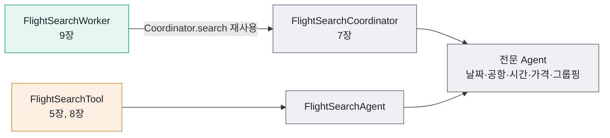

# 6장 전문 Agent로 나누기

"내일 광주에서 제주로 가는 항공편" — 사람에게는 충분한 문장이지만 공공데이터 포털 API는 이 문장을 알아듣지 못합니다. API가 받는 값은 `depAirportId=NAARKJJ`, `arrAirportId=NAARKPC`, `depPlandTime=20261017` 같은 코드와 숫자뿐입니다. 응답도 마찬가지입니다. 출발 시각은 `202610170955` 같은 열두 자리 문자열이고, 운임 정보가 없으면 0원이 옵니다.

그렇다면 "내일"을 `20261017`로, "광주"를 `NAARKJJ`로 바꾸는 일은 누가 해야 할까요? 이 장은 그 변환을 맡는 작은 부품들을 만듭니다.

이 책의 질문은 **"다음 단계를 누가 결정하는가 — 코드인가, LLM인가?"** 입니다. 이 장의 부품들은 아무것도 결정하지 않습니다. 받은 값을 바꾸거나 거를 뿐입니다. 7~9장의 세 패턴은 "누가 이 부품을 어떤 순서로 부르는가"만 다르고, 부품 자체는 똑같이 씁니다. 그래서 부품을 먼저 단단하게 만들어 둡니다.

## 이 책에서 말하는 "전문 Agent"

AI 분야에서 Agent는 보통 "LLM이 스스로 판단해 Tool을 고르고 행동하는 프로그램"을 뜻합니다. 그런데 이 프로젝트의 `service/agent` 패키지에 있는 클래스는 LLM을 전혀 쓰지 않습니다. 이 책은 이들을 **전문 Agent**라고 부릅니다. 전문 Agent는 한 가지 일만 하는 **결정적(deterministic)** 클래스입니다. 같은 입력에는 언제나 같은 결과를 냅니다.

| 구분 | 전문 Agent(이 장) | LLM이 판단하는 Agent(8장) |
|---|---|---|
| 판단 주체 | 개발자가 작성한 코드 | LLM |
| 결과 | 같은 입력이면 항상 같은 결과 | 실행할 때마다 달라질 수 있음 |
| 속도·비용 | 1ms 안팎, 비용 없음 | 호출마다 수 초~수십 초, 토큰 비용 |
| 예 | `DateParserAgent`, `AirportCodeAgent` | `ToolCallingSearchService` |

여행사의 전담 직원을 떠올리면 쉽습니다. 날짜 담당은 "내일"을 날짜로 바꾸는 일만, 공항 담당은 "광주"를 공항 코드로 바꾸는 일만 합니다. 누가 어떤 순서로 일을 맡길지는 이 직원들이 정하지 않습니다.

> **주의**
> 이 책에서 "전문 Agent"는 언제나 LLM을 쓰지 않는 결정적 클래스를 뜻합니다. 전문 Agent끼리는 같은 애플리케이션 안에서 Java 메서드 호출로만 협력합니다. Agent를 별도 서비스로 떼어 내 통신하는 A2A 프로토콜은 이 프로젝트에 구현되어 있지 않습니다([10장](10-choosing-testing-operating.md)에서 개념만 소개합니다).

## 왜 잘게 나누는가

날짜 변환, 공항 코드 변환, 시간·가격 필터, 그룹핑을 `FlightSearchService` 하나에 모두 넣을 수도 있습니다. 나누면 세 가지를 얻습니다.

| 이점 | 뜻 | 이 프로젝트의 예 |
|---|---|---|
| 단일 책임(SRP) | 클래스가 바뀌는 이유가 하나뿐 | 공항이 늘면 `AirportCodeAgent`만 고친다 |
| 쉬운 테스트 | 의존성이 없어 `new`로 만들어 바로 검증 | `new TimeFilterAgent().parseTime("오후 2시")` |
| 재사용 | 여러 패턴이 같은 부품을 공유 | Coordinator, Tool, Worker가 같은 Agent를 쓴다 |

이 책에서는 세 번째가 특히 중요합니다. 세 패턴이 같은 부품을 쓰기 때문에, 결과가 다르다면 그 차이는 "누가 결정했는가"에서 온다고 말할 수 있습니다.



**그림 읽기**: 회색은 코드, 주황은 LLM이 부르는 Tool, 초록은 Worker입니다. 세 경로가 모두 같은 전문 Agent에 닿습니다. 화면의 실행 기록 타임라인도 같은 색 규칙을 씁니다.

## 한눈에 보기

`src/main/java/net/java21/flyschedule/service/agent/` 패키지에는 여덟 개의 클래스가 있습니다.

| 클래스 | 하는 일 | 의존성 | 주로 쓰는 곳 |
|---|---|---|---|
| `DateParserAgent` | "내일", "2026-03-25" → `20260325` | 없음 | Coordinator |
| `AirportCodeAgent` | "광주" → `NAARKJJ` | 없음 | Coordinator, Tool |
| `TimeFilterAgent` | "오후 2시" → 14:00, 출발 시각 필터 | 없음 | Coordinator |
| `PriceFilterAgent` | 운임 범위 필터, 최저가 | 없음 | Coordinator |
| `GroupingAgent` | 항공사별·시간대별 묶기 | 없음 | Coordinator |
| `FlightSearchAgent` | 위 Agent를 엮어 검색 | API + Agent 5개 | `FlightSearchTool`(5장) |
| `AirportListAgent` | 공항 목록 조회 | API, `AirportCodeAgent` | `AirportInfoTool`(5장) |
| `AirlineListAgent` | 항공사 목록 조회 | API | `AirlineInfoTool`(5장) |

앞의 다섯 개는 외부와 통신하지 않는 순수한 변환·필터입니다. 이 장은 이 다섯 개와, 이들을 엮는 `FlightSearchAgent`를 봅니다. 목록 조회 두 개는 API를 감싼 얇은 클래스라 5장의 Tool 설명으로 충분합니다.

## DateParserAgent — 날짜를 API 형식으로

공공데이터 포털 API의 날짜 파라미터는 `YYYYMMDD` 여덟 자리입니다. 사용자는 "내일", "2026-03-25"처럼 씁니다. 그 사이를 잇는 것이 `DateParserAgent`입니다.

`src/main/java/net/java21/flyschedule/service/agent/DateParserAgent.java`

```java
    public String parseDate(String dateInput) {
        log.info("DateParserAgent: 날짜 파싱 요청 - {}", dateInput);

        // 자연어 표현 처리
        if (dateInput == null || dateInput.isBlank()) {
            return LocalDate.now().format(API_DATE_FORMATTER);
        }

        String normalized = dateInput.trim();

        // 이미 API 형식(YYYYMMDD)인 경우 그대로 반환
        if (normalized.matches("\\d{8}")) {
            log.info("DateParserAgent: 이미 API 형식의 날짜 - {}", normalized);
            return normalized;
        }

        normalized = normalized.toLowerCase();

        // 상대적 날짜 표현 처리
        return switch (normalized) {
            case "오늘" -> LocalDate.now().format(API_DATE_FORMATTER);
            case "내일" -> LocalDate.now().plusDays(1).format(API_DATE_FORMATTER);
            case "모레", "내일모레" -> LocalDate.now().plusDays(2).format(API_DATE_FORMATTER);
            case "글피" -> LocalDate.now().plusDays(3).format(API_DATE_FORMATTER);
            default -> parseSpecificDate(normalized);
        };
    }
```

**코드 읽기**

- 날짜가 비어 있으면 오늘로 봅니다. "광주에서 제주"처럼 날짜를 말하지 않은 요청을 위한 기본값입니다.
- 이미 여덟 자리 숫자면 그대로 돌려줍니다. 앞 단계가 이미 변환해 두었어도 안전합니다.
- 나머지는 `parseSpecificDate()`가 `yyyy-MM-dd`로 해석합니다. 실패하면 `IllegalArgumentException("날짜 형식이 올바르지 않습니다. ...")`을 던집니다.

이 Agent가 다루는 표현은 일부러 좁습니다. "다음 주 금요일", "3일 뒤"처럼 달력 계산이 필요한 표현은 받지 않습니다. 요일 표현은 LLM에게 보내기 전에 `DateContext.annotate()`가 `다음 주 금요일(2026-10-23)`처럼 날짜를 붙이고([2장](02-chatclient.md)), "3일 뒤"나 "주말"처럼 그래도 남는 표현은 [7장](07-coordinator.md)에서 LLM이 `YYYY-MM-DD`로 바꾼 뒤 이 Agent에 넘깁니다. 결정적인 부품은 확실한 일만 하고, 애매한 해석은 바깥에 맡기는 구조입니다.

> **주의**
> 예외 메시지는 사용자에게 그대로 보입니다. 7장의 Coordinator는 `IllegalArgumentException`의 메시지를 고치지 않고 응답에 담습니다. 그래서 전문 Agent의 예외 메시지는 "무엇을 고치면 되는지"가 드러나게 씁니다.

## AirportCodeAgent — 공항 이름을 공식 코드로

공항 코드는 `NAARK` 다섯 글자에 두 글자가 붙은 형태입니다. 코드는 공공데이터 포털의 공항 목록 오퍼레이션(`GetArprtList`)이 돌려주는 값을 기준으로 합니다([5장](05-domain-tools.md)의 공항 코드 표 참고).

`src/main/java/net/java21/flyschedule/service/agent/AirportCodeAgent.java`

```java
    private static final Map<String, String> AIRPORT_CODE_MAP = new HashMap<>();

    static {
        // 수도권
        register("NAARKSS", "김포");
        register("NAARKSI", "인천");

        // 부산/경남권
        register("NAARKPK", "김해", "부산");
        // ...

        // 제주권
        register("NAARKPC", "제주");
    }

    private static void register(String code, String... names) {
        for (String name : names) {
            AIRPORT_CODE_MAP.put(name, code);
            AIRPORT_CODE_MAP.put(name + "공항", code);
            AIRPORT_CODE_MAP.put(name + "국제공항", code);
        }
    }
    // ...
    public String getAirportCode(String airportName) {
        if (airportName == null || airportName.isBlank()) {
            throw new IllegalArgumentException("공항 이름을 입력해주세요.");
        }

        String normalized = airportName.trim();

        // 이미 공항 코드 형식인 경우 (NAARKSS, NAARKJJ 등)
        if (normalized.matches("NAARK[A-Z]{2}")) {
            log.info("공항 코드 입력됨: {}", normalized);
            return normalized;
        }

        String code = AIRPORT_CODE_MAP.get(normalized);

        if (code == null) {
            log.warn("알 수 없는 공항: {}", airportName);
            throw new IllegalArgumentException("알 수 없는 공항입니다: " + airportName);
        }

        return code;
    }
```

**코드 읽기**

- `register()`는 이름 하나로 세 가지 표기("광주", "광주공항", "광주국제공항")를 등록합니다. 별칭은 인자로 더 넘깁니다. "김해"와 "부산"이 같은 `NAARKPK`인 것이 그 예입니다.
- 입력이 이미 코드 형식이면 그대로 돌려줍니다. LLM이 Tool을 부를 때 코드를 넘기는 경우가 있기 때문입니다([8장](08-tool-calling-agent.md)).
- 모르는 이름이면 추측하지 않고 예외를 던집니다. "서울"은 공항 이름이 아니므로 `알 수 없는 공항입니다: 서울`이 됩니다. "서울이면 김포겠지"라는 판단은 이 클래스의 몫이 아닙니다.

> **생각해 보기**
> 7장의 `SearchCriteriaExtractor`는 문장에서 공항 이름을 찾을 때 자기만의 목록(`AIRPORT_NAMES`)을 씁니다. 이 목록과 `AIRPORT_CODE_MAP`이 어긋나면 어떤 일이 생길까요? 공항을 하나 추가할 때 고쳐야 하는 곳이 두 군데라는 점은 이 설계의 약점입니다.

## TimeFilterAgent — 시각을 해석하고 거르기

시간 조건은 두 가지 일로 나뉩니다. 사용자의 시각 표현을 `LocalTime`으로 바꾸는 일, 그리고 항공편 출발 시각과 비교해 거르는 일입니다.

`src/main/java/net/java21/flyschedule/service/agent/TimeFilterAgent.java`

```java
    private static final Pattern KOREAN_TIME_PATTERN =
            Pattern.compile("(오전|오후)?\\s*(\\d{1,2})\\s*시(?:\\s*(\\d{1,2})\\s*분)?");
    // ...
    private static final Pattern NUMERIC_TIME_PATTERN =
            Pattern.compile("(\\d{1,2}):?(\\d{2})");
    // ...
    public LocalTime parseTime(String timeInput) {
        // ...
        try {
            Matcher korean = KOREAN_TIME_PATTERN.matcher(normalized);
            if (korean.find()) {
                int hour = Integer.parseInt(korean.group(2));
                int minute = korean.group(3) != null ? Integer.parseInt(korean.group(3)) : 0;
                String meridiem = korean.group(1);
                if ("오후".equals(meridiem) && hour < 12) {
                    hour += 12; // 오후 2시 → 14시
                } else if ("오전".equals(meridiem) && hour == 12) {
                    hour = 0;   // 오전 12시 → 0시
                }
                return LocalTime.of(hour, minute);
            }

            Matcher numeric = NUMERIC_TIME_PATTERN.matcher(normalized);
            if (numeric.matches()) {
                return LocalTime.of(Integer.parseInt(numeric.group(1)), Integer.parseInt(numeric.group(2)));
            }
        } catch (DateTimeException e) {
            // 25시, 70분처럼 범위를 벗어난 값은 아래에서 함께 처리
        }

        throw new IllegalArgumentException("시간 형식이 올바르지 않습니다. (HH:mm 또는 '오후 2시' 등)");
    }
```

**코드 읽기**

- 한글 표현("오후 2시 30분")을 먼저 시도하고, 안 되면 숫자 표현("14:00", "1430", "930")을 시도합니다.
- "오후 12시"는 12시 그대로, "오전 12시"는 0시입니다. 이런 경계값이 테스트에 따로 들어 있습니다.
- `LocalTime.of(25, 0)`이 던지는 `DateTimeException`을 잡아, 사람이 읽을 수 있는 `IllegalArgumentException` 하나로 모읍니다.

거르는 쪽은 단순합니다. `filterAfterTime()`은 출발 시각 문자열 `202610170955`의 9~12번째 글자(`0955`)를 잘라 비교하고, `!departureTime.isBefore(afterTime)`로 기준 시각 정각 출발편을 포함합니다. 출발 시각을 해석할 수 없는 항공편은 결과에서 뺍니다. `filterBeforeTime()`은 방향만 반대입니다.

## PriceFilterAgent — 가격 범위로 거르기

`src/main/java/net/java21/flyschedule/service/agent/PriceFilterAgent.java`

```java
    public List<FlightInfoResponse> filterByPriceRange(
            List<FlightInfoResponse> flights,
            Integer minPrice,
            Integer maxPrice) {

        if (flights == null || flights.isEmpty()) {
            return List.of();
        }

        return flights.stream()
                .filter(flight -> {
                    Integer price = flight.getEconomyCharge();

                    // 가격 정보가 없는 경우 제외
                    if (price == null || price == 0) {
                        return false;
                    }

                    // 최소 가격 필터
                    if (minPrice != null && price < minPrice) {
                        return false;
                    }

                    // 최대 가격 필터
                    return maxPrice == null || price <= maxPrice;
                })
                .collect(Collectors.toList());
    }
```

**코드 읽기**

- 공공데이터 포털 API는 운임 정보가 없을 때 0을 돌려줍니다. 0원을 "가장 싼 항공편"으로 취급하면 안 되므로 가격 정보가 없는 편으로 보고 뺍니다.
- `minPrice`, `maxPrice`가 `null`이면 그쪽 제한이 없습니다. "6만원 이하"는 `(null, 60000)`, "4만원 이상"은 `(40000, null)`입니다.
- 범위가 둘 다 `null`이어도 가격 정보 없는 편은 빠집니다. 그래서 7장의 Coordinator는 가격 조건이 있을 때만 이 Agent를 부릅니다.

같은 클래스에 `findCheapest()`, `findMostExpensive()`, `calculateAveragePrice()`도 있습니다. 모두 0원과 `null`을 같은 규칙으로 걸러 냅니다.

## GroupingAgent — 항공사별로 묶기

화면은 항공편을 항공사별로 묶어 보여 줍니다.

`src/main/java/net/java21/flyschedule/service/agent/GroupingAgent.java`

```java
    public Map<String, List<FlightInfoResponse>> groupByAirline(List<FlightInfoResponse> flights) {
        if (flights == null || flights.isEmpty()) {
            return new TreeMap<>();
        }

        Map<String, List<FlightInfoResponse>> grouped = flights.stream()
                .collect(Collectors.groupingBy(
                        flight -> {
                            String airlineName = flight.getAirlineName();
                            // 항공사명이 null이거나 빈 값일 경우 처리
                            if (airlineName == null || airlineName.trim().isEmpty()) {
                                // 항공편 ID에서 항공사 코드 추출 (예: OZ8141 -> OZ)
                                String flightId = flight.getFlightId();
                                if (flightId != null && flightId.length() >= 2) {
                                    String airlineCode = flightId.substring(0, 2);
                                    log.warn("항공사명 없음, 항공편 ID에서 추출: {} -> {}", flightId, airlineCode);
                                    return airlineCode;
                                }
                                log.warn("항공사명 없음, 기본값 사용: {}", flightId);
                                return "알 수 없는 항공사";
                            }
                            return airlineName;
                        },
                        TreeMap::new, // 정렬 순서 유지
                        Collectors.toList()
                ));
        // ...
        return grouped;
    }
```

**코드 읽기**

- `TreeMap`을 쓰므로 항공사 이름이 가나다순으로 정렬됩니다. 같은 입력이면 순서까지 같습니다. 결정적이라는 말에는 이런 세부도 포함됩니다.
- 항공사 이름이 비어 있으면 편명 앞 두 글자(`OZ8141` → `OZ`)로 대신합니다. 외부 데이터는 언제든 빠진 값을 보낼 수 있다는 전제입니다.

`groupByTimeRange()`는 출발 시각으로 "아침 (06:00-12:00)" 같은 시간대별 묶음을 만듭니다. 지금 화면에서는 쓰지 않지만 연습용으로 남겨 두었습니다.

## FlightSearchAgent — 부품을 엮는 부품

`FlightSearchAgent`는 앞의 Agent들을 정해진 순서로 부릅니다. [5장](05-domain-tools.md)의 `FlightSearchTool`이 이 클래스에 검색을 맡깁니다.

`src/main/java/net/java21/flyschedule/service/agent/FlightSearchAgent.java`

```java
    public Map<String, List<FlightInfoResponse>> searchAndGroupByAirline(
            String departure,
            String arrival,
            String date) {

        log.info("FlightSearchAgent: 항공편 검색 시작");

        // 1. DateParserAgent: 날짜 파싱
        String parsedDate = dateParserAgent.parseDate(date);
        log.info("DateParserAgent: {} → {}", date, parsedDate);

        // 2. AirportCodeAgent: 공항 코드 변환
        String depAirportId = airportCodeAgent.getAirportCode(departure);
        String arrAirportId = airportCodeAgent.getAirportCode(arrival);
        log.info("AirportCodeAgent: {} → {}, {} → {}", departure, depAirportId, arrival, arrAirportId);

        // 3. API 호출
        List<FlightInfoResponse> flights = apiClientService.getFlightSchedule(
                depAirportId, arrAirportId, parsedDate);

        // 4. GroupingAgent: 항공사별 그룹핑
        Map<String, List<FlightInfoResponse>> grouped = groupingAgent.groupByAirline(flights);
        log.info("GroupingAgent: {}개 항공사로 그룹핑 완료", grouped.size());

        return grouped;
    }
```

**코드 읽기**

- 날짜 → 공항 코드 → API 호출 → 그룹핑. 순서는 코드에 적혀 있고, 실행 중에 바뀌지 않습니다. 이것이 이미 작은 "코드가 결정하는" 흐름입니다.
- `searchWithTimeFilter()`와 `searchWithPriceFilter()`는 먼저 위 메서드로 검색하고, 항공사별 목록마다 필터를 적용합니다. 필터를 거친 뒤 항공편이 하나도 남지 않은 항공사는 `filterEachAirline()`이 결과에서 뺍니다.

이 클래스에는 두 가지 한계가 있습니다. 시간 필터와 가격 필터를 함께 걸 수 없고, 각 단계가 얼마나 걸렸는지 밖에서 알 수 없습니다. 7장의 `FlightSearchCoordinator`는 이 클래스를 쓰지 않고 전문 Agent를 직접 부르면서 이 두 가지를 해결합니다.

## 전문 Agent 테스트하기

전문 Agent는 의존성이 없으니 Spring을 띄울 필요가 없습니다. `new`로 만들어 바로 검증합니다. 테스트는 `src/test/java/net/java21/flyschedule/service/` 아래에 `{클래스 이름}Test.java`로 있습니다.

변환표를 검증할 때는 `@ParameterizedTest`와 `@CsvSource`가 잘 맞습니다. 입력과 기대값을 표처럼 늘어놓으면 됩니다.

`src/test/java/net/java21/flyschedule/service/AirportCodeAgentTest.java`

```java
    private final AirportCodeAgent airportCodeAgent = new AirportCodeAgent();

    @ParameterizedTest
    @CsvSource({
            "'김포', 'NAARKSS'",
            "'김포공항', 'NAARKSS'",
            // ...
            "'부산', 'NAARKPK'",
            "'김해', 'NAARKPK'",
            // ...
            "'김해국제공항', 'NAARKPK'"
    })
    @DisplayName("공항 이름을 정확한 코드로 변환해야 한다")
    void getAirportCode_validAirports_returnsCorrectCode(String airportName, String expectedCode) {
        // When
        String result = airportCodeAgent.getAirportCode(airportName);

        // Then
        assertThat(result).isEqualTo(expectedCode);
    }
```

경계값도 같은 방식으로 모읍니다. `TimeFilterAgentTest`는 "오전 12시"→00:00, "오후 12시"→12:00, "930"→09:30을 한 표에 둡니다. `PriceFilterAgentTest`는 운임이 `null`인 편과 0원인 편이 모두 빠지는지 확인합니다.

`FlightSearchAgentTest`는 성격이 다릅니다. 엮는 부품을 테스트하므로, 하위 Agent와 `ApiClientService`를 모두 `@Mock`으로 만들고 `@InjectMocks`로 주입합니다. 확인하는 것은 "변환된 값이 다음 단계로 제대로 넘어가는가"입니다. 예를 들어 `dateParserAgent.parseDate("내일")`이 `"20250310"`을 돌려주게 해 두고, `apiClientService.getFlightSchedule("NAARKJJ", "NAARKPC", "20250310")`이 불렸을 때만 데이터를 돌려주게 합니다.

> **직접 확인하기**
> ```bash
> ./mvnw test -Dtest='*AgentTest'
> ```
> 기대 결과: `AirportCodeAgentTest`, `DateParserAgentTest`, `TimeFilterAgentTest`, `PriceFilterAgentTest`, `GroupingAgentTest`, `FlightSearchAgentTest`가 실행되고 `BUILD SUCCESS`가 나옵니다. LLM 서버나 공공데이터 포털 키 없이도 통과합니다.

> **생각해 보기**
> `DateParserAgentTest`의 상대 날짜 테스트는 결과가 여덟 자리이고 월이 1~12 사이인지만 봅니다. "내일"이 정말 내일인지는 확인하지 않습니다. 이 테스트를 어떻게 바꾸면 더 믿을 만해질까요? (연습 문제 2)

## 핵심 정리

- 전문 Agent는 LLM 없이 한 가지 변환·필터만 하는 결정적 클래스입니다. 같은 입력이면 같은 결과가 나옵니다.
- 모르는 값은 추측하지 않고 `IllegalArgumentException`으로 알립니다. 그 메시지는 사용자에게 그대로 전달됩니다.
- 공공데이터 포털의 특성(공항 코드, 12자리 시각, 0원 운임)을 다루는 지식은 전문 Agent 안에 모입니다.
- 의존성이 없으므로 `new`로 만들어 `@ParameterizedTest`로 변환표를 검증합니다.
- 세 패턴이 같은 부품을 쓰므로, 패턴 사이의 차이는 "누가 순서를 정하는가"에서만 생깁니다.

## 연습 문제

**1. [기본] 공항 별칭 추가하기**

7장에서 LLM이 검색 조건을 뽑을 때 공항 이름을 "제주"가 아니라 "제주도"로 돌려줄 수 있습니다. 지금은 `알 수 없는 공항입니다: 제주도`로 실패합니다. `AirportCodeAgent`에 "제주도"를 `NAARKPC`의 별칭으로 등록하세요.

- **힌트**: `AirportCodeAgent`의 `static` 블록과 `register(String code, String... names)`. "김해"와 "부산"을 함께 등록한 줄이 본보기입니다. 테스트는 `AirportCodeAgentTest`의 `@CsvSource` 목록에 한 줄 추가하면 됩니다.
- **완료 기준**: `./mvnw test -Dtest=AirportCodeAgentTest`가 통과하고, `getAirportCode("제주도")`와 `getAirportCode("제주")`가 모두 `NAARKPC`를 돌려줍니다.

**2. [기본] 상대 날짜 테스트 강화하기**

`DateParserAgentTest`의 `parseDate_relativeDateExpressions`가 실제 날짜를 비교하도록 고치세요.

- **힌트**: `LocalDate.now().plusDays(daysToAdd).format(DateTimeFormatter.BASIC_ISO_DATE)`와 결과를 `isEqualTo`로 비교합니다. `BASIC_ISO_DATE`는 `yyyyMMdd` 형식입니다.
- **완료 기준**: "내일"이 오늘+1일과 정확히 같은지 확인하는 단언이 들어가고, `./mvnw test -Dtest=DateParserAgentTest`가 통과합니다. `plusDays(1)`을 일부러 `plusDays(2)`로 바꾸면 테스트가 실패해야 합니다.

**3. [도전] 시간 범위 필터 만들기**

"오전 10시부터 오후 2시 사이"처럼 시작과 끝이 모두 있는 조건을 한 번에 거르는 `filterBetween(List<FlightInfoResponse> flights, LocalTime from, LocalTime to)`를 `TimeFilterAgent`에 추가하세요.

- **힌트**: `filterAfterTime()`과 `filterBeforeTime()`의 비교식을 합칩니다. 정각 출발편(10:00, 14:00)을 포함할지 먼저 정하고 테스트에 적습니다. 테스트 데이터는 `src/test/java/net/java21/flyschedule/support/TestFlights.java`의 `flight(...)`로 만들 수 있습니다.
- **완료 기준**: 09:55, 10:00, 12:30, 14:00, 14:05 출발편 다섯 개로 테스트했을 때 정한 규칙대로(예: 10:00, 12:30, 14:00) 남고, `./mvnw test -Dtest=TimeFilterAgentTest`가 통과합니다.

부품은 준비되었습니다. 7장에서는 이 부품들을 코드가 정한 순서대로 부르는 Coordinator 패턴을 만들고, 각 단계를 실행 기록으로 남깁니다.
