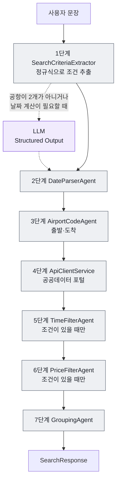

# 7장 Coordinator 패턴 — 코드가 결정한다

이 책의 질문을 다시 떠올립니다. **"다음 단계를 누가 결정하는가 — 코드인가, LLM인가?"**

이 장의 답은 분명합니다. **코드가 결정합니다.** 날짜 변환 다음에 공항 코드 변환, 그다음 API 호출, 그다음 필터와 그룹핑. 이 순서는 `FlightSearchCoordinator`라는 클래스에 적혀 있고 실행 중에 바뀌지 않습니다. LLM은 단 한 곳, 사용자 문장에서 검색 조건을 뽑을 때 정규식이 실패한 경우에만 **fallback**으로 쓰입니다. 그때도 LLM은 "다음에 무엇을 할지"를 정하지 않습니다. 빈칸을 채울 뿐입니다.

"내일 광주에서 제주 오전 10시 이후 8만원 이하"를 이 패턴으로 보내면 실행 기록에 여덟 단계가 남고, 모두 회색(코드)입니다. LLM 호출은 0회, 전체 시간은 약 0.6초이며 그 대부분은 공공데이터 포털 API를 기다리는 시간입니다. 이 장은 그 여덟 단계를 하나씩 만들고, 마지막에 이 패턴이 처리하지 못하는 문장을 만나 봅니다.

## Coordinator 패턴이란

Anthropic의 글 "Building effective agents"(https://www.anthropic.com/engineering/building-effective-agents)는 LLM을 쓰는 시스템을 두 갈래로 나눕니다.

- **workflow**: 미리 정한 코드 경로를 따라 LLM과 Tool을 부른다.
- **agent**: LLM이 스스로 다음 단계와 Tool 사용을 정한다.

이 책의 **Coordinator 패턴**은 workflow 쪽입니다. 그중에서도 LLM 사용을 최소로 줄인 형태입니다. 세 패턴을 같은 질문으로 비교하면 다음과 같습니다.

| 패턴 | 다음 단계를 정하는 것 | LLM의 역할 | 장 |
|---|---|---|---|
| **Coordinator 패턴** | 코드 | 정규식이 실패할 때 검색 조건 추출 | 7장 |
| **Tool Calling Agent** | LLM | 어떤 Tool을 어떤 인자로 부를지 결정 | [8장](08-tool-calling-agent.md) |
| **Orchestrator-Workers 패턴** | LLM이 나누고 코드가 실행 | 작업 분해와 결과 종합 | [9장](09-orchestrator-workers.md) |

Spring 블로그의 agentic patterns 글(https://spring.io/blog/2025/01/21/spring-ai-agentic-patterns)도 같은 분류를 Spring AI 코드로 보여 줍니다. 처음에는 가장 단순한 workflow로 시작하고, 꼭 필요할 때만 LLM에게 결정을 넘기라는 것이 두 글의 공통된 조언입니다.

## 고정된 파이프라인



**그림 읽기**: 실선은 항상 지나는 길, 점선은 정규식이 실패했을 때만 지나는 길입니다. 보라색 LLM 상자는 1단계 안에만 있고, 2단계 이후의 순서에는 끼어들지 못합니다. 5·6단계는 조건이 없으면 건너뜁니다. 건너뛸지도 코드의 `if`가 정합니다.

2~7단계의 부품은 6장에서 만든 전문 Agent입니다. 이 장에서 새로 만드는 것은 1단계(`SearchCriteriaExtractor`), 순서를 정하는 `FlightSearchCoordinator`, 그리고 각 단계를 남기는 실행 기록(`ExecutionTrace`)입니다.

## 검색 조건 — SearchCriteria

세 패턴은 모두 같은 레코드로 검색 조건을 주고받습니다. 2장에서 Structured Output의 대상으로 처음 보았던 바로 그 레코드입니다([2장](02-chatclient.md)).

`src/main/java/net/java21/flyschedule/dto/search/SearchCriteria.java`

```java
public record SearchCriteria(
        @JsonPropertyDescription("출발 공항 한글 이름 (예: 광주, 김포, 제주)")
        String departure,

        @JsonPropertyDescription("도착 공항 한글 이름 (예: 제주, 김포, 김해)")
        String arrival,

        @JsonPropertyDescription("출발 날짜, YYYY-MM-DD 형식")
        String date,

        @JsonPropertyDescription("이 시각 이후 출발, HH:mm 형식. 조건이 없으면 null")
        String afterTime,
        // ...
) {

    public boolean hasRoute() {
        return departure != null && !departure.isBlank() && arrival != null && !arrival.isBlank();
    }
    // ...
```

**코드 읽기**

- 필드는 출발, 도착, 날짜, 이후·이전 시각, 최소·최대 가격 일곱 개입니다. **출발 하나, 도착 하나, 날짜 하나**라는 점을 기억해 두세요. 이 장 끝에서 이 모양이 한계가 됩니다.
- `@JsonPropertyDescription`은 LLM에게 보내는 설명입니다. `.entity(SearchCriteria.class)`를 쓰면 Spring AI가 이 레코드로 JSON 스키마를 만들어 프롬프트에 붙이고, 설명도 스키마에 함께 들어갑니다.
- `hasRoute()`는 출발·도착이 모두 있는지 봅니다. LLM 출력을 검증할 때 씁니다.
- `label()`은 "광주 → 제주 · 2026-10-17 · 10:00 이후" 같은 짧은 이름을 만듭니다. 화면과 실행 기록에 쓰입니다.

## 1단계: SearchCriteriaExtractor — 정규식 먼저, LLM은 나중에

자연어를 검색 조건으로 바꾸는 방법은 둘입니다. 정규식으로 직접 뽑거나, LLM에게 맡기거나. 이 프로젝트는 정규식을 먼저 시도하고, 실패했을 때만 LLM을 부릅니다.

`src/main/java/net/java21/flyschedule/service/ai/SearchCriteriaExtractor.java`

```java
    public Extraction extract(String message, Supplier<ChatClient> chatClient) {
        // "이번 주 토요일" 같은 표현에 코드가 계산한 날짜를 먼저 붙인다 → 정규식도 LLM도 계산할 필요가 없다
        message = DateContext.annotate(message);
        Optional<SearchCriteria> parsed = parseWithRegex(message);
        if (parsed.isPresent()) {
            log.info("정규식으로 검색 조건 추출: {}", parsed.get());
            return new Extraction(parsed.get(), false);
        }

        log.info("정규식으로 공항을 찾지 못해 LLM으로 검색 조건 추출: {}", message);
        SearchCriteria criteria = chatClient.get().prompt()
                .system("""
                        항공편 검색 문장에서 검색 조건을 추출합니다.
                        "내일", "다음 주 금요일" 같은 표현은 계산하지 말고 아래 날짜표에서 찾아 YYYY-MM-DD로 적습니다.
                        공항은 공항 코드가 아니라 한글 이름(광주, 김포, 제주 등)으로 적습니다.
                        문장에 없는 조건은 null로 둡니다.

                        %s
                        """.formatted(DateContext.describe()))
                .user(message)
                .call()
                // 작은 모델이 JSON 앞뒤에 문장을 붙여도 JSON 부분만 읽는다
                .entity(new BeanOutputConverter<>(SearchCriteria.class, null, new LenientJsonCleaner()));

        if (criteria == null || !criteria.hasRoute()) {
            throw new IllegalArgumentException("출발 공항과 도착 공항을 찾지 못했습니다. 예: \"내일 광주에서 제주\"");
        }
        return new Extraction(criteria, true);
    }
```

**코드 읽기**

- 첫 줄의 `DateContext.annotate(message)`는 "이번 주 토요일", "내일" 같은 표현 옆에 코드가 계산한 날짜를 붙입니다(`이번 주 토요일(2026-10-17)`, [2장](02-chatclient.md)). 이후의 정규식과 LLM은 모두 날짜가 붙은 문장을 받습니다.
- 반환값 `Extraction(criteria, usedLlm)`은 조건과 함께 "LLM을 썼는가"를 돌려줍니다. Coordinator는 이 값으로 실행 기록의 색(CODE 또는 LLM)을 정합니다.
- `ChatClient`가 아니라 `Supplier<ChatClient>`를 받습니다. `chatClient.get()`은 정규식이 실패한 뒤에야 불립니다. 그래서 정규식으로 끝나는 문장은 화면에서 Gemini를 골랐고 `GOOGLE_GENAI_API_KEY`가 없어도 검색됩니다. 모델 설정을 확인하는 일 자체가 일어나지 않기 때문입니다.
- LLM 결과에 출발·도착이 없으면 예외를 던집니다. LLM의 출력을 그대로 믿지 않는 첫 번째 관문입니다.

### 정규식이 포기하는 기준

정규식 쪽(`parseWithRegex`)의 핵심은 "언제 포기할 것인가"입니다.

```java
    Optional<SearchCriteria> parseWithRegex(String message) {
        // 공항: 메시지에 나온 순서대로 정렬한 뒤, "~에서"가 붙은 공항을 출발지로 본다
        List<String> found = AIRPORT_NAMES.stream()
                .filter(message::contains)
                .sorted(Comparator.comparingInt(message::indexOf))
                .toList();
        if (found.size() != 2) {
            // 공항이 0~1개면 정보 부족, 3개 이상이면 "김포나 광주에서 제주"처럼 해석이 필요하므로 LLM에 맡긴다
            return Optional.empty();
        }
        String first = found.get(0);
        String second = found.get(1);
        boolean secondIsDeparture = message.contains(second + "에서") && !message.contains(first + "에서");
        String departure = secondIsDeparture ? second : first;
        String arrival = secondIsDeparture ? first : second;

        // 날짜: 2026년 3월 25일, 2026-03-25, 내일, 모레 (없으면 오늘)
        String date = LocalDate.now().toString();
        Matcher dateMatcher = DATE_PATTERN.matcher(message);
        boolean hasAbsoluteDate = dateMatcher.find();
        if (!hasAbsoluteDate && COMPLEX_DATE_PATTERN.matcher(message).find()) {
            // "다음 주 금요일", "3일 뒤"처럼 계산이 필요한 날짜는 정규식으로 처리하지 않고 LLM에 맡긴다
            return Optional.empty();
        }
        // ...
```

정리하면 다음과 같습니다.

| 문장 | 정규식 결과 | 이유 |
|---|---|---|
| "내일 광주에서 제주" | 성공 | 공항 2개, 날짜는 "내일" |
| "광주로 가는 제주에서 출발 항공편" | 성공(제주 → 광주) | "~에서"가 붙은 쪽이 출발 |
| "제주 가는 항공편" | 포기 → LLM | 공항이 1개 |
| "김포나 광주에서 제주" | 포기 → LLM | 공항이 3개, 해석이 필요 |
| "다음 주 금요일 광주에서 제주" | 성공 | `annotate()`가 붙인 `(2026-10-23)`을 `DATE_PATTERN`이 읽음 |
| "주말에 광주에서 제주", "3일 뒤 광주에서 제주" | 포기 → LLM | `COMPLEX_DATE_PATTERN`(주말, N일 뒤, 연도 없는 "3월 25일" 등 코드가 날짜를 붙이지 못한 표현) |

`COMPLEX_DATE_PATTERN`에는 "요일", "이번 주"도 들어 있지만, 요일 표현은 `annotate()`가 이미 절대 날짜를 붙여 두었으므로 `hasAbsoluteDate`가 먼저 참이 되어 이 검사까지 오지 않습니다. 결국 이 검사에 걸리는 것은 코드가 계산하지 못한 표현뿐입니다. 처음에는 요일 표현도 모두 LLM에게 넘겼는데, 작은 모델이 "이번 주 토요일"을 하루 늦게 고르는 일이 운영에서 생기자 날짜 계산을 코드로 옮겼습니다. **코드가 확실히 할 수 있는 일은 LLM에게 맡기지 않는다**는 원칙의 실례입니다.

`COMPLEX_DATE_PATTERN`이 왜 필요한지 생각해 봅시다. 이 검사가 없으면 "주말에 광주에서 제주"는 날짜를 못 찾은 채 오늘 날짜로 검색됩니다. 오류 없이 **엉뚱한 결과**가 나오는 것이 가장 나쁜 실패입니다. 확실하지 않으면 포기하고 LLM에게 넘기는 편이 낫습니다.

시간("오후 2시 30분 이후")과 가격("3만원에서 5만원 사이")도 같은 메서드가 정규식으로 뽑습니다. 규칙은 `SearchCriteriaExtractorTest`의 `@CsvSource` 표에 모두 적혀 있으니 테스트를 문서처럼 읽어 보세요.

### fallback 프롬프트 설계 메모

LLM을 부르는 경우는 드물지만, 부를 때는 결과가 아래 단계에서 바로 쓰입니다. 위 system 프롬프트의 네 줄은 각각 이유가 있습니다.

- **날짜표를 넣는다.** LLM은 시계가 없습니다. 학습 데이터가 끝난 시점의 감각만 있어서, 날짜를 알려 주지 않으면 "내일"을 계산할 수 없습니다. `DateContext.describe()`로 오늘과 이번 주·다음 주 날짜표를 넣고 "계산하지 말고 찾으라"고 합니다([2장](02-chatclient.md)).
- **규칙을 짧은 목록으로 준다.** 원격 Ollama의 3B 모델 같은 작은 모델은 긴 설명보다 짧은 지시를 더 잘 따릅니다. 한 줄에 규칙 하나를 두면 나중에 어떤 규칙이 지켜지지 않았는지 찾기도 쉽습니다.
- **공항은 코드가 아니라 한글 이름으로 받는다.** LLM은 `NAARKJJ` 같은 코드를 정확히 외우지 못하고, 그럴듯한 가짜 코드를 지어낼 수 있습니다. 코드 변환은 6장의 `AirportCodeAgent`가 공식 표로 합니다. LLM은 잘하는 일(문장 해석)만, 코드는 확실한 일(표 조회)만 맡깁니다.
- **문장에 없는 조건은 null로 둔다.** 근거 제한(grounding)입니다. 이 줄이 없으면 LLM이 "보통 이 정도겠지" 하며 가격 상한이나 시각을 지어 넣을 수 있습니다. 입력에 없는 정보는 만들지 말라고 분명히 적습니다.

필드별 형식(`YYYY-MM-DD`, `HH:mm`)은 프롬프트 본문이 아니라 `@JsonPropertyDescription`에 있습니다. 형식 규칙이 필드 옆에 붙어 있으니 레코드를 고칠 때 설명도 같이 고치게 됩니다.

### LLM 출력을 그대로 믿지 않는다

Structured Output은 "JSON 모양"을 맞춰 줄 뿐 "내용이 맞는지"는 보장하지 않습니다. 이 패턴에서는 LLM 출력이 2단계 이후의 전문 Agent를 거치면서 자연스럽게 검증됩니다.

| LLM이 잘못 돌려준 값 | 막는 곳 | 사용자에게 보이는 메시지 |
|---|---|---|
| 출발 또는 도착이 `null` | `SearchCriteriaExtractor` (`hasRoute()`) | 출발 공항과 도착 공항을 찾지 못했습니다. 예: "내일 광주에서 제주" |
| "서울"처럼 없는 공항 | `AirportCodeAgent` | 알 수 없는 공항입니다: 서울 |
| `"2026/10/23"` 같은 날짜 | `DateParserAgent` | 날짜 형식이 올바르지 않습니다. (YYYY-MM-DD 또는 '내일', '모레' 등) |
| `"저녁"` 같은 시각 | `TimeFilterAgent.parseTime()` | 시간 형식이 올바르지 않습니다. (HH:mm 또는 '오후 2시' 등) |
| 깨진 JSON(작은 모델에서 종종) | `.entity()` 변환 예외 | LLM 호출 중 오류가 발생했습니다: ... |

전문 Agent가 모르는 값을 추측하지 않고 예외로 알리도록 만든 덕분입니다(6장). 다만 빈틈도 있습니다. LLM이 날짜를 `null`로 돌려주면 `DateParserAgent`는 오늘로 검색합니다. 오류 없이 다른 날을 검색하는 셈입니다. 9장의 `FlightSearchPlanner.validate()`는 이런 검증을 한곳에 모아 더 명시적으로 합니다.

> **팁**
> 실행 기록의 1단계가 보라색(LLM)이면 위 표의 문제가 생길 수 있는 경로를 지난 것입니다. 회색(CODE)이면 정규식으로 처리되어 같은 문장은 언제나 같은 조건이 됩니다.

## FlightSearchCoordinator — 순서를 적어 둔 클래스

이제 순서를 정하는 클래스입니다. 메서드는 둘입니다. `coordinate()`는 요청 하나를 처음부터 끝까지 처리하고, `search()`는 이미 뽑힌 검색 조건 하나를 2~7단계로 처리합니다.

`src/main/java/net/java21/flyschedule/service/coordinator/FlightSearchCoordinator.java`

```java
    public SearchResponse coordinate(String message, String model, ExecutionTrace trace) {
        try {
            // 1단계: 검색 조건 추출 (정규식이 실패하면 LLM)
            long start = System.nanoTime();
            SearchCriteriaExtractor.Extraction extraction;
            try {
                extraction = criteriaExtractor.extract(message, () -> chatClientProvider.get(model));
            } catch (RuntimeException e) {
                // 정규식은 실패해도 예외를 던지지 않으므로, 여기로 오는 실패는 LLM 추출 단계에서 난 것이다
                trace.record(Kind.LLM, "SearchCriteriaExtractor", "LLM으로 검색 조건 추출", "실패: " + e.getMessage(), start);
                throw e;
            }
            trace.record(extraction.usedLlm() ? Kind.LLM : Kind.CODE, "SearchCriteriaExtractor",
                    extraction.usedLlm() ? "LLM으로 검색 조건 추출" : "정규식으로 검색 조건 추출",
                    extraction.criteria().label(), start);

            // 2~7단계: 정해진 순서대로 전문 Agent 호출
            TaskResult result = search(extraction.criteria(), trace);

            String summary = result.isEmpty() ? "조건에 맞는 항공편이 없습니다." : result.summaryLine();
            return SearchResponse.success(PATTERN, summary, List.of(result), trace);

        } catch (IllegalArgumentException e) {
            log.warn("Coordinator 검색 실패: {}", e.getMessage());
            return SearchResponse.fail(PATTERN, e.getMessage(), trace);
        } catch (Exception e) {
            log.error("Coordinator 검색 오류", e);
            return SearchResponse.fail(PATTERN, ChatClientProvider.describeError(e), trace);
        }
    }
```

**코드 읽기**

- `() -> chatClientProvider.get(model)`이 앞에서 본 `Supplier`입니다. 모델 선택("ollama" 또는 "gemini")은 LLM이 정말 필요할 때 확인됩니다.
- 1단계는 끝난 뒤에야 LLM을 썼는지 알 수 있으므로, 시작 시각 `start`를 미리 재 두고 `trace.record(..., start)`로 나중에 기록합니다.
- 추출이 예외로 끝났다면 LLM 경로에서 실패한 것입니다. 정규식 경로는 조건을 못 찾아도 예외 없이 LLM으로 넘기기 때문입니다. 그래서 실패 단계는 `Kind.LLM`, 제목 "LLM으로 검색 조건 추출", `detail` "실패: ..."로 남습니다. 화면에서는 실패한 1단계가 보라색으로 보입니다.
- 예외는 HTTP 500이 되지 않고 `success: false` 응답이 됩니다. `IllegalArgumentException`은 사용자가 고칠 수 있는 입력 문제이므로 메시지를 그대로 보여 줍니다. 그 밖의 예외(Ollama 연결 실패, 공공데이터 포털 오류인 `ExternalApiException` 등)는 `ChatClientProvider.describeError()`가 안내 문장으로 바꿉니다.
- 실패해도 그때까지의 실행 기록이 응답에 담깁니다. 어느 단계에서 멈췄는지 화면에서 보입니다.

```java
    public TaskResult search(SearchCriteria criteria, ExecutionTrace trace) {
        String date = trace.run(Kind.CODE, "DateParserAgent", "날짜 변환",
                () -> dateParserAgent.parseDate(criteria.date()),
                parsed -> criteria.date() + " → " + parsed);

        String depAirportId = trace.run(Kind.CODE, "AirportCodeAgent", "출발 공항 코드 변환",
                () -> airportCodeAgent.getAirportCode(criteria.departure()),
                code -> criteria.departure() + " → " + code);
        // ... (도착 공항도 같은 방식)

        List<FlightInfoResponse> flights = trace.run(Kind.CODE, "ApiClientService", "공공데이터 포털 API 호출",
                () -> apiClientService.getFlightSchedule(depAirportId, arrAirportId, date),
                list -> list.size() + "편 조회");

        if (criteria.afterTime() != null) {
            List<FlightInfoResponse> source = flights;
            flights = trace.run(Kind.CODE, "TimeFilterAgent", criteria.afterTime() + " 이후 출발만 남기기",
                    () -> timeFilterAgent.filterAfterTime(source, timeFilterAgent.parseTime(criteria.afterTime())),
                    list -> source.size() + "편 → " + list.size() + "편");
        }
        // ... (beforeTime, 가격 조건도 같은 방식)

        List<FlightInfoResponse> filtered = flights;
        Map<String, List<FlightInfoResponse>> grouped = trace.run(Kind.CODE, "GroupingAgent", "항공사별 그룹핑",
                () -> groupingAgent.groupByAirline(filtered),
                map -> map.size() + "개 항공사");

        return TaskResult.of(criteria, grouped);
    }
```

**코드 읽기**

- 모든 단계가 `trace.run(종류, 실행자, 제목, 할 일, 결과 요약)` 한 가지 모양입니다. 할 일을 실행하면서 걸린 시간과 결과 요약을 함께 기록합니다.
- 필터 단계는 `if`로 감쌌습니다. 조건이 없으면 실행 기록에도 나타나지 않습니다.
- `source` 같은 지역 변수를 따로 두는 이유는 람다 안에서 쓰는 변수가 effectively final이어야 하기 때문입니다.
- 6장의 `FlightSearchAgent`와 달리 시간 필터와 가격 필터를 함께 걸 수 있고, 단계마다 기록이 남습니다.
- `search()`는 `public`입니다. 9장의 `FlightSearchWorker`가 이 메서드를 그대로 재사용합니다. 패턴은 서로 배타적이지 않습니다.

## 실행 기록 — ExecutionTrace와 TraceStep

이 책의 질문에 답하려면 "누가 결정했는지"를 눈으로 볼 수 있어야 합니다. 3장에서 Advisor로 LLM 호출을 들여다보았지만([3장](03-advisor.md)), Advisor는 LLM 호출만 봅니다. 코드가 실행한 단계까지 한 줄로 보려면 직접 기록해야 합니다.

`src/main/java/net/java21/flyschedule/dto/search/TraceStep.java`

```java
public record TraceStep(
        int order,
        Kind kind,
        String actor,
        String title,
        String detail,
        long startMs,
        long durationMs,
        String thread
) {

    public enum Kind {
        /** 개발자가 작성한 코드가 순서를 정해 실행 */
        CODE,
        /** LLM 호출 (판단·계획·요약) */
        LLM,
        /** LLM이 호출을 요청해 실행된 Tool */
        TOOL,
        /** Orchestrator가 맡긴 하위 작업 */
        WORKER
    }
}
```

`kind`가 이 책의 질문에 대한 단계별 답입니다. Coordinator 패턴은 거의 모든 줄이 `CODE`이고, 정규식이 실패했을 때 1단계만 `LLM`입니다. `TOOL`은 8장, `WORKER`는 9장에서 등장합니다. `startMs`는 요청 시작부터 이 단계가 시작될 때까지의 시간, `durationMs`는 이 단계가 걸린 시간입니다. `thread`는 9장에서 Worker가 병렬로 도는지 확인할 때 씁니다.

`src/main/java/net/java21/flyschedule/dto/search/ExecutionTrace.java`

```java
    public <T> T run(TraceStep.Kind kind, String actor, String title,
                     Supplier<T> action, Function<T, String> describe) {
        long start = System.nanoTime();
        try {
            T result = action.get();
            add(kind, actor, title, describe.apply(result), start, System.nanoTime());
            return result;
        } catch (RuntimeException e) {
            add(kind, actor, title, "실패: " + e.getMessage(), start, System.nanoTime());
            throw e;
        }
    }
    // ...
    private synchronized void add(TraceStep.Kind kind, String actor, String title, String detail,
                                  long start, long end) {
        steps.add(new TraceStep(steps.size() + 1, kind, actor, title, detail,
                toMs(start - startedAt), toMs(end - start), threadName()));
    }
```

**코드 읽기**

- `run()`은 할 일을 실행하고 결과를 그대로 돌려줍니다. 기록을 남기는 코드가 검색 로직 사이에 끼어들지 않습니다.
- 실패하면 "실패: 메시지"를 남기고 예외를 다시 던집니다. 기록은 남기되 흐름은 바꾸지 않습니다.
- `add()`가 `synchronized`인 이유는 9장에서 여러 Worker가 동시에 기록하기 때문입니다. `steps()`는 복사본을 돌려주므로 실행 중에 읽어도 안전합니다. 작업 API가 이 성질을 이용합니다.

### 화면의 타임라인

화면(`http://localhost:8080/`)은 `trace` 배열을 한 줄씩 그립니다. 줄마다 `kind`에 따라 색을 칠하고, `startMs`와 `durationMs`로 막대의 위치와 길이를 정합니다.

`src/main/resources/templates/index.html`

```javascript
    function renderTrace(trace, totalMs) {
        const total = Math.max(totalMs || 0, ...trace.map(s => s.startMs + s.durationMs), 1);
        const scale = `<div class="timeline-scale"><span>0</span><span>${seconds(Math.round(total / 2))}</span><span>${seconds(total)}</span></div>`;
        return scale + `<div class="trace">${trace.map(step => {
            const left = (step.startMs / total) * 100;
            const width = Math.max((step.durationMs / total) * 100, 0.8);
            return `<div class="trace-row k-${esc(step.kind)}">
```

`k-CODE` 클래스는 회색(`#5b6472`), `k-LLM`은 보라색, `k-TOOL`은 주황색, `k-WORKER`는 초록색입니다. 이 책의 Mermaid 그림과 같은 색이고, 검색 상자 아래의 색 범례에도 같은 색이 나옵니다. 타임라인 위에는 0초·중간·끝 시각을 적은 눈금(`timeline-scale`)이 있어 막대 길이를 초 단위로 읽을 수 있습니다. 패널 위쪽에는 상태 배지(실행 중·완료·실패)와 숫자 칸 네 개(전체 시간, LLM 호출, Tool 호출, Worker)가 있습니다.

> **직접 확인하기**
> 애플리케이션을 실행하고(`./mvnw spring-boot:run`) 브라우저에서 `http://localhost:8080/`을 엽니다. Coordinator 패턴만 선택하고 "내일 광주에서 제주 오전 10시 이후 8만원 이하"를 검색합니다.
> 기대 결과: 실행 기록 여덟 줄이 모두 회색이고, 5번 줄(`ApiClientService`)의 막대만 길게 보입니다. 숫자 칸의 "LLM 호출"이 "0회"입니다. 이어서 "주말에 광주에서 제주"를 검색하면 1번 줄만 보라색으로 바뀌고 그 막대가 가장 깁니다. "다음 주 금요일 광주에서 제주"는 날짜가 코드로 붙으므로 여전히 모두 회색입니다.

## 응답 — SearchResponse와 TaskResult

세 패턴은 같은 응답 형식을 씁니다. `SearchResponse`는 패턴 이름, 성공 여부, 안내 메시지, 결과 목록(`results`), 실행 기록(`trace`), 전체 시간(`elapsedMs`)을 담습니다. 결과 하나(`TaskResult`)는 검색 조건, 항공사별 항공편, 전체 편수, 최저가 항공편입니다. Coordinator는 결과가 언제나 하나이고, 9장의 Orchestrator-Workers는 Worker마다 하나씩 여럿입니다.

항공편 한 건은 `FlightView`로 바꿔 담습니다. API의 `202610171030` 같은 시각을 `10:30`으로, 운임 0원을 `null`(가격 정보 없음)로 바꿉니다.

> **직접 확인하기**
> ```bash
> curl -X POST http://localhost:8080/api/search/coordinator \
>   -H "Content-Type: application/json" \
>   -d '{"message": "내일 광주에서 제주 오전 10시 이후 8만원 이하", "model": "ollama"}'
> ```
> 기대 결과: `"success": true`, `"pattern": "coordinator"`이고 `trace`의 모든 `kind`가 `"CODE"`입니다.

응답은 다음과 비슷합니다. 오늘이 2026-10-16이라고 가정했고, 항공편 목록은 항공사마다 한 편씩만 남기고 줄였습니다. 편명·시각·가격은 그날의 공공데이터 포털 응답에 따라 다릅니다.

```json
{
  "pattern": "coordinator",
  "success": true,
  "message": "광주 → 제주 · 2026-10-17 · 10:00 이후 · 8만원 이하: 5편, 최저가 제주항공 7C1402 10:30 출발 45,000원",
  "results": [
    {
      "label": "광주 → 제주 · 2026-10-17 · 10:00 이후 · 8만원 이하",
      "criteria": {
        "departure": "광주", "arrival": "제주", "date": "2026-10-17",
        "afterTime": "10:00", "beforeTime": null, "minPrice": null, "maxPrice": 80000
      },
      "flightsByAirline": {
        "아시아나항공": [
          { "flightId": "OZ8143", "airline": "아시아나항공", "departureAirport": "광주", "arrivalAirport": "제주",
            "departureTime": "13:20", "arrivalTime": "14:10", "price": 57900 }
        ],
        "제주항공": [
          { "flightId": "7C1402", "airline": "제주항공", "departureAirport": "광주", "arrivalAirport": "제주",
            "departureTime": "10:30", "arrivalTime": "11:20", "price": 45000 }
        ]
      },
      "totalCount": 5,
      "cheapest": { "flightId": "7C1402", "airline": "제주항공", "departureAirport": "광주", "arrivalAirport": "제주",
                    "departureTime": "10:30", "arrivalTime": "11:20", "price": 45000 }
    }
  ],
  "trace": [
    { "order": 1, "kind": "CODE", "actor": "SearchCriteriaExtractor", "title": "정규식으로 검색 조건 추출",
      "detail": "광주 → 제주 · 2026-10-17 · 10:00 이후 · 8만원 이하", "startMs": 0, "durationMs": 1, "thread": "http-nio-8080-exec-3" },
    { "order": 2, "kind": "CODE", "actor": "DateParserAgent", "title": "날짜 변환",
      "detail": "2026-10-17 → 20261017", "startMs": 1, "durationMs": 0, "thread": "http-nio-8080-exec-3" },
    { "order": 3, "kind": "CODE", "actor": "AirportCodeAgent", "title": "출발 공항 코드 변환",
      "detail": "광주 → NAARKJJ", "startMs": 1, "durationMs": 0, "thread": "http-nio-8080-exec-3" },
    { "order": 4, "kind": "CODE", "actor": "AirportCodeAgent", "title": "도착 공항 코드 변환",
      "detail": "제주 → NAARKPC", "startMs": 1, "durationMs": 0, "thread": "http-nio-8080-exec-3" },
    { "order": 5, "kind": "CODE", "actor": "ApiClientService", "title": "공공데이터 포털 API 호출",
      "detail": "12편 조회", "startMs": 1, "durationMs": 598, "thread": "http-nio-8080-exec-3" },
    { "order": 6, "kind": "CODE", "actor": "TimeFilterAgent", "title": "10:00 이후 출발만 남기기",
      "detail": "12편 → 8편", "startMs": 599, "durationMs": 0, "thread": "http-nio-8080-exec-3" },
    { "order": 7, "kind": "CODE", "actor": "PriceFilterAgent", "title": "가격 범위로 거르기",
      "detail": "8편 → 5편", "startMs": 599, "durationMs": 0, "thread": "http-nio-8080-exec-3" },
    { "order": 8, "kind": "CODE", "actor": "GroupingAgent", "title": "항공사별 그룹핑",
      "detail": "3개 항공사", "startMs": 599, "durationMs": 1, "thread": "http-nio-8080-exec-3" }
  ],
  "elapsedMs": 601
}
```

**응답 읽기**

- `message`는 LLM이 쓴 문장이 아니라 `TaskResult.summaryLine()`이 만든 문장입니다. 이 패턴은 결과를 요약할 때도 LLM을 쓰지 않습니다.
- `trace`를 위에서 아래로 읽으면 이 장 앞부분의 파이프라인 그림과 같습니다. 전체 601ms 중 598ms가 5번 단계입니다.
- `flightsByAirline`의 키는 `GroupingAgent`의 `TreeMap` 덕분에 가나다순입니다.

## 컨트롤러와 작업 API

`SearchController`는 세 패턴의 엔드포인트를 한곳에 모읍니다. 빈 문장 검사도 여기서 한 번만 합니다.

| 메서드와 경로 | 동작 |
|---|---|
| `POST /api/search/coordinator` | 검색이 끝날 때까지 기다렸다가 `SearchResponse`를 돌려준다 |
| `POST /api/search/coordinator/jobs` | 검색을 백그라운드에서 시작하고 `202 Accepted`로 작업 ID를 바로 돌려준다 |
| `GET /api/search/jobs/{jobId}` | 지금까지의 실행 기록과, 끝났으면 결과를 돌려준다 |

Coordinator는 1초 안에 끝나므로 동기 API로 충분합니다. 하지만 8·9장의 패턴은 LLM을 여러 번 불러 1분을 넘길 수 있고, 앞단 프록시(nginx 기본 60초)가 연결을 끊으면 504 오류가 납니다. 그래서 화면은 세 패턴 모두 작업 API로 시작하고 1.5초마다 상태를 묻습니다. `coordinate(message, model, trace)`처럼 실행 기록을 밖에서 받는 오버로드가 있는 이유가 이것입니다. 작업 서비스가 만든 `ExecutionTrace`를 넘겨 두면, 검색이 끝나기 전에도 그 기록을 읽어 진행 상황을 보여 줄 수 있습니다.

```json
{ "jobId": "3f1c9a2e-...", "pattern": "coordinator", "status": "RUNNING", "trace": [], "result": null }
```

시작 응답은 위와 같고, 끝난 뒤 조회하면 `"status": "DONE"`과 함께 `result`에 앞의 `SearchResponse`가 들어 있습니다. 작업 보관 시간, 동시 작업 수 제한, nginx 설정은 [10장](10-choosing-testing-operating.md)에서 다룹니다.

## 테스트: 경계만 가짜로, Agent는 진짜로

`FlightSearchCoordinatorTest`는 외부와 닿는 두 곳만 가짜로 바꿉니다. 공공데이터 포털을 부르는 `ApiClientService`와 LLM을 부르는 `ChatClient`입니다. 전문 Agent는 진짜 객체를 `new`로 만들어 넣습니다.

`src/test/java/net/java21/flyschedule/service/coordinator/FlightSearchCoordinatorTest.java`

```java
    @BeforeEach
    void setUp() {
        apiClientService = mock(ApiClientService.class);
        chatClient = mock(ChatClient.class, RETURNS_DEEP_STUBS);
        ChatClientProvider provider = mock(ChatClientProvider.class);
        when(provider.get(anyString())).thenReturn(chatClient);
        when(apiClientService.getFlightSchedule(anyString(), anyString(), anyString())).thenReturn(apiFlights);

        coordinator = new FlightSearchCoordinator(provider, new SearchCriteriaExtractor(),
                new DateParserAgent(), new AirportCodeAgent(), apiClientService,
                new TimeFilterAgent(), new PriceFilterAgent(), new GroupingAgent());
    }
    // ...
    @Test
    @DisplayName("정규식이 실패하면 1단계만 LLM으로 처리하고, 나머지 순서는 그대로다")
    void llmOnlyForExtraction() {
        when(chatClient.prompt().system(anyString()).user(anyString()).call().entity(org.mockito.ArgumentMatchers.<org.springframework.ai.converter.StructuredOutputConverter<SearchCriteria>>any()))
                .thenReturn(new SearchCriteria("김포", "제주", "2026-03-27", null, null, null, null));

        SearchResponse response = coordinator.coordinate("이번 주 금요일 서울에서 제주도", "gemini");

        assertThat(response.success()).isTrue();
        assertThat(response.trace().get(0).kind()).isEqualTo(Kind.LLM);
        assertThat(response.trace().subList(1, response.trace().size())).extracting(TraceStep::kind).containsOnly(Kind.CODE);
        verify(apiClientService).getFlightSchedule("NAARKSS", "NAARKPC", "20260327");
    }
```

**코드 읽기**

- `apiFlights`는 `TestFlights.flight(...)`로 만든 네 편(09:55 아시아나 57,900원, 10:30 제주항공 45,000원, 15:30 제주항공 72,000원, 18:30 대한항공 89,000원)입니다. 가짜 API는 어떤 인자로 불려도 이 네 편을 돌려줍니다.
- `RETURNS_DEEP_STUBS`는 `prompt().system(...).user(...).call().entity(...)` 같은 긴 호출 체인의 끝만 정해 줄 수 있게 합니다. LLM이 `김포 → 제주`를 돌려준 것처럼 꾸밉니다.
- 전문 Agent가 진짜이므로 "김포"가 실제로 `NAARKSS`로, "2026-03-27"이 실제로 `20260327`로 바뀌어 API에 넘어갔는지 `verify`로 확인할 수 있습니다. Agent까지 가짜로 만들면 이 테스트는 "가짜가 가짜를 불렀다"는 것밖에 증명하지 못합니다. 결정적인 부품은 진짜로 쓰는 편이 낫습니다.
- 같은 파일의 다른 테스트도 읽어 보세요. `fixedOrderAllCode`는 실행 기록의 실행자 순서를 `containsExactly`로 고정합니다. `filtersOnlyWhenRequested`는 "10시 이후 8만원 이하"가 네 편 중 두 편(7C1402, 7C1406)만 남기는지 봅니다. `regexPathIgnoresModelConfig`는 Gemini 키가 없어도 정규식 경로는 성공하고, LLM이 필요한 문장에서만 `GOOGLE_GENAI_API_KEY` 안내가 나오는지 확인합니다.

가짜 LLM으로 테스트하는 다른 기법(Tool 메서드를 직접 실행하는 가짜, 병렬성 검증)은 8·9장과 [10장](10-choosing-testing-operating.md)에서 정리합니다.

> **직접 확인하기**
> ```bash
> ./mvnw test -Dtest='FlightSearchCoordinatorTest,SearchCriteriaExtractorTest,ExecutionTraceTest'
> ```
> 기대 결과: `BUILD SUCCESS`. LLM 서버와 공공데이터 포털 키 없이 통과합니다.

## 결정성과 비용

| 항목 | 정규식 경로 | LLM fallback 경로 |
|---|---|---|
| LLM 호출 수 | 0회 | 1회 |
| 걸리는 시간 | 약 0.6초(대부분 공공데이터 포털 API 대기) | API 대기 + LLM 한 번. 원격 Ollama 3B 모델은 수십 초가 걸리기도 한다 |
| 같은 입력, 같은 결과? | 예(같은 날이면 같은 조건) | 보장되지 않음. 모델·실행마다 달라질 수 있다 |
| 토큰 비용 | 없음 | 호출 한 번분 |

정규식 경로에서는 같은 문장이 언제나 같은 검색 조건이 되고, 같은 순서로 같은 Agent를 부릅니다. 문제가 생기면 실행 기록만 보고 어느 단계인지 알 수 있습니다. 이것이 코드가 결정하는 패턴의 가장 큰 장점입니다.

## 한계: "금요일이나 토요일에 김포나 광주에서 제주"

이제 이 문장을 Coordinator 패턴에 보내 봅시다.

1. `annotate()`가 "금요일(2026-10-16)이나 토요일(2026-10-17)"처럼 날짜를 붙여 줍니다. 그래도 정규식은 김포, 광주, 제주 세 공항을 찾으므로 포기합니다. 공항이 두 개가 아니기 때문입니다.
2. LLM이 검색 조건을 채웁니다. 그런데 `SearchCriteria`에는 출발 칸이 하나, 날짜 칸이 하나뿐입니다.
3. LLM은 하나를 골라 채울 수밖에 없습니다. 이를테면 "김포 → 제주 · 금요일"입니다.

사용자가 원한 것은 네 가지 조합입니다.

| 조합 | Coordinator 결과 |
|---|---|
| 김포 → 제주 · 금요일 | 검색됨(LLM이 이것을 골랐다면) |
| 김포 → 제주 · 토요일 | 빠짐 |
| 광주 → 제주 · 금요일 | 빠짐 |
| 광주 → 제주 · 토요일 | 빠짐 |

오류는 나지 않습니다. 성공 응답에 결과 하나가 담겨 옵니다. 앞에서 말한 가장 나쁜 실패, 곧 **조용히 틀린 결과**입니다.

문제는 추출이 아니라 파이프라인의 모양에 있습니다. "검색 조건 하나 → 검색 한 번"이라는 고정된 경로로는 "몇 번 검색해야 하는가"부터 요청마다 다른 문장을 표현할 수 없습니다. 코드로 고치려면 "~이나", "~또는", "~랑" 같은 표현을 해석하는 규칙을 계속 늘려야 하고, 규칙은 끝없이 늘어납니다.

길은 두 가지입니다.

- **LLM에게 다음 단계를 맡긴다.** LLM이 문장을 읽고 검색 Tool을 필요한 만큼 부르게 합니다. [8장](08-tool-calling-agent.md)의 Tool Calling Agent입니다.
- **LLM에게 작업 분해만 맡긴다.** LLM이 문장을 검색 조건 목록(2 × 2 = 4개)으로 나누고, 각 조건은 이 장의 `search()`가 코드로 실행합니다. [9장](09-orchestrator-workers.md)의 Orchestrator-Workers 패턴입니다.

> **직접 확인하기**
> 화면에서 Coordinator 패턴으로 "금요일이나 토요일에 김포나 광주에서 제주"를 검색합니다.
> 기대 결과: 1번 줄이 보라색(LLM으로 검색 조건 추출)이고, 검색 결과는 하나뿐입니다. 결과의 제목(`label`)을 보면 LLM이 네 조합 중 어느 것을 골랐는지 알 수 있습니다. 같은 문장을 두세 번 보내 골라진 조합이 같은지도 확인해 보세요.

## 핵심 정리

- Coordinator 패턴에서는 코드가 다음 단계를 결정합니다. 순서는 `FlightSearchCoordinator`에 적혀 있고 LLM은 그 순서에 끼어들지 못합니다.
- 검색 조건 추출은 정규식이 먼저이고, 확실하지 않으면 포기하고 LLM에게 넘깁니다. 요일 같은 날짜 표현은 `DateContext.annotate()`가 먼저 날짜를 붙여 정규식 경로로 처리합니다. 프롬프트에는 날짜표, 짧은 규칙, 근거 제한을 넣습니다.
- LLM 출력은 `hasRoute()`와 뒤따르는 전문 Agent가 검증합니다. 모르는 값은 예외가 되어 사용자에게 안내됩니다.
- `ExecutionTrace`가 단계마다 종류(CODE·LLM·TOOL·WORKER), 시작 시각, 걸린 시간, 스레드를 남기고, 화면은 이를 색깔 있는 타임라인으로 그립니다.
- 정규식 경로는 LLM 호출 0회, 약 0.6초, 같은 입력에 같은 결과입니다. 대신 "검색 조건 하나"로 표현할 수 없는 요청은 조용히 일부만 처리합니다.

## 연습 문제

**1. [기본] 필터 단계가 빠지는지 확인하는 테스트**

가격 조건만 있는 문장("내일 광주에서 제주 6만원 이하")에서는 실행 기록에 `TimeFilterAgent`가 없어야 합니다. 이를 확인하는 테스트를 추가하세요.

- **힌트**: `FlightSearchCoordinatorTest`의 `filtersOnlyWhenRequested`. `extracting(TraceStep::actor)` 뒤에 `doesNotContain("TimeFilterAgent")`를 씁니다. 테스트 데이터 네 편 중 6만원 이하가 몇 편인지 먼저 계산해 두세요.
- **완료 기준**: 새 테스트가 `PriceFilterAgent`는 포함하고 `TimeFilterAgent`는 포함하지 않음을 단언하며, 남은 편수(2편: 57,900원, 45,000원)까지 확인하고 통과합니다.

**2. [기본] LLM이 잘못된 날짜를 돌려줄 때**

LLM이 날짜를 `"2026/10/23"`처럼 잘못된 형식으로 돌려주면 Coordinator는 어떤 응답을 돌려줄까요? 예상을 먼저 적고 테스트로 확인하세요.

- **힌트**: `llmOnlyForExtraction`처럼 `entity(...)`를 `any()`로 꾸밉니다. 예외를 던지는 곳은 `DateParserAgent.parseSpecificDate()`이고, `coordinate()`의 `catch (IllegalArgumentException e)`가 받습니다.
- **완료 기준**: `success()`가 `false`, `message()`에 "날짜 형식"이 들어 있고, 실행 기록의 마지막 단계가 `DateParserAgent`이며 `detail`이 "실패"로 시작한다는 단언이 통과합니다. `ApiClientService`는 한 번도 불리지 않아야 합니다(`verify(..., never())`).

**3. [도전] fallback 프롬프트에 허용 공항 목록 넣기**

`llmOnlyForExtraction`의 실제 상황을 생각해 봅시다. 진짜 LLM은 "서울"을 "김포"로 바꿔 주지 않을 수 있고, 그러면 `알 수 없는 공항입니다: 서울`로 실패합니다. system 프롬프트에 사용할 수 있는 공항 이름 목록과 "서울은 김포로 적는다" 같은 규칙을 넣으세요.

- **힌트**: `SearchCriteriaExtractor`의 `AIRPORT_NAMES`를 `String.join(", ", AIRPORT_NAMES)`로 프롬프트에 넣습니다. 테스트에서는 `ArgumentCaptor<String>`으로 `chatClient.prompt().system(...)`에 넘어간 문자열을 잡아 확인할 수 있습니다(`RETURNS_DEEP_STUBS`에서 `chatClient.prompt()`는 매번 같은 가짜 객체를 돌려줍니다).
- **완료 기준**: system 프롬프트에 "광주", "김포", "제주"가 모두 들어 있음을 확인하는 테스트가 통과하고, 기존 `SearchCriteriaExtractorTest`와 `FlightSearchCoordinatorTest`도 모두 통과합니다. 화면에서 Ollama로 "이번 주 토요일 서울에서 제주"를 검색해 1단계 `detail`이 "김포 → 제주"로 나오는지 확인합니다(모델에 따라 다를 수 있으니 결과를 기록해 둡니다).

**4. [도전] "3일 뒤"도 코드가 계산하기**

"3일 뒤 광주에서 제주"는 지금 `COMPLEX_DATE_PATTERN`에 걸려 LLM으로 갑니다. 그런데 "N일 뒤"는 답이 하나로 정해지는 계산입니다. `DateContext.annotate()`가 "3일 뒤(2026-10-19)"처럼 날짜를 붙이게 고쳐, 이 문장도 정규식 경로로 처리되게 하세요.

- **힌트**: `DateContext`의 `RELATIVE_DAY`, `WEEKDAY`처럼 `(\d+)\s*일\s*(뒤|후)` 패턴을 하나 더 두고 `replaceAll`로 날짜를 붙입니다. 이미 괄호가 붙은 표현은 건너뛰는 `(?!\s*\()`도 함께 씁니다.
- **완료 기준**: `DateContextTest`에 `"3일 뒤 출발"` → `"3일 뒤(2026-10-19) 출발"`(오늘 2026-10-16 기준) 테스트를 추가해 통과합니다. `SearchCriteriaExtractorTest.giveUpOnComplexDates`의 `'3일 뒤 광주에서 제주'`는 `parseWithRegex()`만 부르므로 그대로 통과하고, `extract("3일 뒤 광주에서 제주", ...)`는 `usedLlm()`이 `false`인 새 테스트를 추가해 통과합니다. 화면에서 같은 문장을 검색하면 1번 줄이 회색(CODE)입니다.

코드가 모든 순서를 정하는 방식의 장점과 한계를 보았습니다. 8장에서는 정반대로, 어떤 Tool을 몇 번 부를지를 LLM에게 맡기는 Tool Calling Agent를 만듭니다.
