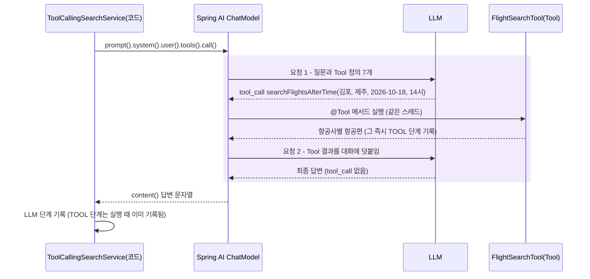

# 8장 Tool Calling Agent — LLM이 결정한다

"모레 김포에서 제주 오후 2시 이후 항공편" — 7장의 Coordinator는 이 문장을 받으면 정규식으로 조건을 뽑고, `afterTime`이 있으니 `TimeFilterAgent`를 부르는 `if` 문을 탔습니다. 다음 단계를 정한 것은 개발자가 쓴 **코드**였습니다.

이번 장에서는 같은 문장을 LLM에게 통째로 맡깁니다. 코드는 질문과 Tool 목록만 넘기고, "시간 조건이 있으니 `searchFlightsAfterTime`을 부르자"는 판단은 LLM이 합니다. 이 책의 질문 "다음 단계를 누가 결정하는가"에 대해, 이 장의 답은 **LLM**입니다. 그 대가로 무엇을 얻고 무엇을 잃는지가 이 장의 주제입니다.

## 8.1 LLM에게 넘기는 세 가지 결정

Anthropic의 글 [Building effective agents](https://www.anthropic.com/engineering/building-effective-agents)는 LLM을 쓰는 시스템을 둘로 나눕니다. 코드가 정해 둔 경로를 따라가는 **workflow**와, LLM이 스스로 경로를 정하는 **agent**입니다. 7장의 Coordinator 패턴은 workflow이고, 이 장의 **Tool Calling Agent**는 agent입니다.

Tool Calling Agent는 LLM 하나가 Tool 목록을 받아 다음 세 가지를 스스로 정합니다.

| 결정 | 예 |
|---|---|
| **어떤 Tool**을 부를지 | `searchFlightsByAirline`인가, `searchFlightsAfterTime`인가, 먼저 `getAirportCode`를 부를 것인가 |
| **어떤 인자**로 부를지 | "모레" → `"2026-10-18"`, "오후 2시" → `"14:00"` |
| **몇 번** 부를지 | 한 번으로 끝낼지, 결과를 보고 다른 Tool을 더 부를지 |

같은 문장을 두 패턴으로 처리하면 차이가 분명해집니다.

| | Coordinator 패턴(7장) | Tool Calling Agent(이 장) |
|---|---|---|
| 처리 순서 | `FlightSearchCoordinator` 코드에 고정 | LLM이 Tool 설명을 읽고 정함 |
| "이후"를 보고 시간 필터를 쓰는 판단 | 코드의 `if (criteria.afterTime() != null)` | LLM이 `searchFlightsAfterTime`을 고름 |
| 처음 보는 표현("저녁 비행기") | 정규식에 없으면 LLM fallback 또는 실패 | LLM이 해석해 볼 수 있음 |
| 같은 입력의 결과 | 항상 같음 | 실행마다 달라질 수 있음 |

LLM이 Tool을 직접 실행하지는 않는다는 점은 [4장](04-tool-calling.md)에서 보았습니다. LLM은 "이 Tool을 이 인자로 불러 달라"고 **요청**하고, 실행은 Spring AI가 맡습니다. 이 장에서 쓰는 Tool 7개는 [5장](05-domain-tools.md)에서 만든 `FlightSearchTool`, `AirportInfoTool`, `AirlineInfoTool`입니다.

## 8.2 ToolCallingSearchService — 코드에 if 문이 없다

`src/main/java/net/java21/flyschedule/service/toolcalling/ToolCallingSearchService.java`

```java
public SearchResponse search(String message, String model, ExecutionTrace trace) {
    ToolResultCapture.getAndClear(); // 이전 요청의 기록이 남아 있지 않도록 비운다
    ToolResultCapture.bind(trace);   // Tool이 실행되는 즉시 TOOL 단계로 기록 (화면에서 실시간으로 보임)

    long start = System.nanoTime();
    try {
        String answer = chatClientProvider.get(model).prompt()
                .system(systemPrompt())
                .user(message)
                .tools(flightSearchTool, airportInfoTool, airlineInfoTool)
                .call()
                .content();

        // Tool 단계는 실행될 때 이미 기록됐다. LLM 호출 구간(Tool 실행을 감싸는 전체 구간)을 마지막에 남긴다
        List<ToolCall> calls = ToolResultCapture.getAndClear();
        trace.record(Kind.LLM, ChatClientProvider.normalize(model),
                "Tool 선택과 답변 작성", "Tool " + calls.size() + "회 호출 후 답변", start);

        if (calls.isEmpty()) {
            return SearchResponse.fail(PATTERN,
                    StringUtils.hasText(answer) ? answer : "LLM이 Tool을 호출하지 않았습니다.", trace);
        }

        TaskResult result = lastFlightResult(calls);
        String text = StringUtils.hasText(answer) ? answer : "검색을 마쳤습니다.";
        return SearchResponse.success(PATTERN, text, result == null ? List.of() : List.of(result), trace);

    } catch (IllegalArgumentException e) {
        ToolResultCapture.getAndClear();
        return SearchResponse.fail(PATTERN, e.getMessage(), trace);
    } catch (Exception e) {
        log.error("Tool Calling 검색 실패 (model={})", model, e);
        ToolResultCapture.getAndClear(); // 실패 전까지 실행된 Tool은 이미 기록됐다. ThreadLocal만 비운다
        trace.record(Kind.LLM, ChatClientProvider.normalize(model), "Tool 선택과 답변 작성",
                "실패: " + ChatClientProvider.describeError(e), start);
        return SearchResponse.fail(PATTERN, ChatClientProvider.describeError(e), trace);
    }
}
```

코드 읽기

1. `ToolResultCapture.bind(trace)`: 이 작업의 실행 기록을 현재 스레드에 연결합니다. 이제 `call()` 안에서 Tool이 실행될 때마다 그 즉시 TOOL 단계가 `trace`에 쌓입니다(8.6).
2. `chatClientProvider.get(model)`: 화면에서 고른 모델(Ollama 또는 Gemini)의 `ChatClient`를 돌려줍니다([2장](02-chatclient.md)). Gemini 키가 없으면 `IllegalArgumentException`이 나고, 첫 번째 `catch`가 그 안내 문장을 그대로 응답합니다.
3. `.tools(...)`: 이 요청에서 LLM이 쓸 수 있는 Tool 객체 3개(메서드 7개)를 넘깁니다.
4. `.call().content()`: Tool 호출이 몇 번 오가든 모두 끝난 뒤 최종 답변 문자열만 돌려줍니다.
5. `ToolResultCapture.getAndClear()`: `call()` 동안 실행된 Tool의 이름·인자·결과·실행 구간을 꺼내고, `bind`로 맺은 연결도 풉니다. 꺼낸 기록은 Tool 호출 횟수와 화면용 결과를 만드는 데 씁니다. 이어서 `call()` 전체 구간을 LLM 단계로 **마지막에** 기록합니다.
6. LLM 호출이 실패하면(두 번째 `catch`) LLM 단계를 "실패: ..."로 남깁니다. 그 전에 실행된 TOOL 단계는 이미 기록되어 있으므로 그대로 남습니다.
7. Tool을 한 번도 부르지 않았으면 실패로 처리합니다. 이유는 8.4에서 봅니다.

코드에는 "어떤 Tool을 부를지" 정하는 분기가 하나도 없습니다. 그 판단은 모두 `call()` 안, LLM에게 넘어갔습니다.

## 8.3 call() 한 번 안에서 일어나는 일

`call()`은 메서드 호출 한 번이지만, 안에서는 LLM과 여러 번 오갑니다.



그림 읽기: 보라색 구간 전체가 실행 기록의 **LLM 단계 하나**입니다. Tool 실행은 그 구간 **안에서** 일어나므로, 화면 타임라인에서도 TOOL 막대는 LLM 막대 안쪽에 그려집니다. 기록되는 순서는 반대입니다. TOOL 단계는 실행되는 순간 먼저 남고, 구간 전체를 감싸는 LLM 단계는 `call()`이 끝난 뒤 마지막에 남습니다.

Tool을 한 번 부르면 모델과는 최소 두 번 오갑니다(Tool 요청 1번 + 최종 답변 1번). LLM이 Tool을 두 번에 나눠 부르면 세 번입니다. 코드에서 보이는 LLM 호출은 `call()` 한 번이지만, 비용과 지연은 왕복 수만큼 늘어납니다.

또 하나 중요한 성질이 있습니다. Spring AI 1.1.4는 `call()`에서 Tool을 **`call()`을 부른 그 스레드에서 순서대로** 실행합니다. 5장의 `ToolResultCapture`가 `ThreadLocal`에 기록을 담아도 요청끼리 섞이지 않는 이유가 이것입니다. `stream()`은 다른 스레드에서 Tool을 실행하므로 이 방식을 쓸 수 없습니다.

## 8.4 system 프롬프트 — Coordinator의 if 문을 대신하는 규칙

코드에서 분기가 사라졌다면, LLM은 무엇을 기준으로 판단할까요? Tool 설명(`@Tool`, `@ToolParam`)과 system 프롬프트입니다.

`src/main/java/net/java21/flyschedule/service/toolcalling/ToolCallingSearchService.java`

```java
private String systemPrompt() {
    return """
            당신은 국내선 항공편 검색 도우미입니다. 반드시 한국어로 답변하세요.
            항공편 정보는 반드시 Tool을 호출해서 얻고, Tool 결과에 없는 내용은 지어내지 마세요.
            오늘: %s (%s)
            규칙:
            - 날짜는 "2026-06-25" 형식으로 Tool에 전달합니다.
            - 시간은 24시간 형식("14:00")으로 전달합니다.
            - 공항은 한글 이름 그대로 전달합니다. (예: "광주", "제주")
            - 답변은 항공편 수와 가장 저렴한 항공편을 중심으로 3~4문장으로 요약합니다.
            """.formatted(LocalDate.now(), LocalDate.now().getDayOfWeek()
                    .getDisplayName(java.time.format.TextStyle.FULL, java.util.Locale.KOREAN));
}
```

| 설계 | 이유 |
|---|---|
| **근거 제한(grounding)**: "반드시 Tool을 호출해서 얻고, Tool 결과에 없는 내용은 지어내지 마세요" | LLM은 그럴듯한 항공편 번호와 가격을 지어낼 수 있습니다(환각). 답의 근거를 Tool 결과로 묶어 둡니다 |
| **오늘 날짜와 요일** `"오늘: %s (%s)"` | LLM은 오늘이 며칠인지 모릅니다. 알려 주지 않으면 "모레"를 학습 데이터 시점 기준으로 계산합니다. 요일(`getDisplayName(TextStyle.FULL, Locale.KOREAN)` → "금요일")까지 주어야 "이번 주 토요일"을 셈할 수 있습니다 |
| **짧은 규칙 목록** | 긴 문단보다 한 줄짜리 규칙이 작은 모델에게도 잘 지켜집니다. 규칙이 Tool 인자 형식을 하나로 맞춰 Tool 안의 `DateParserAgent`·`AirportCodeAgent`가 처리할 수 있게 합니다 |
| **답변 길이 제한** | 출력 토큰이 줄어 빨라지고, 작은 모델이 길게 쓰다 엉뚱한 내용을 덧붙이는 일이 줄어듭니다 |

8.2의 코드에서 Tool 호출이 0회면 실패로 처리한 것도 근거 제한의 연장입니다. Tool 없이 나온 답은 되묻기("어느 공항에서 출발하시나요?")이거나 지어낸 항공편일 수 있으므로, 성공으로 보여 주지 않고 LLM의 말을 안내 문장으로만 보여 줍니다.

> **생각해 보기**
> 요일을 넣었다고 작은 모델이 "다음 주 금요일"을 늘 맞게 계산할까요? 날짜 계산처럼 답이 하나인 일은 LLM보다 코드(`DateParserAgent`, 6장)가 잘합니다. 프롬프트로 도울 수 있는 것과 코드로 옮겨야 할 것을 나눠 보세요.

## 8.5 Tool은 요청마다 넘긴다

`ChatClientConfig`는 Tool을 `defaultTools(...)`로 등록하지 않습니다([4장](04-tool-calling.md)). 같은 `ChatClient`를 여러 곳에서 쓰기 때문입니다.

| 사용하는 곳 | LLM에게 시키는 일 | Tool 필요 |
|---|---|---|
| `SearchCriteriaExtractor`(7장) | 문장 → `SearchCriteria` | 아니요 |
| `FlightSearchPlanner`(9장) | 요청 → 작업 계획 | 아니요 |
| `ResultSynthesizer`(9장) | 결과 요약 → 추천 문장 | 아니요 |
| `ToolCallingSearchService`(이 장) | Tool을 골라 검색하고 답변 | 예 |

기본값으로 등록하면 모든 호출에 Tool 7개의 이름·설명·JSON 스키마가 따라갑니다. 입력 토큰과 지연이 늘고, 조건만 뽑으면 되는 호출에서 LLM이 검색 Tool을 불러 API를 헛되이 호출하며, 작은 모델은 Structured Output(JSON) 대신 Tool 호출로 답해 파싱에 실패하기도 합니다. 그래서 Tool은 필요한 요청에서만 `.tools(...)`로 넘깁니다.

## 8.6 실행 기록에 TOOL 단계 남기기

`call().content()`는 답변 문자열만 줍니다. 그 사이에 무엇이 실행됐는지는 5장의 `ToolResultCapture.capture(...)`가 Tool마다 남긴 기록으로 압니다. 8.2에서 `bind(trace)`로 실행 기록을 연결해 두었으므로, `capture()`는 기록을 쌓는 김에 7장의 `TraceStep` 형식으로 TOOL 단계도 바로 남깁니다.

`src/main/java/net/java21/flyschedule/mcp/ToolResultCapture.java`

```java
public static void bind(ExecutionTrace trace) {
    LIVE_TRACE.set(trace);
}

private static void add(ToolCall call) {
    CALLS.get().add(call);
    ExecutionTrace trace = LIVE_TRACE.get();
    if (trace != null) {
        trace.record(TraceStep.Kind.TOOL, call.toolName(),
                call.failed() ? "Tool 실행 실패" : "LLM이 요청한 Tool 실행",
                call.arguments() + " → " + (call.failed() ? "실패: " + call.error() : summarize(call.result())),
                call.startNanos(), call.endNanos());
    }
}
```

코드 읽기

1. `LIVE_TRACE`: `bind()`로 연결한 실행 기록을 담는 `ThreadLocal`입니다. Tool은 `call()`을 부른 스레드에서 실행되므로(8.3) 같은 스레드에서 이 값을 꺼낼 수 있습니다. 연결된 기록이 없으면(예: `McpController`로 Tool을 직접 부를 때) TOOL 단계를 남기지 않습니다.
2. 기록 시점: TOOL 단계는 Tool이 끝나는 **그 순간** 남습니다. 그래서 작업 API로 진행 상황을 조회하는 화면에서는 LLM이 아직 답을 쓰는 중에도 TOOL 단계가 먼저 나타납니다.
3. 시각: 넘기는 시각은 `capture()`가 잰 `startNanos`·`endNanos`입니다. TOOL 막대는 실제로 실행된 위치와 길이로 그려지고, 나중에 기록되는 LLM 막대가 그 바깥을 감쌉니다.
4. `detail`: "인자 → 결과 요약"입니다. `summarize()`는 항공사별 `Map`이면 "5개 항공사, 14편", `List`면 "N건"처럼 짧게 줄입니다. Tool이 예외를 던졌으면 제목이 "Tool 실행 실패", `detail`이 "인자 → 실패: 메시지"가 됩니다.

화면 아래의 항공편 표는 LLM이 쓴 문장이 아니라 Tool의 실제 반환값입니다.

`src/main/java/net/java21/flyschedule/service/toolcalling/ToolCallingSearchService.java`

```java
@SuppressWarnings("unchecked")
private TaskResult lastFlightResult(List<ToolCall> calls) {
    for (int i = calls.size() - 1; i >= 0; i--) {
        if (calls.get(i).result() instanceof Map<?, ?> map) {
            return TaskResult.of(null, (Map<String, List<FlightInfoResponse>>) map)
                    .withLabel(calls.get(i).arguments());
        }
    }
    return null;
}
```

뒤에서부터 찾아 **마지막** 항공편 검색 결과(`Map`)를 씁니다. LLM이 넓게 검색한 뒤 시간 조건으로 다시 좁혔다면 마지막 결과가 의도에 가장 가깝기 때문입니다. 공항 코드(`String`), 공항 목록(`List`), 실패한 호출(`null`)은 건너뜁니다. LLM의 답변 문장이 틀려도 표는 공공데이터 포털 데이터 그대로입니다.

> **직접 확인하기**
> 앱을 실행하고(`./mvnw spring-boot:run`) 동기 엔드포인트로 요청합니다.
> ```bash
> curl -X POST http://localhost:8080/api/search/tool-calling \
>   -H "Content-Type: application/json" \
>   -d '{"message": "모레 김포에서 제주 오후 2시 이후 항공편", "model": "gemini"}'
> ```
> 기대 결과: `"pattern": "tool-calling"`, `trace`에는 `"kind": "TOOL"` 단계가 먼저 나오고, 마지막 단계가 `"kind": "LLM"`, `"title": "Tool 선택과 답변 작성"`입니다. 각 TOOL 단계의 `startMs`는 LLM 단계의 `startMs`보다 크거나 같고, 끝나는 시각(`startMs + durationMs`)은 LLM 단계 안에 있습니다. 화면(`http://localhost:8080/`)에서 같은 문장을 Tool Calling 패턴으로 실행하면 TOOL 막대가 LLM 막대 안쪽에 그려집니다.

화면은 동기 엔드포인트 대신 작업(job) API(`POST /api/search/tool-calling/jobs` → `GET /api/search/jobs/{jobId}`)를 1.5초 간격으로 조회합니다. LLM 호출이 오래 걸려도 프록시 타임아웃에 걸리지 않게 하기 위해서입니다. 자세한 내용은 [10장](10-choosing-testing-operating.md)에서 다룹니다. TOOL 단계는 실행되는 즉시 기록되므로, 화면에서는 LLM이 답을 쓰는 동안에도 TOOL 단계가 먼저 나타나고 LLM 단계는 마지막에 붙습니다. 9장의 Orchestrator와 비교해 보세요.

## 8.7 실패 사례와 대응

Tool Calling Agent의 유연함은 곧 불확실함입니다. 특히 `qwen2.5:3b-instruct-q4_K_M` 같은 작은 로컬 모델에서 다음 실패가 자주 보입니다. 실패를 알아보는 곳은 실행 기록의 TOOL 단계입니다.

| 실패 | 실행 기록에서 보이는 모습 | 이 프로젝트의 처리 | 더 할 수 있는 대응 |
|---|---|---|---|
| LLM이 Tool을 부르지 않음 | LLM 단계 하나, "Tool 0회 호출 후 답변" | `success: false`, LLM의 말을 그대로 보여 줌 | 프롬프트의 "반드시 Tool을 호출" 규칙 강조, 더 큰 모델 |
| 엉뚱한 Tool을 고름("오후 2시 이후"인데 `searchFlightsByAirline`) | TOOL 단계의 이름이 의도와 다름 | 결과는 그대로 보여 줌 | Tool 설명에 "언제 쓰는지"를 명확히, 넘기는 Tool 수 줄이기 |
| 엉뚱한 인자(날짜를 `"이번 주 금요일"` 그대로, 공항 자리에 `NAARKJJ`) | "Tool 실행 실패", `detail`에 형식 오류 메시지 | 예외 메시지가 Tool 결과로 LLM에게 돌아가고, LLM이 고쳐서 다시 부르기도 함 | Tool 안의 검증 메시지를 "어떻게 고치라"는 문장으로 |
| 없는 공항("서울에서 제주") | `getAirportCode` 실패 → 다른 공항으로 재시도 | 실패한 호출도 TOOL 단계로 남음 | 시스템 프롬프트에 지원 공항 목록 |
| 외부 API 오류(`ExternalApiException`) | Tool 실행 실패, 공공데이터 포털 오류 메시지 | Tool 결과로 LLM에게 전달, 밖으로 나오면 `describeError`가 메시지를 그대로 보여 줌 | 서비스 키(`DATA_GO_KR_SERVICE_KEY`) 확인 |
| LLM 연결 실패 | 그때까지 실행된 TOOL 단계 뒤에 "실패: ..."로 끝난 LLM 단계 | "LLM 서버에 연결할 수 없습니다..." 안내. 재시도는 `spring.ai.retry.max-attempts: 2`로 줄여 둠 | 다른 모델 선택 |
| 응답이 너무 늦음 | 전체 시간이 수십 초 | 화면은 작업 API로 프록시 타임아웃을 피함 | Tool 결과 크기 제한(항공사별 최대 3편, 5장) |

"서울에서 제주" 같은 실패-재시도 흐름은 테스트로도 확인할 수 있습니다.

> **직접 확인하기**
> ```bash
> ./mvnw test -Dtest=ToolCallingSearchServiceTest#failedToolIsRecorded
> ```
> 기대 결과: 테스트가 통과합니다. 이 테스트는 `getAirportCode("서울")`이 실패한 뒤 김포로 다시 검색한 상황에서 실행 기록 제목이 "Tool 실행 실패 → LLM이 요청한 Tool 실행 → Tool 선택과 답변 작성" 순서로 남는지 검사합니다.

대응 방법을 정리하면, 결국 LLM이 보는 정보를 **분명하게** 하는 일입니다. Tool 설명, `@ToolParam` 설명, system 프롬프트 규칙, Tool이 돌려주는 오류 메시지가 모두 LLM의 판단 재료입니다. 그래도 순서가 늘 같은 일이라면, 애초에 LLM에게 맡기지 않는 것이 가장 확실한 대응입니다(7장).

## 8.8 결정성, 지연, 비용

| | Coordinator 패턴(정규식 경로) | Tool Calling Agent |
|---|---|---|
| 코드에서 보이는 LLM 호출 | 0회 | 최소 1회(`call()`) |
| 실제 모델 왕복 | 0회 | Tool을 부르면 2회 이상 |
| 실측 지연 | 약 0.6초(대부분 공공데이터 API 대기) | 모델에 따라 수 초 ~ 수십 초(아래 실측 예는 약 99초) |
| 같은 입력에 같은 결과 | 예 | 보장되지 않음 |

`temperature: 0.0`으로 두어도 Tool 선택이 늘 같다고 보장되지는 않습니다. 모델 버전이 바뀌거나 Tool 설명 한 줄만 바뀌어도 고르는 Tool이 달라질 수 있습니다. 원격 Ollama의 3B 모델은 호출 한 번에 수십 초가 걸리기도 하는데, 왕복이 두세 번 쌓이면 1분을 넘기기 쉽습니다. 실제로 이 앱은 동기 요청이 nginx의 기본 60초 제한에 걸려 504 오류를 낸 적이 있고, 그래서 화면이 작업 API를 쓰게 되었습니다.

데모 사이트(https://fly.java21.net)에서 Ollama `qwen2.5:3b` 모델로 "광주에서 제주" 검색을 실행했을 때 남은 실제 실행 기록입니다.

| 순서 | kind | actor | detail | 시작 | 걸린 시간 |
|---|---|---|---|---|---|
| 1 | TOOL | searchFlightsByAirline | 광주 → 제주, 2026-10-17 → 5개 항공사, 14편 | 약 36.4초 | 약 84ms |
| 2 | LLM | ollama | Tool 1회 호출 후 답변 | 0초 | 99,362ms |

표 읽기: 전체 약 99.4초 가운데 Tool(공공데이터 포털 호출 포함)은 0.1초도 걸리지 않았습니다. LLM이 Tool을 고르는 데 약 36초, Tool 결과를 받아 답을 쓰는 데 약 63초가 걸렸습니다. 지연의 거의 전부가 모델 왕복입니다. 이 요청을 동기 엔드포인트로 보냈다면 nginx의 60초 제한을 넘겨 504로 끝났을 것입니다.

> **생각해 보기**
> 같은 문장을 다섯 번 보냈을 때 TOOL 단계 수가 매번 다르다면, 이 결과를 운영 서비스에서 그대로 써도 될까요? "어떤 요청이라면 괜찮은가"를 기준으로 답해 보세요.

## 8.9 가짜 LLM으로 테스트하기

실제 LLM으로 테스트하면 느리고, 결과가 매번 다르고, 키가 필요합니다. 그래서 `ToolCallingSearchServiceTest`는 LLM을 흉내 냅니다. 핵심은 **`call().content()`가 불릴 때, LLM이 요청한 것처럼 Tool 메서드를 직접 실행하는 것**입니다.

`src/test/java/net/java21/flyschedule/service/toolcalling/ToolCallingSearchServiceTest.java`

```java
ChatClient chatClient = mock(ChatClient.class);
requestSpec = mock(ChatClient.ChatClientRequestSpec.class, RETURNS_SELF);
callSpec = mock(ChatClient.CallResponseSpec.class);
when(chatClient.prompt()).thenReturn(requestSpec);
when(requestSpec.call()).thenReturn(callSpec);
// ...

/** LLM이 Tool을 호출한 뒤 answer를 답한 것처럼 동작하게 한다 */
private void llmCallsToolsThenAnswers(Supplier<String> llmTurn) {
    when(callSpec.content()).thenAnswer(invocation -> llmTurn.get());
}

@Test
@DisplayName("Tool은 실행되는 즉시 TOOL 단계로 기록되고, 그 전체를 감싸는 LLM 구간이 마지막에 기록된다")
void recordsToolCalls() {
    // ...
    llmCallsToolsThenAnswers(() -> {
        airportInfoTool.getAirportCode("광주");
        flightSearchTool.searchFlightsByAirline("광주", "제주", "2026-03-25");
        return "제주항공 7C1402편이 45,000원으로 가장 저렴합니다.";
    });

    SearchResponse response = service.search("3월 25일 광주에서 제주", "gemini");
    // ...
    assertThat(response.trace()).extracting(TraceStep::kind)
            .containsExactly(Kind.TOOL, Kind.TOOL, Kind.LLM);
```

코드 읽기

1. `RETURNS_SELF`: `.system(...)`, `.user(...)`, `.tools(...)`처럼 자기 자신을 돌려주는 체인 메서드가 모두 같은 가짜 객체를 돌려줍니다. 체인을 한 줄씩 정해 둘 필요가 없습니다.
2. `thenAnswer(...)`: `content()`가 불리는 **순간** 람다가 실행됩니다. 람다 안에서 진짜 `FlightSearchTool`·`AirportInfoTool` 메서드를 부르므로, 실제 `call()`처럼 같은 스레드에서 `ToolResultCapture`에 기록이 쌓입니다.
3. Tool 안쪽(`FlightSearchAgent`, `AirportListAgent`)만 Mockito 가짜라서 공공데이터 포털도 부르지 않습니다.

LLM의 판단(어떤 Tool을 부를지)은 테스트가 정해 두고, **그 판단을 받은 뒤의 코드**(기록, 결과 선택, 실패 처리)를 검증하는 방식입니다. 같은 테스트 클래스에는 Tool 0회(`noToolCall`), 마지막 결과 사용(`usesLastFlightResult`), 요청마다 Tool 전달과 오늘 날짜(`passesToolsPerRequest`), LLM 연결 실패(`llmFailure`), LLM이 답을 쓰기 전에 TOOL 단계가 이미 기록되는지(`toolStepsAppearWhileLlmIsRunning`), 이전 요청 기록 정리(`clearsLeftovers`) 테스트도 있습니다. 가짜 LLM 기법 전체는 10장에서 한 번 더 정리합니다.

> **직접 확인하기**
> ```bash
> ./mvnw test -Dtest=ToolCallingSearchServiceTest
> ```
> 기대 결과: 모든 테스트가 통과합니다. LLM 서버나 API 키가 없어도 됩니다.

## 핵심 정리

- Tool Calling Agent는 어떤 Tool을, 어떤 인자로, 몇 번 부를지를 LLM이 정합니다. 코드에는 분기 대신 `.tools(...)`와 system 프롬프트가 남습니다.
- `call()` 한 번 안에서 모델과 2회 이상 오가며, Tool은 같은 스레드에서 실행됩니다. 실행 기록에는 Tool이 실행되는 즉시 TOOL 단계가 남고, 그 구간 전체를 감싸는 LLM 단계 하나가 마지막에 남습니다.
- system 프롬프트에는 오늘 날짜와 요일, 짧은 규칙 목록, "Tool 결과에 없는 내용은 지어내지 마라"는 근거 제한을 넣습니다. Tool 0회 응답은 실패로 봅니다.
- Tool은 `defaultTools`가 아니라 필요한 요청에서만 넘깁니다.
- 유연한 대신 결정성이 낮고, 느리고, 비쌉니다. 실패는 TOOL 단계에서 찾고, LLM이 보는 정보를 분명하게 해서 줄입니다.

## 연습 문제

**1. [기본] system 프롬프트의 요일 검사하기**
system 프롬프트에는 "오늘: 2026-10-16 (금요일)"처럼 요일이 들어갑니다. 그런데 지금 테스트는 날짜만 검사합니다. 요일도 검사해 보세요.
- **힌트**: `ToolCallingSearchService.systemPrompt()`, `ToolCallingSearchServiceTest.passesToolsPerRequest`의 `verify(requestSpec).system(contains(...))`. 요일 문자열은 `LocalDate.now().getDayOfWeek().getDisplayName(TextStyle.FULL, Locale.KOREAN)`으로 만듭니다.
- **완료 기준**: 요일 문자열이 프롬프트에 들어갔는지 검사하는 테스트를 추가하고 `./mvnw test`가 통과합니다.

**2. [기본] 넘기는 Tool 줄이기**
항공사 Tool(`AirlineInfoTool`)은 이 검색에 거의 쓰이지 않습니다. `.tools(...)`에서 빼고 결과를 비교해 보세요.
- **힌트**: `ToolCallingSearchService` 생성자와 `.tools(...)`, 테스트의 `verify(requestSpec).tools(any(), any(), any())`.
- **완료 기준**: 테스트를 새 인자 수에 맞게 고치고 통과합니다. 화면에서 같은 문장을 Ollama로 세 번 실행해 TOOL 단계 수와 전체 시간을 표로 적습니다.

**3. [도전] Tool을 부르지 않은 이유 구분하기**
지금은 Tool 0회면 LLM의 답을 그대로 실패 메시지로 씁니다. 답이 질문(되묻기)인지, 항공편을 지어낸 것인지 구분해 다른 안내를 보여 주세요.
- **힌트**: `search()`의 `calls.isEmpty()` 분기. 예를 들어 답에 `?`가 있으면 되묻기, 편명 패턴(`[A-Z0-9]{2}\d{3,4}`)이 있으면 지어낸 답으로 봅니다.
- **완료 기준**: `noToolCall` 테스트 옆에 "지어낸 편명이 있는 답" 테스트를 추가해, 응답 메시지가 LLM의 답이 아니라 "Tool 결과 없이 만든 답이라 보여 주지 않습니다" 같은 안내인지 검증합니다.

**4. [도전] Tool 결과 요약을 더 알차게**
TOOL 단계의 `detail`은 "5개 항공사, 14편"까지만 보여 줍니다. 여기에 최저가("최저 45,000원")를 덧붙여 보세요.
- **힌트**: `ToolResultCapture.summarize(Object)`. `Map`의 값은 `List<FlightInfoResponse>`이고 일반석 가격은 `getEconomyCharge()`입니다(`null`일 수 있음). 결과가 비었을 때도 생각합니다.
- **완료 기준**: `ToolResultCaptureTest`에 `summarize` 테스트를 추가해 "1개 항공사, 2편, 최저 45,000원" 같은 문자열을 검증하고, `ToolCallingSearchServiceTest`가 그대로 통과합니다.

LLM에게 모든 단계를 맡기면 유연하지만 느리고 불안정했습니다. 다음 장에서는 LLM에게 "나누기"와 "종합하기"만 맡기고 실행은 코드에 돌려주는 [9장 Orchestrator-Workers 패턴](09-orchestrator-workers.md)을 만듭니다.
