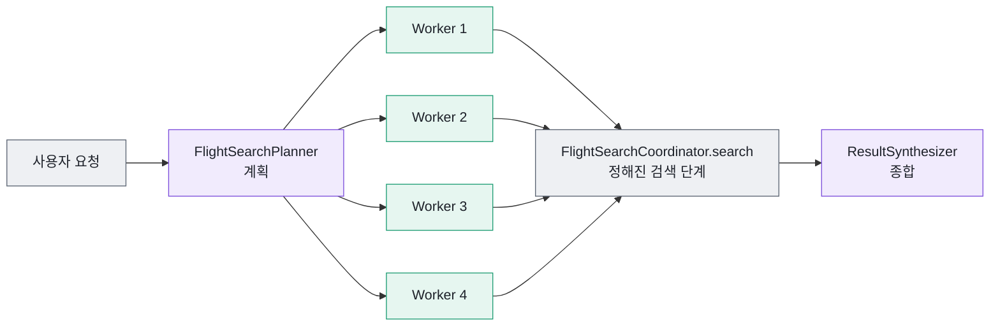
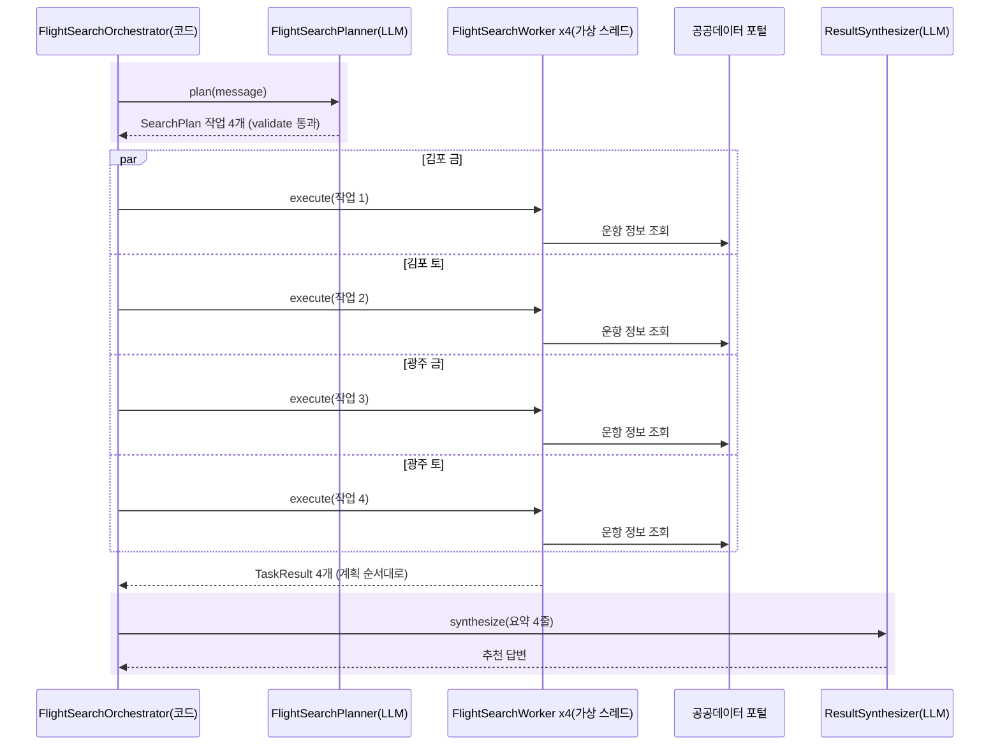

# 9장 Orchestrator-Workers 패턴 — LLM이 나누고 코드가 실행한다

"금요일이나 토요일에 김포나 광주에서 제주" — 이 문장을 처리하려면 몇 번 검색해야 할까요? 날짜 후보 2개 × 출발지 후보 2개, 모두 **4번**입니다.

7장의 Coordinator는 이 문장을 처리하지 못합니다. 처리 순서가 "조건 하나 → 검색 하나"로 코드에 고정되어 있기 때문입니다. 8장의 Tool Calling Agent는 LLM이 검색 Tool을 네 번 불러 줄 수도 있지만, 작은 모델은 한두 번 부르고 멈추기 쉽고, 네 번을 불러도 LLM 왕복마다 하나씩 차례로 기다립니다.

이 장의 답은 둘의 중간입니다. "다음 단계를 누가 결정하는가"에 대해, **무엇을 몇 개 검색할지는 LLM이 결정하고, 검색 자체는 코드가 병렬로 실행합니다.**

## 9.1 세 역할: Planner, Worker, Synthesizer

[Building effective agents](https://www.anthropic.com/engineering/building-effective-agents)는 **orchestrator-workers**를 이렇게 설명합니다. 중앙의 LLM이 작업을 동적으로 나누어 Worker에게 맡기고 결과를 종합한다. 필요한 하위 작업을 **미리 예측할 수 없을 때** 알맞다. 하위 작업이 미리 정해져 있지 않고 입력에 따라 Orchestrator가 정한다는 점이 단순한 병렬화와 다르다.



그림 읽기: 보라색(LLM)은 처음과 끝에만 있습니다. 가운데의 초록색 Worker와 회색 코드는 LLM 없이 실행됩니다. Worker가 몇 개 생길지는 첫 보라색 상자가 정합니다.

| 역할 | 하는 일 | 클래스 | 누가 결정하는가 |
|---|---|---|---|
| Planner | 요청을 하위 작업 N개로 나눈다 | `FlightSearchPlanner` | LLM(검증은 코드) |
| Worker | 작업 하나를 검색한다 | `FlightSearchWorker` | 코드 |
| Synthesizer | 작업별 결과를 비교해 추천한다 | `ResultSynthesizer` | LLM |
| 전체 지휘 | 계획 → 병렬 실행 → 종합을 잇는다 | `FlightSearchOrchestrator` | 코드 |

예제 문장 "이번 주 금요일이나 토요일에 김포나 광주에서 제주 가는 제일 싼 항공편 찾아줘"는 다음 네 작업이 됩니다(오늘이 2026-10-15 목요일일 때).

| 작업 | 출발 | 도착 | 날짜 |
|---|---|---|---|
| 1 | 김포 | 제주 | 2026-10-16(금) |
| 2 | 김포 | 제주 | 2026-10-17(토) |
| 3 | 광주 | 제주 | 2026-10-16(금) |
| 4 | 광주 | 제주 | 2026-10-17(토) |

"조건이 몇 개로 나뉘는가"를 정하는 규칙을 코드로 쓰려면 "A나 B", "A, B 중", "A 또는 B" 같은 표현을 모두 정규식으로 다뤄야 합니다. 이 판단을 LLM에게 맡기는 것이 이 패턴의 핵심입니다.

## 9.2 Planner — Structured Output으로 계획 받기

계획의 모양은 레코드로 정합니다. 작업 하나는 7장의 `SearchCriteria` 그대로입니다.

`src/main/java/net/java21/flyschedule/service/orchestrator/SearchPlan.java`

```java
public record SearchPlan(
        @JsonPropertyDescription("요청을 이렇게 나눈 이유를 한 문장으로")
        String reasoning,

        @JsonPropertyDescription("Worker에게 맡길 검색 작업 목록. 검색 조건이 하나면 1개")
        List<SearchCriteria> tasks
) {
}
```

`src/main/java/net/java21/flyschedule/service/orchestrator/FlightSearchPlanner.java`

```java
public SearchPlan plan(String message, ChatClient chatClient) {
    SearchPlan plan = chatClient.prompt()
            .system("""
                    당신은 국내선 항공편 검색 작업을 나누는 Orchestrator입니다.
                    사용자 요청에 출발지, 도착지, 날짜 후보가 여러 개 있으면 조합마다 검색 작업을 하나씩 만드세요.
                    조건이 하나뿐이면 작업도 하나입니다. 작업은 최대 %d개까지만 만드세요.
                    오늘 날짜는 %s(%s)입니다. "이번 주 금요일" 같은 표현은 YYYY-MM-DD로 바꾸세요.
                    공항은 한글 이름(광주, 김포, 제주 등)으로 적고, 없는 조건은 null로 둡니다.
                    """.formatted(MAX_TASKS, LocalDate.now(), LocalDate.now().getDayOfWeek()))
            .user(message)
            .call()
            .entity(SearchPlan.class);

    return validate(plan);
}
```

코드 읽기

1. `.entity(SearchPlan.class)`: [2장](02-chatclient.md)에서 본 **Structured Output**입니다. Spring AI가 레코드에서 JSON 스키마를 만들어 프롬프트에 붙이고, LLM의 JSON 응답을 `SearchPlan`으로 바꿔 줍니다.
2. `@JsonPropertyDescription`: 스키마에 들어가는 필드 설명입니다. LLM은 이 설명을 읽고 값을 채웁니다. `SearchCriteria`의 각 필드에도 같은 설명이 붙어 있습니다("출발 날짜, YYYY-MM-DD 형식" 등).
3. `reasoning`이 `tasks`보다 앞에 있습니다. LLM은 앞 필드부터 쓰므로, 이유를 먼저 한 문장 적고 나서 목록을 만들게 됩니다. 결과에는 쓰지 않지만 나누는 품질에 도움이 됩니다.
4. 프롬프트에 **오늘 날짜와 요일**을 함께 넣습니다. "이번 주 금요일"을 계산하려면 오늘이 무슨 요일인지 알아야 합니다.
5. "조합마다 하나씩"은 곱으로 나누는 규칙, "조건이 하나뿐이면 작업도 하나"는 단순한 요청을 쓸데없이 쪼개지 않게 하는 규칙입니다.
6. `.tools(...)`가 없습니다. Planner는 계획만 하고 검색은 하지 않습니다.

## 9.3 validate — LLM의 출력을 그대로 믿지 않는다

LLM이 만든 계획은 **사용자 입력과 같은 수준으로** 검증합니다. 계획이 잘못되면 그 개수만큼 공공데이터 포털 API를 헛되이 부르게 됩니다.

`src/main/java/net/java21/flyschedule/service/orchestrator/FlightSearchPlanner.java`

```java
SearchPlan validate(SearchPlan plan) {
    if (plan == null || plan.tasks() == null) {
        throw new IllegalArgumentException("검색 계획을 세우지 못했습니다. 출발지와 도착지를 포함해 다시 입력해 주세요.");
    }

    // "광주"와 "광주공항"은 같은 공항이므로, 출발=도착 검사와 중복 제거는 공항 코드로 비교한다
    Set<List<Object>> seen = new HashSet<>();
    List<SearchCriteria> tasks = plan.tasks().stream()
            .filter(SearchCriteria::hasRoute)
            .filter(task -> airportCodeAgent.isValidAirport(task.departure())
                    && airportCodeAgent.isValidAirport(task.arrival()))
            .filter(task -> !departureCode(task).equals(arrivalCode(task)))
            .filter(task -> seen.add(Arrays.asList(departureCode(task), arrivalCode(task), task.date(),
                    task.afterTime(), task.beforeTime(), task.minPrice(), task.maxPrice())))
            .limit(MAX_TASKS)
            .toList();

    if (tasks.size() < plan.tasks().size()) {
        log.warn("계획 검증: 작업 {}개 중 {}개만 사용", plan.tasks().size(), tasks.size());
    }
    if (tasks.isEmpty()) {
        throw new IllegalArgumentException("검색할 수 있는 작업이 없습니다. 지원하는 공항 이름으로 다시 입력해 주세요.");
    }
    return new SearchPlan(plan.reasoning(), tasks);
}
```

| 검증 | 막는 실수 |
|---|---|
| `plan == null` | 작은 모델이 JSON 형식을 깨뜨려 계획 자체가 없음 |
| `hasRoute()` | 출발지나 도착지를 `null`로 둠 |
| `isValidAirport()` | "서울", "도쿄"처럼 국내선 공항이 아닌 이름([6장](06-specialized-agents.md)의 `AirportCodeAgent`). `getAirportCode()`처럼 `NAARKJJ` 같은 공항 코드는 통과시킵니다 |
| 출발 ≠ 도착(공항 코드로) | "제주 → 제주", "김해 → 부산"(같은 공항) |
| 중복 제거(공항 코드로) | 같은 작업을 두 번, 또는 "광주 → 제주"와 "광주공항 → 제주국제공항"처럼 이름만 다른 같은 작업 |
| `limit(MAX_TASKS)` | 프롬프트의 "최대 4개"를 무시하고 10개를 만들어 API 호출이 폭주 |

프롬프트로 한 번("최대 4개까지만"), 코드로 한 번(`limit`) 막습니다. 프롬프트는 부탁이고 코드는 보장입니다. 검증에 실패하면 `IllegalArgumentException`이 나고, Orchestrator는 Worker와 종합 단계를 실행하지 않고 안내 문장으로 응답합니다.

`validate()`는 패키지 접근 수준이라 같은 패키지의 테스트에서 LLM 없이 바로 부를 수 있습니다. LLM 호출과 검증을 분리해 두면 테스트가 쉬워집니다.

## 9.4 Worker — Coordinator를 재사용한다

Worker는 검색 로직을 새로 만들지 않습니다. 7장에서 `FlightSearchCoordinator`의 검색 단계(날짜 변환 → 공항 코드 변환 → API 호출 → 시간·가격 필터 → 그룹핑)를 `public search(criteria, trace)`로 분리해 두었기 때문입니다.

`src/main/java/net/java21/flyschedule/service/orchestrator/FlightSearchWorker.java`

```java
public TaskResult execute(SearchCriteria task, ExecutionTrace trace) {
    try {
        return trace.run(Kind.WORKER, "FlightSearchWorker", task.label(),
                () -> coordinator.search(task, trace),
                TaskResult::summaryLine);
    } catch (RuntimeException e) {
        // 작업 하나가 실패해도 나머지 작업 결과는 살린다
        log.warn("Worker 실패 ({}): {}", task.label(), e.getMessage());
        return TaskResult.of(task, Map.of());
    }
}
```

코드 읽기

1. `coordinator.search(task, trace)`: 7장의 Coordinator 검색 단계를 그대로 부릅니다. 같은 `trace`를 넘기므로 Coordinator 안의 CODE 단계도 실행 기록에 남습니다.
2. `trace.run(Kind.WORKER, ...)`: 작업 전체를 WORKER 단계 하나로 감쌉니다. `detail`은 `TaskResult::summaryLine`(예: "광주 → 제주 · 2026-10-16: 7편, 최저가 ...")입니다.
3. `catch`: 예외가 나면 `trace.run`이 WORKER 단계를 "실패: ..."로 기록하고 예외를 다시 던지며, Worker가 받아 **빈 결과**를 돌려줍니다.

여기서 **패턴은 조합된다**는 것을 볼 수 있습니다. 판단이 필요한 위쪽(무엇을 검색할지)은 LLM이, 결과가 늘 같아야 하는 아래쪽(어떻게 검색할지)은 코드가 맡습니다. Orchestrator-Workers 패턴 안에 Coordinator 패턴이 부품으로 들어 있는 셈입니다. 세 패턴은 하나를 고르는 선택지이기도 하지만, 층층이 쌓을 수 있는 부품이기도 합니다.

## 9.5 가상 스레드로 Worker를 병렬 실행하기

`src/main/java/net/java21/flyschedule/service/orchestrator/FlightSearchOrchestrator.java`

```java
public SearchResponse orchestrate(String message, String model, ExecutionTrace trace) {
    String modelName = ChatClientProvider.normalize(model);

    try {
        ChatClient chatClient = chatClientProvider.get(model);

        // 1. 계획: LLM이 요청을 하위 작업으로 나눈다
        SearchPlan plan = trace.run(Kind.LLM, modelName, "작업 계획 (FlightSearchPlanner)",
                () -> planner.plan(message, chatClient),
                p -> p.tasks().size() + "개 작업: " + p.tasks().stream()
                        .map(SearchCriteria::label).collect(Collectors.joining(" / ")));

        // 2. 실행: Worker를 작업마다 가상 스레드에서 병렬로 실행한다
        List<TaskResult> results = runWorkers(plan.tasks(), trace);

        // 3. 종합: LLM이 결과를 비교해 추천한다
        String answer = trace.run(Kind.LLM, modelName, "결과 종합 (ResultSynthesizer)",
                () -> synthesizer.synthesize(message, results, chatClient),
                text -> text.length() + "자 답변");

        return SearchResponse.success(PATTERN, answer, results, trace);
    // ...
}

private List<TaskResult> runWorkers(List<SearchCriteria> tasks, ExecutionTrace trace) {
    try (ExecutorService executor = Executors.newVirtualThreadPerTaskExecutor()) {
        List<CompletableFuture<TaskResult>> futures = tasks.stream()
                .map(task -> CompletableFuture.supplyAsync(() -> worker.execute(task, trace), executor))
                .toList();
        return futures.stream().map(CompletableFuture::join).toList();
    }
}
```

코드 읽기

1. 계획과 종합은 `trace.run(Kind.LLM, ...)`으로 감쌉니다. 계획 단계의 `detail`에는 "4개 작업: 김포 → 제주 · 2026-10-16 / ..."처럼 LLM이 나눈 내용이 남습니다.
2. `Executors.newVirtualThreadPerTaskExecutor()`: 작업마다 **가상 스레드**(Java 21)를 하나씩 만듭니다. Worker의 시간은 대부분 공공데이터 포털 응답 대기(블로킹 I/O)입니다. 가상 스레드는 기다리는 동안 OS 스레드를 내어 주므로, `RestClient` 같은 블로킹 코드를 그대로 두고도 가볍게 동시에 실행할 수 있습니다.
3. `supplyAsync(..., executor)`: 실행기를 꼭 넘깁니다. 빼면 공용 `ForkJoinPool`에서 실행됩니다.
4. 먼저 `toList()`로 **모두 제출한 뒤** 모두 `join`합니다. 한 스트림에서 `supplyAsync`와 `join`을 이어 쓰면 하나 제출하고 기다리기를 반복해 순차 실행이 됩니다.
5. `try (...)`: Java 21의 `ExecutorService`는 `AutoCloseable`입니다. 블록을 나갈 때 남은 작업을 기다리고 정리합니다.
6. `worker.execute()`가 예외를 모두 잡으므로 `join()`이 예외를 던지지 않습니다.



그림 읽기: `par` 블록 안의 네 호출은 동시에 진행됩니다. 전체 시간은 "계획 + **가장 느린** Worker + 종합"에 가깝고, Worker 시간의 합보다 짧습니다.

### 여러 스레드가 하나의 실행 기록에 쓴다

Worker 4개가 같은 `ExecutionTrace`에 동시에 기록하므로, 7장의 `ExecutionTrace`는 `add()`와 `steps()`를 `synchronized`로 묶어 두었습니다. 스레드 이름도 함께 남깁니다.

`src/main/java/net/java21/flyschedule/dto/search/ExecutionTrace.java`

```java
/**
 * 가상 스레드는 이름이 비어 있으므로 "virtual-{id}"로 표시합니다.
 */
private static String threadName() {
    Thread thread = Thread.currentThread();
    return thread.isVirtual() ? "virtual-" + thread.threadId() : thread.getName();
}
```

가상 스레드는 기본 이름이 빈 문자열이라, 그대로 두면 어느 Worker가 어느 스레드에서 돌았는지 구분할 수 없습니다.

> **직접 확인하기**
> 화면(`http://localhost:8080/`)에서 **복합** 예시(금·토 × 김포·광주 → 제주)를 고르고 Orchestrator-Workers 패턴을 실행합니다.
> 기대 결과:
> - 패널 위 통계에 `LLM 2회`, `Worker 4개`가 보입니다.
> - 실행 기록에서 초록색 WORKER 막대 4개가 **거의 같은 위치에서 시작해 겹쳐** 그려집니다. 순차 실행이었다면 계단처럼 이어졌을 것입니다.
> - 각 줄 끝의 스레드 이름이 `· virtual-41`, `· virtual-43`처럼 서로 다릅니다(숫자는 실행마다 다름). 계획과 종합 LLM 단계는 요청을 처리한 다른 스레드 이름으로 표시됩니다.
> - 작업마다 하나씩, 검색 결과 카드가 4개 나옵니다. 같은 문장을 Coordinator 패턴으로 실행하면 결과가 하나뿐인 것과 비교해 보세요.

실행 기록 JSON에서 WORKER 단계만 골라 보면 다음과 같은 모양입니다(숫자는 예시).

| order | title | startMs | durationMs | thread |
|---|---|---|---|---|
| 19 | 광주 → 제주 · 2026-10-16 | 1792 | 610 | virtual-43 |
| 22 | 광주 → 제주 · 2026-10-17 | 1792 | 655 | virtual-44 |
| 24 | 김포 → 제주 · 2026-10-17 | 1791 | 820 | virtual-42 |
| 25 | 김포 → 제주 · 2026-10-16 | 1791 | 905 | virtual-41 |

`startMs`는 거의 같고 `thread`는 모두 다릅니다. `order`는 **기록된 순서**라서 먼저 끝난 Worker가 앞 번호를 받습니다. `trace.run()`은 작업이 끝난 뒤 기록하므로, Worker 안의 CODE 단계가 해당 WORKER 단계보다 먼저 번호를 받는다는 점도 눈여겨보세요.

화면은 작업(job) API를 1.5초 간격으로 조회하므로, 계획 LLM 단계가 먼저 나타나고 Worker 단계가 하나씩 늘어나는 모습을 실행 중에 볼 수 있습니다. 8장의 Tool Calling 패턴은 TOOL 단계가 실행 즉시 나타나지만, 그 바깥을 감싸는 LLM 단계는 `call()`이 끝난 뒤 마지막에 붙습니다. 이 장의 Orchestrator는 계획 LLM 단계가 끝나자마자 기록되므로 순서가 반대입니다.

> **주의**
> Java 21에서는 가상 스레드가 `synchronized` 블록 안에 있는 동안 OS 스레드에 고정(pinning)됩니다. `ExecutionTrace.add()`는 목록에 한 줄 추가하는 짧은 구간이라 문제가 없지만, `synchronized` 안에서 I/O를 하면 병렬성이 떨어집니다.

## 9.6 Synthesizer — 요약 한 줄씩만 보낸다

`src/main/java/net/java21/flyschedule/service/orchestrator/ResultSynthesizer.java`

```java
public String synthesize(String message, List<TaskResult> results, ChatClient chatClient) {
    String summaries = results.stream()
            .map(TaskResult::summaryLine)
            .collect(Collectors.joining("\n- ", "- ", ""));

    try {
        String answer = chatClient.prompt()
                .system("""
                        당신은 항공편 검색 결과를 비교해 추천하는 도우미입니다. 한국어로 3~4문장으로 답하세요.
                        아래 검색 결과에 있는 내용만 사용하고, 없는 항공편이나 가격을 지어내지 마세요.
                        """)
                .user("""
                        사용자 요청: %s

                        작업별 검색 결과:
                        %s
                        """.formatted(message, summaries))
                .call()
                .content();
        if (StringUtils.hasText(answer)) {
            return answer;
        }
    } catch (Exception e) {
        log.warn("결과 종합 LLM 호출 실패, 코드 요약 사용: {}", e.getMessage());
    }
    return fallbackSummary(results);
}
```

코드 읽기

1. LLM에게 가는 것은 항공편 전체 목록이 아니라 `TaskResult.summaryLine()` 네 줄입니다. 예: `- 광주 → 제주 · 2026-10-16: 7편, 최저가 제주항공 7C... 07:30 출발 45,000원`.
2. system 프롬프트의 "검색 결과에 있는 내용만 사용하고 ... 지어내지 마세요"는 8장과 같은 근거 제한입니다.
3. LLM 호출이 실패하거나 빈 답을 주면 `fallbackSummary()`가 코드로 최저가 하나를 골라 답합니다.

왜 한 줄씩만 보낼까요? "제일 싼 항공편"을 고르는 데 필요한 정보는 작업별 편수와 최저가뿐입니다. 김포 → 제주는 하루 100편이 넘기도 하는데, 전체를 넘기면 입력 토큰이 늘어 느리고 비싸며, 로컬 모델의 컨텍스트(`num-ctx: 4096`)를 넘기 쉽고, 작은 모델은 정보가 많을수록 엉뚱한 항공편을 섞어 답합니다. **LLM에게는 판단에 필요한 만큼만** 주고, 전체 목록은 응답의 `results`로 화면에 따로 보여 줍니다.

## 9.7 실패를 단계마다 다르게 다룬다

| 단계 | 실패 예 | 처리 | 이유 |
|---|---|---|---|
| 계획 | JSON 깨짐, 알 수 없는 공항만 있음, Gemini 키 없음 | `success: false`, Worker·종합 실행 안 함 | 계획이 없으면 진행할 수 없다 |
| Worker | `ExternalApiException`, 날짜 형식 오류 | 그 작업만 빈 결과, 나머지는 정상 | 4개 중 3개로도 추천할 수 있다 |
| 종합 | LLM 연결 실패, 빈 답 | 코드 요약(`fallbackSummary`)으로 대신 | 검색 결과는 이미 있다 |

같은 "실패"라도 그 단계가 **없으면 안 되는지, 있으면 좋은지**에 따라 처리를 다르게 정했습니다. 다만 지금은 Worker 실패와 "실제로 항공편이 없음"이 둘 다 "항공편 없음"으로 LLM에게 전달됩니다. 연습 문제 2에서 고쳐 봅니다.

## 9.8 결정성과 비용

| | Coordinator(7장) | Tool Calling Agent(8장) | Orchestrator-Workers(이 장) |
|---|---|---|---|
| LLM 호출 | 0회(정규식 경로) | 최소 1회, 모델 왕복 2회 이상 | 계획 1회 + 종합 1회 |
| 작업 수가 늘면 | 처리 불가 | 왕복이 그만큼 순차로 늘어남 | LLM 호출은 그대로, Worker만 병렬로 늘어남 |
| 같은 입력에 같은 결과 | 예 | 보장되지 않음 | 계획만 달라질 수 있음. 검색은 코드라 같음 |

Coordinator의 정규식 경로는 실측 약 0.6초였고 대부분이 공공데이터 API 대기였습니다. Orchestrator는 Worker 4개를 병렬로 돌리므로 검색 시간은 Coordinator 한 번과 비슷하지만, LLM 호출 두 번이 더해집니다. 원격 Ollama 3B 모델은 호출 한 번에 수십 초가 걸리기도 하므로 두 번이면 nginx의 기본 60초 제한을 넘기기 쉽습니다. 화면이 작업 API를 쓰는 이유입니다.

## 9.9 테스트 — 병렬성을 어떻게 증명하는가

LLM의 판단(작업을 몇 개로 나누는가)은 테스트가 정해 두고, 그 판단을 받은 뒤의 코드를 검증합니다. 이 장의 테스트에는 가짜 LLM 기법 두 가지와 병렬성 검증이 나옵니다.

**Planner — `RETURNS_DEEP_STUBS`로 entity 반환 정하기.** 호출 체인 끝만 정해 두면 됩니다.

`src/test/java/net/java21/flyschedule/service/orchestrator/FlightSearchPlannerTest.java`

```java
ChatClient chatClient = mock(ChatClient.class, RETURNS_DEEP_STUBS);
SearchPlan fromLlm = plan(
        task("김포", "제주", "2026-03-27"), task("김포", "제주", "2026-03-28"),
        task("광주", "제주", "2026-03-27"), task("광주", "제주", "2026-03-28"));
when(chatClient.prompt().system(anyString()).user(anyString()).call().entity(SearchPlan.class))
        .thenReturn(fromLlm);
```

`validate()`는 LLM 없이 직접 부릅니다. `dropsInvalidTasks`(알 수 없는 공항·출발=도착·경로 없음), `dedupeAndLimit`(중복과 최대 4개), `normalizesAirportNames`("광주"와 "광주공항"은 같은 공항), `emptyPlan`(`null` 계획) 테스트가 9.3의 표를 하나씩 검증합니다.

**Orchestrator — 병렬성 검증.** Planner와 Synthesizer는 가짜, Worker는 진짜입니다. Coordinator의 검색 단계는 작업마다 300ms가 걸리는 가짜로 바꿉니다.

`src/test/java/net/java21/flyschedule/service/orchestrator/FlightSearchOrchestratorTest.java`

```java
@Test
@DisplayName("Worker는 서로 다른 스레드에서 병렬로 실행된다 (전체 시간 < 작업 시간의 합)")
void workersRunInParallel() {
    when(planner.plan(anyString(), any()))
            .thenReturn(new SearchPlan("2 × 2", List.of(gimpoFri, gimpoSat, gwangjuFri, gwangjuSat)));

    SearchResponse response = orchestrator.orchestrate("금·토 김포·광주 → 제주", "ollama");

    List<TraceStep> workers = response.trace().stream().filter(s -> s.kind() == Kind.WORKER).toList();
    assertThat(workers).hasSize(4);
    assertThat(workers).extracting(TraceStep::thread).doesNotHaveDuplicates().allMatch(name -> name.startsWith("virtual-"));
    assertThat(response.elapsedMs()).isLessThan(WORKER_DELAY_MS * 4);
}
```

코드 읽기

1. 순차 실행이었다면 최소 300ms × 4 = 1,200ms가 걸립니다. **전체 시간이 작업 시간의 합보다 짧다**는 것으로 병렬 실행을 증명합니다.
2. 스레드 이름이 모두 `virtual-`로 시작하고 서로 달라야 합니다. 화면에서 눈으로 본 것을 테스트로 고정한 셈입니다.

같은 클래스의 `workerFailureIsolated`는 한 작업이 예외를 던져도 `success: true`이고 그 작업만 빈 결과인지, `planFailure`는 계획이 실패하면 Coordinator와 Synthesizer를 한 번도 부르지 않는지(`verify(..., never())`) 검사합니다. `ResultSynthesizerTest`는 `ArgumentCaptor`로 LLM에게 실제로 보낸 사용자 메시지를 붙잡아 요약 한 줄씩만 들어갔는지 확인합니다.

> **직접 확인하기**
> ```bash
> ./mvnw test -Dtest='FlightSearchOrchestratorTest,FlightSearchPlannerTest,ResultSynthesizerTest'
> ```
> 기대 결과: 모든 테스트가 통과합니다. `runWorkers()`에서 `supplyAsync`의 두 번째 인자 `executor`를 지우거나, 제출과 `join`을 한 스트림으로 합쳐 보세요. `workersRunInParallel`이 어떻게 실패하는지 확인한 뒤 되돌립니다.

## 핵심 정리

- Orchestrator-Workers 패턴은 LLM이 요청을 하위 작업으로 나누고(Planner), 코드가 병렬로 실행하고(Worker), LLM이 종합합니다(Synthesizer). 하위 작업의 개수가 미리 정해져 있지 않다는 점이 Coordinator와 다릅니다.
- 계획은 `.entity(SearchPlan.class)`와 `@JsonPropertyDescription`으로 받고, `validate()`로 공항·중복·개수를 검증합니다. 프롬프트는 부탁, 코드는 보장입니다.
- Worker는 7장의 `FlightSearchCoordinator.search()`를 재사용합니다. 패턴은 서로 조합되는 부품입니다.
- 가상 스레드와 "모두 제출한 뒤 모두 기다리기"로 Worker를 병렬 실행하고, 화면의 겹친 WORKER 막대와 `virtual-N` 스레드 이름, 테스트의 시간 비교로 확인합니다.
- Synthesizer에는 요약 한 줄씩만 보내고, 실패는 단계의 중요도에 따라 다르게 다룹니다.

## 연습 문제

**1. [기본] 버린 작업을 사용자에게 알리기**
지금은 `validate()`가 작업을 버려도 로그에 경고만 남습니다. 버린 작업과 이유("알 수 없는 공항", "출발=도착", "중복", "최대 4개 초과")를 답변 끝에 덧붙여 보세요.
- **힌트**: `FlightSearchPlanner.validate()`의 필터 체인을 반복문으로 풀면 이유별로 기록하기 쉽습니다. `SearchPlan`에 `List<String> warnings`를 더하고 `FlightSearchOrchestrator.orchestrate()`에서 덧붙입니다.
- **완료 기준**: `FlightSearchPlannerTest`에 "서울 → 제주"를 넣으면 경고에 "알 수 없는 공항"이 들어 있는지 검증하는 테스트가 추가되고 `./mvnw test`가 통과합니다.

**2. [기본] Worker 실패와 "항공편 없음" 구분하기**
실패한 작업의 요약 한 줄이 "김포 → 제주 · 2026-10-16: 검색 실패(...)"처럼 나오게 바꿔 보세요.
- **힌트**: `TaskResult`에 실패 사유 필드를 추가하고 `summaryLine()`에서 분기합니다. 실패 결과는 `FlightSearchWorker.execute()`의 `catch`에서 만듭니다. 레코드 생성자가 바뀌므로 `TaskResult.of`, `withLabel`도 고칩니다.
- **완료 기준**: `FlightSearchOrchestratorTest.workerFailureIsolated`에서 실패한 작업의 `summaryLine()`이 "검색 실패"를 포함하는지 검증하고, 기존 테스트가 모두 통과합니다.

**3. [도전] 작업이 하나면 종합 LLM 호출 생략하기**
작업이 1개면 비교할 대상이 없습니다. 이때는 `ResultSynthesizer`를 부르지 않고 `summaryLine()`을 답으로 쓰게 바꿔 보세요.
- **힌트**: `FlightSearchOrchestrator.orchestrate()`에서 `runWorkers()` 다음, 종합 단계 앞에서 `results.size()`로 분기합니다.
- **완료 기준**: 작업 1개짜리 계획을 넣은 테스트에서 LLM 단계가 1개이고 `verify(synthesizer, never()).synthesize(anyString(), anyList(), any())`가 통과합니다.

**4. [도전] Worker 제한 시간 두기**
공공데이터 포털이 느리면 Worker 하나 때문에 전체가 늦어집니다. 정해진 시간 안에 끝나지 않은 작업은 빈 결과로 처리해 보세요.
- **힌트**: `runWorkers()`의 `supplyAsync(...)` 뒤에 `completeOnTimeout(TaskResult.of(task, Map.of()), ...)`. 제한 시간은 테스트에서 줄일 수 있게 생성자 파라미터로 뺍니다. `try (ExecutorService ...)`는 닫힐 때 남은 작업을 기다린다는 점도 함께 고민해야 합니다.
- **완료 기준**: 가짜 Coordinator 하나가 제한 시간보다 오래 `sleep`하는 테스트에서, 응답이 제한 시간 근처에 돌아오고 해당 작업의 `totalCount`가 0입니다.

세 패턴을 모두 만들었으니, 이제 "언제 무엇을 쓸 것인가"와 "어떻게 테스트하고 운영할 것인가"가 남았습니다. [10장](10-choosing-testing-operating.md)에서 세 패턴을 한 표로 비교해 고르는 기준을 세우고, 가짜 LLM 테스트 기법, 작업 API, 배포까지 운영의 문제를 다룹니다.
