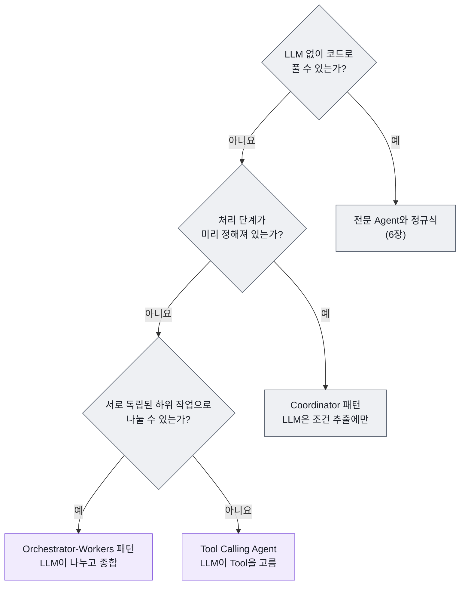
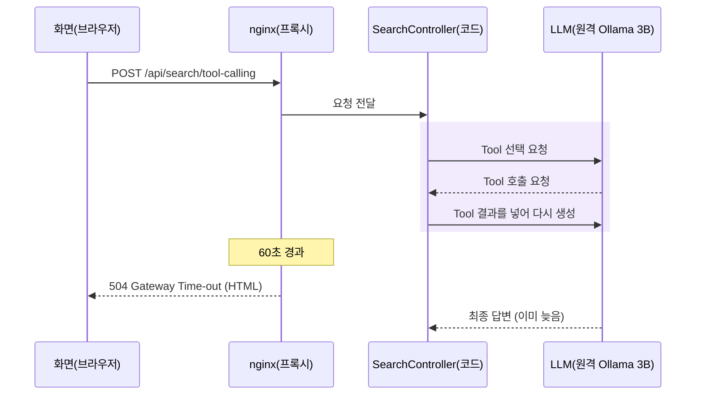
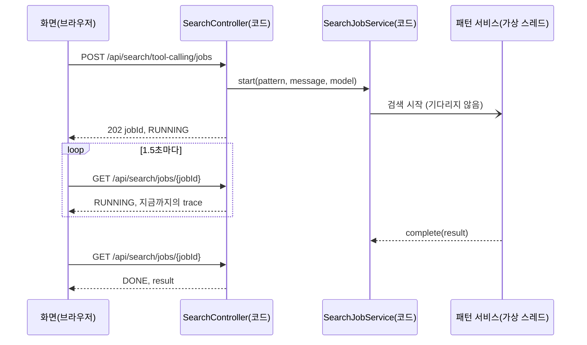
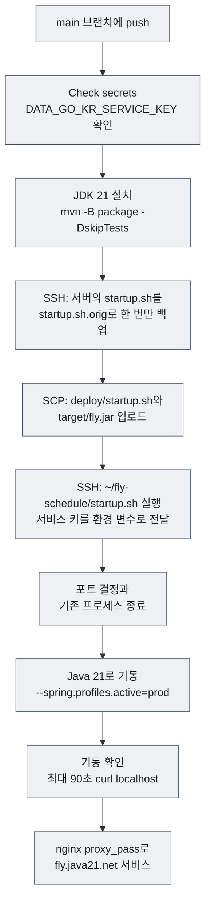
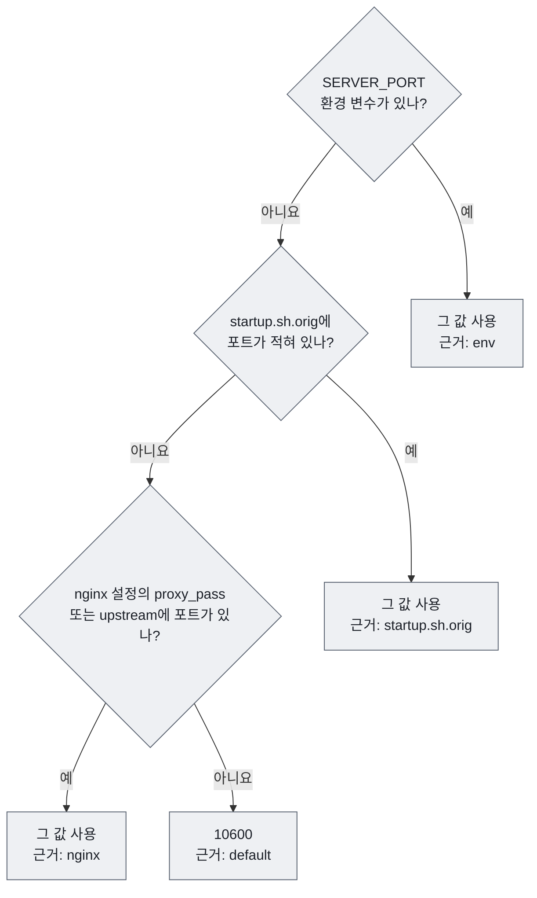

# 10장 패턴 고르기, 테스트, 운영

데모 사이트에 처음 배포한 날, 화면에서 "복합" 예시를 누르고 1분쯤 기다리자 세 패널 중 두 곳에 `504 Gateway Time-out`이 떴습니다. 로컬에서는 멀쩡히 돌던 코드였습니다. 코드에는 버그가 없었습니다. 원격 Ollama의 3B 모델이 Tool 결과를 받아 답을 다시 쓰는 동안, 앞단의 nginx가 60초를 기다리다 연결을 끊은 것입니다.

이 장은 책 전체의 질문 **"다음 단계를 누가 결정하는가 — 코드인가, LLM인가?"** 를 마지막으로 정리합니다. LLM에게 결정을 많이 맡길수록 할 수 있는 일은 늘어나지만, 그만큼 느려지고 결과가 흔들리며 테스트와 운영이 어려워집니다. 앞에서 만든 세 패턴을 한 표에 놓고 고르는 기준을 세운 뒤, LLM 없이 테스트하는 방법과 실제 서버에서 겪은 문제를 차례로 다룹니다.

## 10.1 세 패턴을 한 표에 놓기

7~9장에서 같은 문장을 세 가지 방식으로 처리했습니다. 차이를 한 표로 모으면 다음과 같습니다.

| 기준 | Coordinator 패턴 | Tool Calling Agent | Orchestrator-Workers 패턴 |
|---|---|---|---|
| 다음 단계를 누가 정하나 | 코드 (순서 고정) | LLM (어떤 Tool을 언제 부를지) | LLM이 나누고 종합, 실행은 코드(Worker) |
| 한 요청의 LLM 호출 | 0회(정규식 경로) 또는 1회(LLM fallback) | `call()` 최소 1회. 내부에서 Tool 결과를 받아 다시 생성하므로 모델 왕복은 2회 이상 | 계획 1회 + 종합 1회 (종합이 실패하면 코드 요약) |
| 지연 (실측 감각) | 정규식 경로 약 0.6초, 대부분 공공데이터 포털 API 대기 | 모델 왕복 수에 비례. 원격 3B 모델은 왕복 한 번에 수십 초(실측 약 99초, [8장](./08-tool-calling-agent.md)) | LLM 2회 + 가장 느린 Worker 1개 (Worker는 병렬) |
| 같은 입력에 같은 결과 | 정규식 경로는 항상 같음 | 모델이 고른 Tool·인자에 따라 달라질 수 있음 | 작업 수와 분해 방식이 달라질 수 있음 |
| 잘 맞는 요청 | "내일 광주에서 제주"처럼 형태가 정해진 요청 | 필요한 정보가 요청마다 다른 대화형 요청 | "금요일이나 토요일에 김포나 광주에서 제주"처럼 독립된 조합으로 나뉘는 요청 |
| 약점 | 복합 조건을 처리하지 못함 | Tool을 안 부르거나 엉뚱한 인자를 넣음 | 계획 JSON이 깨지거나 없는 공항을 계획에 넣음 |
| 실패 대응 | 실패한 단계가 trace에 그대로 남음 | `success: false` + LLM의 답을 그대로 보여 줌 | `FlightSearchPlanner.validate()`로 계획 검증, Worker 실패 격리 |
| 자세한 내용 | [7장](./07-coordinator.md) | [8장](./08-tool-calling-agent.md) | [9장](./09-orchestrator-workers.md) |

표의 위에서 아래로 내려갈수록 결정권이 코드에서 LLM으로 옮겨 갑니다. Anthropic의 [Building effective agents](https://www.anthropic.com/engineering/building-effective-agents)는 코드가 경로를 정하는 구조를 **workflow**, LLM이 경로를 정하는 구조를 **agent**로 나눕니다. 이 기준으로 보면 Coordinator 패턴은 workflow, Tool Calling Agent는 agent이고, Orchestrator-Workers 패턴은 그 중간입니다.

### 가장 단순한 것부터

같은 글이 강조하는 원칙은 "가장 단순한 해법에서 시작하고, 필요할 때만 복잡도를 더하라"입니다. 이 프로젝트에 대입하면 다음 순서로 묻게 됩니다.



그림 읽기: 질문은 모두 개발자가 설계 시점에 답하는 것이므로 회색(코드)입니다. 아래로 내려갈수록 결과 상자가 보라색(LLM이 결정)으로 바뀝니다. 위쪽에서 멈출수록 빠르고, 싸고, 테스트하기 쉽습니다.

판단할 때 세 가지를 함께 봅니다.

- **비용**: LLM 호출 수가 곧 비용입니다. 유료 모델이라면 토큰 요금이, 자체 모델이라면 GPU 시간이 듭니다. Coordinator 패턴의 정규식 경로는 0원입니다.
- **지연**: 사용자가 기다리는 시간은 모델 왕복 수에 비례합니다. Tool Calling Agent는 Tool을 한 번 더 부를 때마다 왕복이 하나씩 늘어납니다.
- **결정성**: 같은 입력에 같은 결과가 나와야 하는 기능(예: 요금 계산, 예약)은 결정권을 코드에 둡니다. `temperature: 0.0`으로도 LLM 출력이 완전히 같아지지는 않습니다([1장](./01-llm-and-spring-ai.md)).

> **생각해 보기**
> 실제 서비스라면 세 패턴 중 하나만 고를 필요가 없습니다. 이 프로젝트의 Orchestrator-Workers 패턴은 Worker 안에서 Coordinator 패턴의 검색 단계를 그대로 재사용합니다([9장](./09-orchestrator-workers.md)). "정규식으로 처리되면 Coordinator, 안 되면 Orchestrator"처럼 앞단에서 요청을 나누는 라우터를 둔다면 어떤 장단점이 생길까요?

## 10.2 가짜 LLM으로 테스트하기

진짜 LLM으로 단위 테스트를 돌리면 세 가지 문제가 생깁니다. 결과가 매번 다를 수 있고, 느리고, 키와 네트워크가 있어야 합니다. 그래서 이 프로젝트의 테스트는 LLM과 공공데이터 포털을 모두 가짜로 바꿉니다. 키 없이 `./mvnw test`만으로 세 패턴의 흐름을 검증할 수 있는 이유입니다.

가짜로 바꾸는 지점은 테스트할 대상에 따라 다릅니다.

| 검증하려는 것 | 가짜로 바꾸는 것 | 기법 | 테스트 |
|---|---|---|---|
| LLM의 Structured Output을 받아 쓰는 코드 | `ChatClient` 체인 전체 | `RETURNS_DEEP_STUBS` | `SearchCriteriaExtractorTest` |
| LLM이 Tool을 부른 뒤의 기록과 결과 처리 | `ChatClient`의 요청 체인과 `content()` | `RETURNS_SELF` + `thenAnswer`에서 Tool 직접 실행 | `ToolCallingSearchServiceTest` |
| Worker의 병렬 실행 | Planner, Synthesizer, Coordinator | 일부러 느린 가짜 + 시간·스레드 검증 | `FlightSearchOrchestratorTest` |
| 공공데이터 포털 요청 URL과 오류 처리 | HTTP 서버 | `MockRestServiceServer` | `ApiClientServiceTest` |
| 백그라운드 작업의 상태 변화 | 패턴 서비스 | `CountDownLatch` + Awaitility | `SearchJobServiceTest` |

### 기법 1: 체인을 통째로 흉내 내기 (RETURNS_DEEP_STUBS)

`chatClient.prompt().system(...).user(...).call().entity(...)`는 메서드 다섯 개가 이어진 체인입니다. 단계마다 mock을 만들면 테스트가 길어집니다. Mockito의 `RETURNS_DEEP_STUBS`는 체인 중간 객체를 자동으로 만들어 주므로, 마지막 반환값만 정하면 됩니다.

`src/test/java/net/java21/flyschedule/service/ai/SearchCriteriaExtractorTest.java`

```java
    @BeforeEach
    void setUp() {
        extractor = new SearchCriteriaExtractor();
        chatClient = mock(ChatClient.class, RETURNS_DEEP_STUBS);
    }
// ...
    @Test
    @DisplayName("정규식으로 충분하면 LLM을 호출하지 않는다")
    void regexSkipsLlm() {
        SearchCriteriaExtractor.Extraction extraction = extractor.extract("내일 광주에서 제주", () -> chatClient);

        assertThat(extraction.usedLlm()).isFalse();
        verifyNoInteractions(chatClient);
    }

    @Test
    @DisplayName("정규식이 실패하면 LLM의 Structured Output을 사용한다")
    void usesLlmWhenRegexFails() {
        SearchCriteria fromLlm = new SearchCriteria("김포", "제주", "2026-03-27", null, null, null, null);
        when(chatClient.prompt().system(anyString()).user(anyString()).call().entity(SearchCriteria.class))
                .thenReturn(fromLlm);

        SearchCriteriaExtractor.Extraction extraction =
                extractor.extract("이번 주 금요일 서울에서 제주도 가는 비행기", () -> chatClient);

        assertThat(extraction.usedLlm()).isTrue();
        assertThat(extraction.criteria()).isEqualTo(fromLlm);
    }
```

코드 읽기

- `when(chatClient.prompt()...entity(SearchCriteria.class))`는 "LLM이 이 JSON을 돌려줬다고 치자"는 뜻입니다. LLM의 판단은 가짜로 고정하고, 그 결과를 받아 쓰는 코드만 검증합니다.
- `verifyNoInteractions(chatClient)`는 **LLM을 부르지 않았다**는 사실을 검증합니다. 비용과 결정성에 관한 약속([7장](./07-coordinator.md)의 정규식 우선)을 테스트로 고정한 것입니다.
- 같은 파일의 `llmWithoutRoute()`는 LLM이 출발지를 비워 돌려준 경우를 흉내 냅니다. LLM의 잘못된 출력도 이렇게 재현할 수 있습니다.

### 기법 2: LLM이 Tool을 부른 것처럼 만들기 (RETURNS_SELF)

Tool Calling Agent는 더 까다롭습니다. 실제로는 `call().content()` 안에서 Spring AI가 LLM의 요청을 받아 Tool 메서드를 실행합니다([4장](./04-tool-calling.md)). 테스트에서는 `content()`가 불릴 때 **Tool 메서드를 직접 실행**하는 가짜 응답을 만듭니다.

`src/test/java/net/java21/flyschedule/service/toolcalling/ToolCallingSearchServiceTest.java`

```java
        ChatClient chatClient = mock(ChatClient.class);
        requestSpec = mock(ChatClient.ChatClientRequestSpec.class, RETURNS_SELF);
        callSpec = mock(ChatClient.CallResponseSpec.class);
        when(chatClient.prompt()).thenReturn(requestSpec);
        when(requestSpec.call()).thenReturn(callSpec);
// ...
    /** LLM이 Tool을 호출한 뒤 answer를 답한 것처럼 동작하게 한다 */
    private void llmCallsToolsThenAnswers(Supplier<String> llmTurn) {
        when(callSpec.content()).thenAnswer(invocation -> llmTurn.get());
    }
// ...
        llmCallsToolsThenAnswers(() -> {
            airportInfoTool.getAirportCode("광주");
            flightSearchTool.searchFlightsByAirline("광주", "제주", "2026-03-25");
            return "제주항공 7C1402편이 45,000원으로 가장 저렴합니다.";
        });

        SearchResponse response = service.search("3월 25일 광주에서 제주", "gemini");

        assertThat(response.success()).isTrue();
        assertThat(response.pattern()).isEqualTo("tool-calling");
        assertThat(response.message()).contains("7C1402");
        assertThat(response.trace()).extracting(TraceStep::kind)
                .containsExactly(Kind.TOOL, Kind.TOOL, Kind.LLM);
```

코드 읽기

- `RETURNS_SELF`는 `system(...)`, `user(...)`, `tools(...)`처럼 자기 자신을 돌려주는 빌더 메서드를 한 번에 처리합니다. 그래서 `requestSpec` 하나로 체인이 끝까지 이어집니다.
- `thenAnswer` 안에서 진짜 Tool 객체(`airportInfoTool`, `flightSearchTool`)의 메서드를 부릅니다. Tool 안의 `ToolResultCapture`가 진짜로 동작하므로, trace에 TOOL 단계가 실행 순서대로 먼저 기록되고 LLM 단계가 마지막에 붙는지 확인할 수 있습니다.
- Tool 아래의 `FlightSearchAgent`만 mock입니다. 즉 "LLM의 결정"과 "외부 API"만 가짜이고 그 사이의 코드는 모두 진짜입니다.

같은 파일에는 실패 사례도 모여 있습니다. `noToolCall()`은 LLM이 Tool을 하나도 부르지 않고 되묻는 경우, `failedToolIsRecorded()`는 LLM이 "서울"이라는 없는 공항을 넣었다가 "김포"로 다시 시도하는 경우, `llmFailure()`는 Tool 실행 뒤 LLM 연결이 끊긴 경우(TOOL 단계는 남고 LLM 단계가 "실패: ..."로 기록됨)입니다. 진짜 모델로는 일부러 일으키기 어려운 상황을 가짜 LLM은 몇 줄로 재현합니다.

### 기법 3: 병렬성 검증하기

Orchestrator-Workers 패턴에서 검증할 핵심은 "Worker가 정말 동시에 도는가"입니다. 가짜 Coordinator에 일부러 300ms 지연을 넣고, 전체 시간이 작업 시간의 합보다 짧은지 봅니다.

`src/test/java/net/java21/flyschedule/service/orchestrator/FlightSearchOrchestratorTest.java`

```java
        // Coordinator 검색 단계는 작업마다 WORKER_DELAY_MS가 걸린다고 가정
        when(coordinator.search(any(), any())).thenAnswer(invocation -> {
            SearchCriteria task = invocation.getArgument(0);
            Thread.sleep(WORKER_DELAY_MS);
            int price = task.departure().equals("광주") ? 45000 : 52000;
            return TaskResult.of(task, Map.of("제주항공", List.of(flight("7C" + price, "제주항공", "1030", "1120", price))));
        });
// ...
    @Test
    @DisplayName("Worker는 서로 다른 스레드에서 병렬로 실행된다 (전체 시간 < 작업 시간의 합)")
    void workersRunInParallel() {
        when(planner.plan(anyString(), any()))
                .thenReturn(new SearchPlan("2 × 2", List.of(gimpoFri, gimpoSat, gwangjuFri, gwangjuSat)));

        SearchResponse response = orchestrator.orchestrate("금·토 김포·광주 → 제주", "ollama");

        List<TraceStep> workers = response.trace().stream().filter(s -> s.kind() == Kind.WORKER).toList();
        assertThat(workers).hasSize(4);
        assertThat(workers).extracting(TraceStep::thread).doesNotHaveDuplicates().allMatch(name -> name.startsWith("virtual-"));
        assertThat(response.elapsedMs()).isLessThan(WORKER_DELAY_MS * 4);
    }
```

코드 읽기

- `planner.plan(...)`이 정해진 `SearchPlan`을 돌려주므로 "LLM이 4개로 나눴다"는 상황이 고정됩니다. 병렬 실행 코드만 남습니다.
- 두 가지 증거를 함께 봅니다. 스레드 이름이 모두 다르고 `virtual-`로 시작하는지, 그리고 전체 시간이 `300ms × 4`보다 짧은지입니다. 순차 실행이었다면 1200ms를 넘습니다.

### 기법 4: 외부 API 흉내 내기 (MockRestServiceServer)

LLM만 가짜로 바꾸는 것이 아닙니다. 공공데이터 포털도 테스트에서는 `MockRestServiceServer`가 대신합니다. `RestClient.Builder`에 묶어 두면 실제 네트워크로 나가지 않습니다.

`src/test/java/net/java21/flyschedule/service/api/ApiClientServiceTest.java`

```java
    @BeforeEach
    void setUp() {
        RestClient.Builder builder = RestClient.builder();
        server = MockRestServiceServer.bindTo(builder).build();

        DataGoKrApiProperties properties = new DataGoKrApiProperties();
        properties.setUrl("https://apis.data.go.kr/1613000/DmstcFlightNvgInfo");
        properties.setServiceKey("test-key");
        service = new ApiClientService(properties, builder);
    }
// ...
    @Test
    @DisplayName("API가 오류 코드(resultCode != 00)를 돌려주면 그 이유를 담아 알린다")
    void resultCodeError() {
        server.expect(requestTo(containsString("/GetFlightOpratInfoList"))).andRespond(withSuccess("""
                {"response":{"header":{"resultCode":"30","resultMsg":"SERVICE_KEY_IS_NOT_REGISTERED_ERROR"}}}
                """, MediaType.APPLICATION_JSON));

        assertThatThrownBy(() -> service.getFlightSchedule("NAARKJJ", "NAARKPC", "20261016"))
                .isInstanceOf(ExternalApiException.class)
                .hasMessageContaining("SERVICE_KEY_IS_NOT_REGISTERED_ERROR");
    }
```

코드 읽기

- `ApiClientService`가 `RestClient.Builder`를 주입받도록 만든 덕분에([5장](./05-domain-tools.md)) 테스트에서 가짜 서버를 끼울 수 있습니다. 테스트하기 쉬운 구조는 설계 단계에서 정해집니다.
- 같은 파일의 `requestsEnoughRows()`는 요청 URL에 `numOfRows=500`이 들어가는지 검증합니다. 하루 100편이 넘는 노선이 잘리던 실제 버그(부록 B)가 다시 생기지 않게 막는 테스트입니다.

### 기법 5: 비동기 작업 기다리기 (Awaitility)

10.3절의 작업 API는 검색을 다른 스레드에서 실행합니다. 테스트가 결과를 바로 확인하면 아직 끝나지 않았을 수 있습니다. `Thread.sleep`으로 넉넉히 기다리면 테스트가 느려지고 가끔 실패합니다. Awaitility는 "조건이 참이 될 때까지, 최대 몇 초"를 선언합니다.

`src/test/java/net/java21/flyschedule/service/job/SearchJobServiceTest.java`

```java
        when(toolCalling.search(anyString(), anyString(), any(ExecutionTrace.class))).thenAnswer(invocation -> {
            ExecutionTrace trace = invocation.getArgument(2);
            trace.record(Kind.TOOL, "searchFlightsByAirline", "LLM이 요청한 Tool 실행", "광주 → 제주");
            firstStepRecorded.countDown();
            finish.await(5, TimeUnit.SECONDS);
            return SearchResponse.success("tool-calling", "완료", List.of(), trace);
        });

        SearchJob job = jobService.start("tool-calling", "내일 광주에서 제주", "ollama");

        assertThat(firstStepRecorded.await(5, TimeUnit.SECONDS)).isTrue();
        assertThat(job.status()).isEqualTo(SearchJob.Status.RUNNING);
        assertThat(jobService.find(job.id()).orElseThrow().trace().steps()).hasSize(1);

        finish.countDown();
        await().atMost(Duration.ofSeconds(5)).until(() -> job.status() == SearchJob.Status.DONE);
        assertThat(job.result().message()).isEqualTo("완료");
```

코드 읽기

- `CountDownLatch` 두 개로 가짜 검색을 "첫 단계 기록 후 멈춤" 상태에 붙잡아 둡니다. 그 사이에 RUNNING 상태와 중간 trace를 확인합니다.
- `finish.countDown()`으로 검색을 풀어 준 뒤 `await().atMost(...).until(...)`로 DONE이 될 때까지 기다립니다. 빨리 끝나면 바로 다음 줄로 넘어갑니다.

> **직접 확인하기**
> 다섯 기법의 테스트만 골라 실행합니다.
>
> ```bash
> ./mvnw test -Dtest='SearchCriteriaExtractorTest,ToolCallingSearchServiceTest,FlightSearchOrchestratorTest,ApiClientServiceTest,SearchJobServiceTest'
> ```
>
> 기대 결과: `BUILD SUCCESS`. Ollama, Gemini, 서비스 키가 없어도 통과합니다. 전체 테스트는 `./mvnw test`로 실행하고, 실행 결과의 `Tests run` 줄에서 개수를 확인합니다.

### 가짜 LLM이 알려 주지 않는 것

가짜 LLM 테스트는 **LLM 바깥의 코드**를 검증합니다. 프롬프트가 좋은지, 작은 모델이 Tool을 제대로 고르는지는 알려 주지 않습니다. 이 부분은 진짜 모델로 확인해야 합니다. 이 책에서는 화면의 예시 버튼(기본, 시간, 가격, 복합)을 Ollama와 Gemini로 한 번씩 실행해 실행 기록을 눈으로 비교하는 방식을 씁니다. 프롬프트를 고쳤다면 이 확인을 다시 합니다.

> **팁**
> 진짜 모델로 반복 확인할 문장이 늘어나면, 기대하는 Tool 이름과 인자를 적은 "평가용 문장 목록"을 만들어 두고 한 번에 돌려 보는 방법이 있습니다. 10.5절의 Evaluator-Optimizer 패턴과 같은 생각입니다.

## 10.3 작업(job) API — 프록시 타임아웃 피하기

### 무슨 일이 있었나

장 도입부의 504는 이렇게 생겼습니다. 처음 만든 검색 API(`POST /api/search/{pattern}`)는 검색이 끝날 때까지 HTTP 연결을 붙잡고 있었습니다. 애플리케이션 쪽 타임아웃은 넉넉했습니다.

| 구간 | 설정 | 값 |
|---|---|---|
| 애플리케이션 → LLM·공공데이터 포털 | `spring.http.client.read-timeout` | 300s |
| 브라우저 → 애플리케이션 (Tomcat) | `server.tomcat.connection-timeout` | 300000ms |
| 브라우저 → nginx → 애플리케이션 | nginx `proxy_read_timeout` | 기본 60s |

문제는 표의 마지막 줄입니다. 데모 서버는 nginx 뒤에 있고, nginx는 기본값으로 60초 안에 응답이 오지 않으면 연결을 끊고 HTML 오류 페이지(504)를 돌려줍니다. 화면은 그 HTML을 JSON으로 읽으려다 실패했습니다.

실제 숫자로 보면 더 분명합니다. 데모 사이트에서 Ollama `qwen2.5:3b`로 Tool Calling 검색을 한 번 실행한 실행 기록입니다(필드 일부).

```json
[
  {"kind": "TOOL", "actor": "searchFlightsByAirline", "title": "LLM이 요청한 Tool 실행",
   "detail": "광주 → 제주, 2026-10-17 → 5개 항공사, 14편", "startMs": 36400, "durationMs": 84},
  {"kind": "LLM", "actor": "ollama", "title": "Tool 선택과 답변 작성",
   "detail": "Tool 1회 호출 후 답변", "startMs": 0, "durationMs": 99362}
]
```

`startMs`는 약 36.4초를 반올림한 값입니다. Tool은 0.1초도 걸리지 않았지만 LLM 구간은 약 99.4초입니다. 동기 API였다면 60초에서 끊겼을 요청입니다.



그림 읽기: 보라색 구간(LLM 왕복)이 60초를 넘기는 순간 nginx가 먼저 포기합니다. 애플리케이션은 검색을 끝까지 하지만, 그 결과를 받을 연결이 이미 없습니다.

해결 방법은 두 가지입니다. nginx의 제한을 늘리거나, 요청 하나가 오래 걸리지 않게 바꾸는 것입니다. 이 프로젝트는 둘 다 합니다. nginx 설정은 10.4절에서 다루고, 여기서는 코드를 바꾼 방법을 봅니다.

### 요청을 "시작"과 "조회"로 나누기

작업 API는 검색을 백그라운드에서 시작하고 **작업 ID만 바로** 돌려줍니다. 화면은 짧은 요청으로 상태를 여러 번 묻습니다.

| 메서드 | 경로 | 응답 |
|---|---|---|
| `POST` | `/api/search/{pattern}/jobs` | `202 Accepted`, `{"jobId": "...", "status": "RUNNING", "trace": [...], "result": null}` |
| `GET` | `/api/search/jobs/{jobId}` | `200`, `status`가 `RUNNING`이면 지금까지의 trace, `DONE`이면 `result`까지. 없는 ID는 `404` |



그림 읽기: 어느 요청도 몇 밀리초 안에 끝나므로 nginx의 60초 제한에 걸리지 않습니다. 덤으로 화면이 1.5초마다 trace를 다시 그리므로, 실행 기록이 한 단계씩 쌓이는 모습을 실시간으로 볼 수 있습니다. Tool Calling 패턴도 TOOL 단계가 Tool 실행 즉시 기록되므로(`ToolResultCapture.bind`, 8장), 위 예라면 약 36초에 TOOL 단계가 먼저 나타나고 약 99초에 LLM 단계가 붙습니다.

핵심 코드는 `SearchJobService.start()`입니다.

`src/main/java/net/java21/flyschedule/service/job/SearchJobService.java`

```java
    public SearchJob start(String pattern, String message, String model) {
        TracedSearch search = searches.get(pattern);
        if (search == null) {
            throw new IllegalArgumentException("알 수 없는 패턴입니다: " + pattern);
        }
        removeExpired();
        if (jobs.size() >= MAX_JOBS) {
            throw new IllegalArgumentException("실행 중인 검색이 너무 많습니다. 잠시 후 다시 시도하세요.");
        }

        SearchJob job = new SearchJob(UUID.randomUUID().toString(), pattern);
        jobs.put(job.id(), job);
        executor.submit(() -> {
            try {
                job.complete(search.run(message, model, job.trace()));
            } catch (Exception e) {
                // 각 패턴이 예외를 응답으로 바꾸지만, 놓친 예외가 있어도 작업이 영원히 RUNNING으로 남지 않게 한다
                log.error("검색 작업 실패 ({})", job.id(), e);
                job.complete(SearchResponse.fail(pattern, "검색 중 오류가 발생했습니다: " + e.getMessage(), job.trace()));
            }
        });
        return job;
    }
```

코드 읽기

- `searches`는 패턴 이름과 메서드 참조(`coordinator::coordinate` 등)를 묶은 `Map`입니다. 세 패턴 서비스에는 **trace를 밖에서 넘겨받는 오버로드**(`coordinate(message, model, trace)`)가 있습니다. 작업이 trace를 쥐고 있으므로 실행 중에도 읽을 수 있습니다. `ExecutionTrace.steps()`는 `synchronized`로 복사본을 돌려주므로 다른 스레드에서 읽어도 안전합니다.
- `executor`는 `Executors.newVirtualThreadPerTaskExecutor()`입니다. 대부분의 시간을 LLM과 API 응답을 기다리며 보내는 작업이므로 가상 스레드가 잘 맞습니다([9장](./09-orchestrator-workers.md)).
- `catch (Exception e)`는 마지막 안전망입니다. 이것이 없으면 놓친 예외 하나로 작업이 영원히 RUNNING에 머물고, 화면은 최대 대기 시간(6분)까지 조회를 계속합니다. `unexpectedExceptionCompletesJob()` 테스트가 이 약속을 지킵니다.
- 작업은 메모리에만 있습니다. 끝난 작업은 `RETENTION`(10분) 뒤 `@Scheduled` 메서드가 지우고, 동시에 `MAX_JOBS`(200)개까지만 받습니다. 서버를 재시작하면 작업은 사라집니다. 여러 서버로 늘린다면 Redis 같은 공용 저장소가 필요합니다.

동기 API(`POST /api/search/{pattern}`)는 지우지 않았습니다. curl이나 `.http` 파일로 한 번에 결과를 보기에는 동기 API가 편하고, 프록시가 없는 로컬에서는 문제가 없기 때문입니다.

> **직접 확인하기**
> 애플리케이션을 실행한 뒤 작업을 시작하고, 돌려받은 `jobId`로 상태를 조회합니다.
>
> ```bash
> curl -s -X POST http://localhost:8080/api/search/orchestrator/jobs \
>   -H "Content-Type: application/json" \
>   -d '{"message": "이번 주 금요일이나 토요일에 김포나 광주에서 제주", "model": "ollama"}'
> curl -s http://localhost:8080/api/search/jobs/{jobId}
> ```
>
> 기대 결과: 첫 요청은 바로 `"status":"RUNNING"`과 `"result":null`을 돌려줍니다. 두 번째 요청을 몇 번 반복하면 `trace` 배열이 늘어나다가 `"status":"DONE"`과 함께 `result`가 채워집니다.

> **주의**
> 화면의 `requestJson()`(`src/main/resources/templates/index.html`)은 응답의 `Content-Type`이 JSON이 아니면 `HTTP 504 - 서버가 응답하지 않습니다...`처럼 상태 코드를 담은 메시지를 보여 줍니다. 프록시 오류 페이지를 JSON으로 읽다가 엉뚱한 파싱 오류가 나던 문제를 막기 위한 것입니다. 프록시 뒤에서 동작하는 화면을 만든다면 같은 처리가 필요합니다.

## 10.4 배포 — main에 push하면 서버까지

데모 사이트(https://fly.java21.net)는 GitHub Actions가 배포합니다. `main` 브랜치에 push하면 빌드부터 서버 재시작까지 자동으로 진행됩니다. Pull request에서는 빌드만 하고 배포 단계는 건너뜁니다(배포 단계마다 `if: github.event_name == 'push'`).



그림 읽기: A~F는 `.github/workflows/maven.yml`의 단계, G~I는 서버에서 도는 `deploy/startup.sh`의 단계입니다. 배포에는 LLM이 끼지 않으므로 모든 단계가 코드(회색)입니다. 서비스 키가 없으면 B에서 멈춥니다. 키 없이 배포된 앱은 모든 검색이 실패하기 때문입니다.

> **주의**
> 빌드 단계는 `-DskipTests`로 테스트를 건너뜁니다. push하기 전에 로컬에서 `./mvnw test`를 실행하세요.

### 비밀 값은 어디에 두나

API 키는 코드와 `application.yml`에 적지 않습니다. `application.yml`은 환경 변수를 읽기만 합니다(`service-key: ${DATA_GO_KR_SERVICE_KEY:}`, `api-key: ${GOOGLE_GENAI_API_KEY:not-set}`). 배포 환경에서는 값을 두 곳에 나눠 둡니다.

| 위치 | 값 | 용도 |
|---|---|---|
| GitHub Secrets (Settings > Secrets and variables > Actions) | `SSH_IP`, `SSH_ID`, `SSH_PASSWORD`, `SSH_PORT` | 배포 서버 접속 |
| GitHub Secrets | `DATA_GO_KR_SERVICE_KEY` | workflow가 `envs`로 원격 셸에 넘기고, `startup.sh`가 실행하는 java 프로세스가 물려받음 |
| 서버의 `~/fly-schedule/.env` | `GOOGLE_GENAI_API_KEY=...` (선택) | `startup.sh`가 파일이 있으면 읽어 환경 변수로 내보냄 |

Gemini 키가 없어도 앱은 정상으로 기동합니다. 화면에서 Gemini를 고르면 `ChatClientProvider`가 "Gemini API 키가 설정되지 않았습니다..."라고 안내합니다([1장](./01-llm-and-spring-ai.md)). `.env`는 `.gitignore`에 들어 있습니다.

### startup.sh가 하는 일

`deploy/startup.sh`는 배포마다 서버로 복사되어 실행됩니다. 순서는 다음과 같습니다.

1. jar(`~/fly-schedule/target/fly.jar`, 없으면 `~/fly-schedule/fly.jar`)를 찾고, `.env`가 있으면 읽습니다. `DATA_GO_KR_SERVICE_KEY`가 없으면 멈춥니다.
2. 포트를 정합니다(아래 그림).
3. Java를 고릅니다. `JAVA_BIN` → `/usr/local/java/java21/bin/java` → `$JAVA_HOME/bin/java` → `PATH`의 `java` 순서입니다. 비대화식 SSH에서는 `PATH`의 `java`가 21이 아닐 수 있기 때문입니다.
4. 실행 중인 앱을 종료합니다. `app.pid`의 프로세스, `fly.jar`를 실행 중인 java 프로세스, 같은 포트를 잡고 있는 프로세스에 종료 신호를 보내고 30초 안에 끝나지 않으면 강제 종료합니다.
5. `nohup`(Linux에서는 `setsid`도)으로 새로 시작합니다. `--server.port`와 `--spring.profiles.active`(기본 `prod`)를 넘기고, `JAVA_OPTS` 기본값은 `-Xms512m -Xmx1024m`, 로그는 `~/fly-schedule/app.log`입니다. `prod` 프로필에서는 `logback-spring.xml`이 콘솔 대신 파일(`logs/flyschedule.log`)에 INFO 로그를 남깁니다.
6. 최대 90초 동안 `http://localhost:{포트}/`를 확인합니다. 응답이 오면 성공, 아니면 최근 로그 50줄을 출력하고 실패로 끝납니다. 실패하면 GitHub Actions의 `run-script` 단계가 빨간색이 됩니다.

### 포트는 왜 감지하나 — 502 사고

처음 이 스크립트를 넣었을 때 데모 사이트가 `502 Bad Gateway`를 돌려줬습니다. 서버의 nginx는 `fly.java21.net`을 10600번 포트로 넘기는데, 새 스크립트는 `application.yml`의 기본값 8080으로 앱을 띄웠기 때문입니다. 원래 서버에 있던 스크립트는 `PORT=10600`처럼 변수에 포트를 적어 두었는데, 이 형식을 찾지 못했습니다. 그래서 지금의 스크립트는 서버 설정에서 포트를 찾고, 고른 포트와 근거를 로그에 남깁니다.



그림 읽기: 위에서부터 차례로 확인하고 처음 찾은 값을 씁니다. `startup.sh.orig`는 workflow의 `backup original startup.sh` 단계가 저장소의 스크립트로 처음 바꾸기 전에 한 번만 만든 원본 백업입니다. nginx 설정은 `server_name`에 `fly.java21.net`(환경 변수 `NGINX_SERVER_NAME`으로 변경 가능)이 들어 있는 파일에서 찾습니다.

`deploy/startup.sh`

```bash
NGINX_HOST="${NGINX_SERVER_NAME:-fly.java21.net}"
detect_port() {
  if [ -n "${SERVER_PORT:-}" ]; then
    echo "$SERVER_PORT env"; return
  fi
  local found
  if [ -f "$APP_DIR/startup.sh.orig" ]; then
    # "--server.port=10600" 또는 "PORT=10600" (--server.port=$PORT처럼 변수를 쓰는 경우)
    found=$(grep -oE '(server\.port[= ]|SERVER_PORT=|^[[:space:]]*PORT=)[0-9]+' "$APP_DIR/startup.sh.orig" | grep -oE '[0-9]+$' | head -1 || true)
    [ -n "$found" ] && { echo "$found startup.sh.orig"; return; }
  fi
  # ...
  echo "10600 default"
}
read -r PORT PORT_SOURCE < <(detect_port)
echo "[startup] 포트 $PORT (근거: $PORT_SOURCE)"
```

코드 읽기

- `detect_port`는 "포트 근거" 두 단어를 출력하고, `read -r PORT PORT_SOURCE`가 이를 나눠 받습니다. 근거가 로그에 남으므로 502가 나면 배포 로그의 `[startup] 포트 ... (근거: ...)` 줄부터 봅니다.
- 이어서 스크립트는 nginx 설정 중 `server_name`, `proxy_pass`, `upstream` 줄을 `[startup][nginx]` 접두사로 출력합니다. nginx가 바라보는 포트와 앱 포트를 한 화면에서 비교할 수 있습니다.

### nginx 설정 권장값

작업 API로 바꾼 뒤에는 화면의 요청이 60초에 걸리지 않습니다. 그래도 동기 API를 프록시 뒤에서 쓸 수 있도록 nginx의 읽기 제한을 애플리케이션의 `read-timeout`(300s)과 맞춰 두기를 권장합니다. 아래는 예시이며, 이 저장소에는 nginx 설정 파일이 들어 있지 않습니다.

```nginx
server {
    server_name fly.java21.net;

    location / {
        proxy_pass http://127.0.0.1:10600;
        proxy_read_timeout 300s;
        proxy_send_timeout 300s;
    }
}
```

> **주의**
> `proxy_pass`의 포트는 `startup.sh`가 고른 포트와 같아야 합니다. 다르면 502 Bad Gateway가 납니다. 설정을 바꾼 뒤에는 `sudo nginx -t`로 문법을 확인하고 `sudo systemctl reload nginx`로 반영합니다.

> **팁**
> 저장소에는 `Dockerfile`과 `docker-compose.yml`도 있지만 데모 사이트의 배포는 위의 `startup.sh` 방식입니다. `pom.xml`의 `<finalName>`이 `fly`이므로 빌드한 jar는 `target/fly.jar`이고, `Dockerfile`도 이 파일을 복사합니다(`COPY target/fly.jar app.jar`). Docker로 실행하려면 먼저 `./mvnw clean package`로 jar를 만듭니다.

## 10.5 더 나아가기 — MCP 서버, A2A, Evaluator-Optimizer

이 절의 세 주제는 개념만 소개합니다. **이 프로젝트에는 구현되어 있지 않으며, 구현은 이 책의 범위 밖입니다.** 세 주제 모두 "결정을 누구에게, 어디에 맡기는가"라는 이 책의 질문을 한 단계 넓힌 것입니다.

| 주제 | 한 문장 요약 | 이 프로젝트와의 관계 | 참고 |
|---|---|---|---|
| MCP 서버 | Agent와 Tool·데이터를 잇는 표준 프로토콜로, Tool을 다른 Agent 애플리케이션에서도 쓸 수 있게 노출 | `mcp` 패키지의 Tool은 `@Tool`로 만든 일반 Tool이지만, 한 가지 일만 하고 설명이 붙어 있어 MCP 서버로 옮기기 쉬운 형태 | [Spring AI MCP Server Boot Starter](https://docs.spring.io/spring-ai/reference/api/mcp/mcp-server-boot-starter-docs.html) |
| A2A 프로토콜 | Google이 2025년 발표한 Agent 간 통신 프로토콜(현재 Linux Foundation). MCP가 Agent와 Tool을 잇는다면 A2A는 Agent와 Agent를 이음 | Orchestrator-Workers 패턴의 Worker를 별도 서비스로 분리하면 Orchestrator와 Worker가 A2A로 통신할 수 있음. 지금은 같은 JVM 안의 메서드 호출 | [a2a-protocol.org](https://a2a-protocol.org) |
| Evaluator-Optimizer 패턴 | 한 LLM이 답을 만들고, 다른 LLM(또는 코드)이 평가해 기준에 못 미치면 고쳐 쓰게 하는 반복 구조 | `ResultSynthesizer`의 답변에 나온 편명·가격이 실제 결과에 있는지 검사하는 평가자를 붙일 수 있음 | [Building effective agents](https://www.anthropic.com/engineering/building-effective-agents), [Spring AI agentic patterns](https://spring.io/blog/2025/01/21/spring-ai-agentic-patterns) |

### MCP 서버로 Tool 노출하기

지금 `FlightSearchTool`은 이 애플리케이션의 `ToolCallingSearchService`만 씁니다. MCP 서버로 노출하면 Claude Desktop이나 IDE 같은 다른 MCP 클라이언트도 같은 Tool을 부를 수 있습니다. Spring AI는 MCP 서버용 Boot Starter를 제공하며, 공식 문서는 HTTP 전송 방식이 기본적으로 인증 없이 열린다는 점을 경고합니다. 공공데이터 포털 키를 쓰는 Tool을 외부에 열 때는 인증부터 설계해야 합니다.

### A2A로 Worker 분리하기

Worker를 별도 서비스로 떼어 내면 Worker만 따로 늘리거나 다른 언어로 만들 수 있습니다. 대신 네트워크 지연, 부분 실패, 인증이 새 문제로 들어옵니다. 지금 구조에서 Worker 하나가 실패해도 나머지 결과를 살리는 처리(`workerFailureIsolated()` 테스트)는 서비스를 나눈 뒤에 더 중요해집니다.

### Evaluator-Optimizer로 답 검증하기

8장과 9장의 system 프롬프트는 "Tool 결과에 없는 내용은 지어내지 마라"고 지시합니다. 지시는 지시일 뿐 보장이 아닙니다. 평가자를 두면 이 규칙을 검사로 바꿀 수 있습니다. 평가자가 꼭 LLM일 필요는 없습니다. 답변에 나온 편명이 `results`에 있는지는 정규식과 코드로 확인할 수 있고, 이쪽이 더 싸고 결정적입니다. 이 책의 질문으로 돌아가면, **판단은 LLM에게 맡기더라도 검사는 코드에게 맡길 수 있습니다.**

## 정리

- 결정권이 코드에서 LLM으로 옮겨 갈수록 할 수 있는 일은 늘지만 LLM 호출 수, 지연, 결과의 흔들림도 함께 늘어납니다. 가장 단순한 패턴에서 시작합니다.
- 가짜 LLM 테스트는 "LLM의 결정"과 "외부 API"만 가짜로 두고 그 사이의 코드를 진짜로 검증합니다. `RETURNS_DEEP_STUBS`, `RETURNS_SELF` + `thenAnswer`, 지연을 넣은 가짜, `MockRestServiceServer`, Awaitility를 상황에 맞게 씁니다.
- 프롬프트의 품질은 가짜 LLM으로 검증할 수 없습니다. 진짜 모델로 화면에서 확인합니다.
- 오래 걸리는 LLM 요청은 작업 API(`202` + 상태 조회)로 나누면 프록시 타임아웃(nginx 기본 60초)에 걸리지 않습니다.
- 배포는 `main` push → GitHub Actions → `deploy/startup.sh`입니다. 비밀 값은 GitHub Secrets와 서버의 `.env`에 두고, 포트는 nginx가 바라보는 값과 맞춥니다.

## 연습 문제

1. **[기본] 작업 수 제한 테스트하기**
   `SearchJobServiceTest`에 "작업이 `MAX_JOBS`개 쌓이면 새 작업을 거절한다"는 테스트를 추가합니다.
   - **힌트**: `SearchJobService.start()`, `MAX_JOBS`. 가짜 검색이 `CountDownLatch`를 기다리게 해 작업이 RUNNING에 머물게 합니다(`exposesProgressWhileRunning()` 참고). 테스트가 끝나면 latch를 풀어 줍니다.
   - **완료 기준**: `./mvnw test -Dtest=SearchJobServiceTest` 통과. 새 테스트에서 `MAX_JOBS + 1`번째 `start()`가 "실행 중인 검색이 너무 많습니다" 메시지의 `IllegalArgumentException`을 던집니다.

2. **[기본] 가격 Tool을 부른 경우 재현하기**
   `ToolCallingSearchServiceTest`에 "LLM이 `searchFlightsByPriceRange`를 불렀다"는 상황을 만들고, trace의 TOOL 단계 actor가 `searchFlightsByPriceRange`인지 검증합니다.
   - **힌트**: `llmCallsToolsThenAnswers(...)`, `FlightSearchTool.searchFlightsByPriceRange(...)`의 파라미터. Tool 아래에서 부르는 `FlightSearchAgent` 메서드를 `when(...)`으로 정해 둡니다.
   - **완료 기준**: `./mvnw test -Dtest=ToolCallingSearchServiceTest` 통과, trace의 kind가 `TOOL, LLM` 순서이고 TOOL 단계의 `detail`에 가격 조건 요약(예: `60,000원 이하`)이 들어 있습니다.

3. **[도전] 코드로 만든 평가자 붙이기**
   Orchestrator-Workers 패턴의 종합 답변에 나온 편명(예: `7C1402`)이 모두 `results` 안에 있는지 검사하는 메서드를 만들고, 없는 편명이 있으면 `ResultSynthesizer.fallbackSummary(...)`의 요약으로 바꿉니다.
   - **힌트**: `FlightSearchOrchestrator`, `ResultSynthesizer`, `TaskResult.flightsByAirline()`, `FlightView.flightId()`. 편명은 영문 대문자·숫자 조합이므로 정규식으로 찾을 수 있습니다. 테스트에서는 `synthesizer`가 mock이므로 `fallbackSummary(...)`의 반환값도 `when(...)`으로 정해 둡니다.
   - **완료 기준**: `FlightSearchOrchestratorTest`에 "가짜 Synthesizer가 결과에 없는 편명을 답하면 코드 요약으로 바뀐다"는 테스트를 추가하고 `./mvnw test`가 통과합니다.

4. **[도전] 포트 감지 결과 확인하기**
   서버 없이 로컬에서 `startup.sh`의 포트 결정 규칙을 확인합니다. `SERVER_PORT`를 주었을 때와 주지 않았을 때 로그의 근거가 어떻게 달라지는지 봅니다.
   - **힌트**: `deploy/startup.sh`의 `detect_port`. 임시 디렉터리를 `HOME`으로 두고 `target/fly.jar`를 복사한 뒤 `HOME=/tmp/fly-home SERVER_PORT=18080 DATA_GO_KR_SERVICE_KEY=... bash deploy/startup.sh`처럼 실행합니다. 이미 실행 중인 다른 `fly.jar` 프로세스가 종료될 수 있으니 주의합니다.
   - **완료 기준**: 로그에 `[startup] 포트 18080 (근거: env)`가 나오고, `SERVER_PORT` 없이 실행하면 `(근거: default)`와 함께 10600으로 기동합니다.

## 마치며

이 책은 한 문장을 세 번 풀었습니다. 코드가 순서를 정한 Coordinator 패턴, LLM이 Tool을 고른 Tool Calling Agent, LLM이 나누고 코드가 실행한 Orchestrator-Workers 패턴입니다. 새 기능을 만날 때마다 "이 단계의 결정을 코드에 둘까, LLM에 맡길까"를 먼저 물어보세요. 책에 나온 용어는 [부록 A 용어집](./appendix-a-glossary.md)에, 실습과 배포에서 만나는 오류는 [부록 B 문제 해결 모음](./appendix-b-troubleshooting.md)에 모아 두었습니다.
